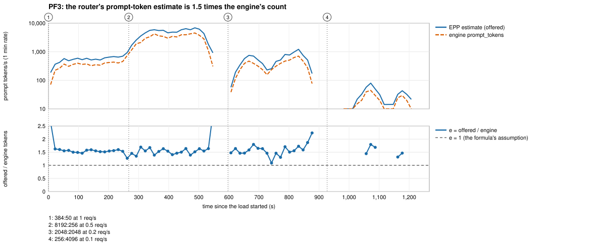
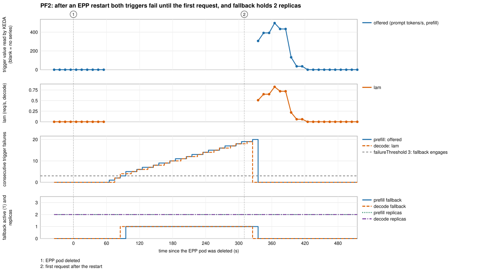
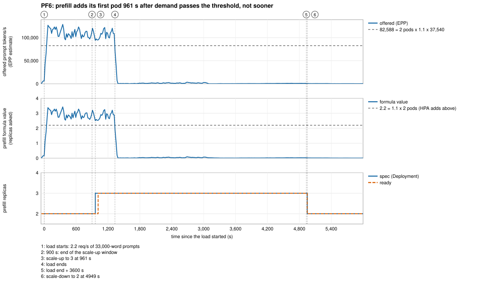
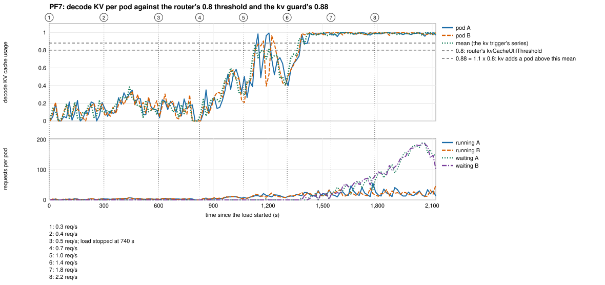
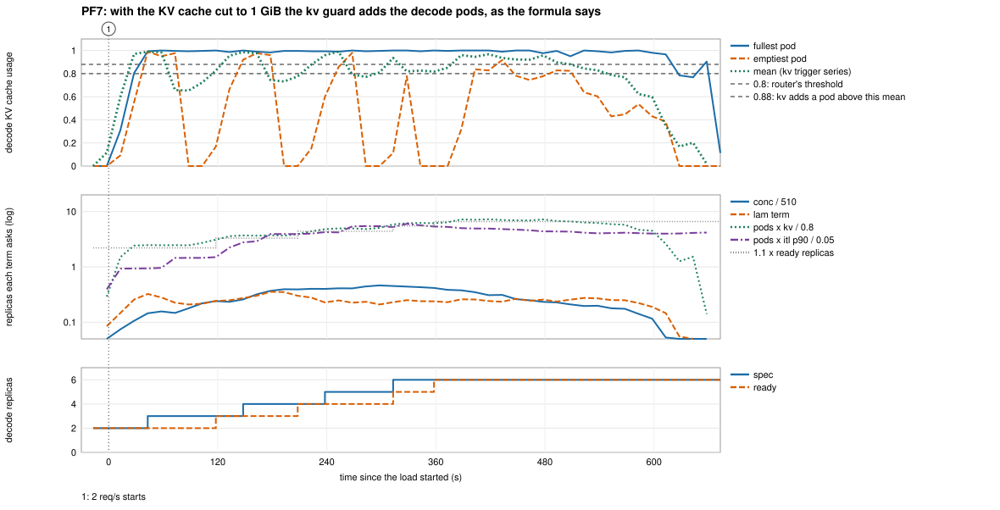
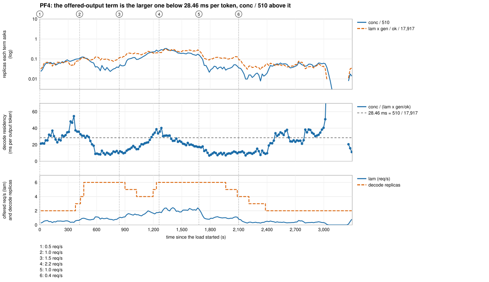
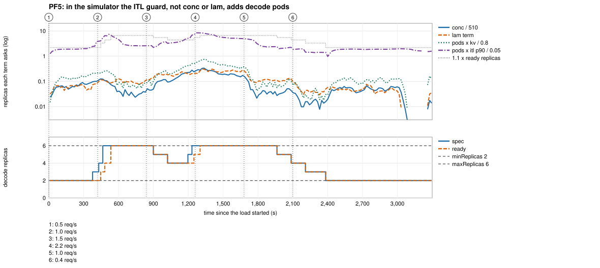
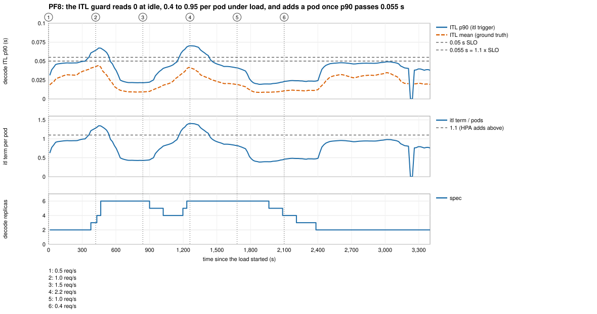
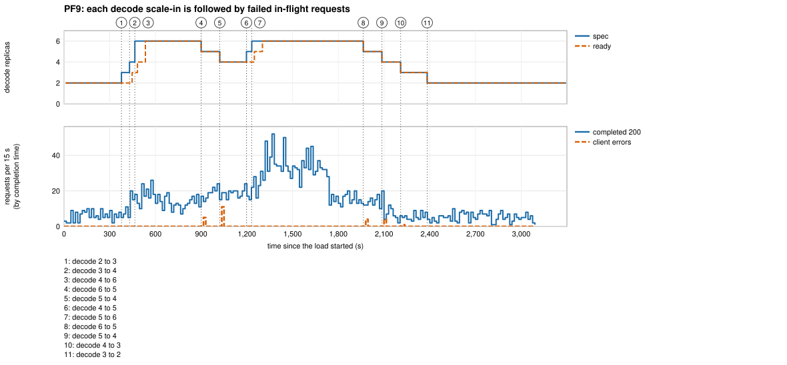
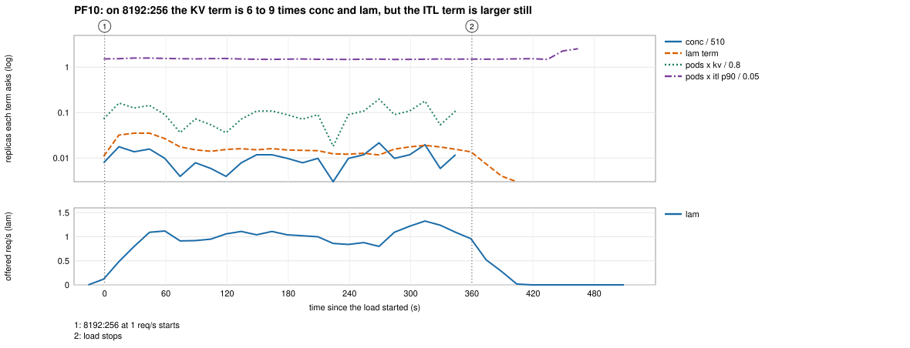

# Step 2: Verification with a simulator — pd-disaggregation/uncached-concurrency

Step 2 of the [evaluation protocol](../../2-simulator-verification.md), run with the
`simulator-verification` skill on the step 1 verdict
[`uncached-concurrency.md`](uncached-concurrency.md) (revised in `e05f207e` for the blis
constants of `2e607e4a`; predicted failures PF1–PF10). Properties P1–P11 are defined in
[step 1](../../1-static-signal-analysis.md) §1.2. Data, scripts and plots are in
[`uncached-concurrency-step2/`](uncached-concurrency-step2/).

| | |
|---|---|
| Scenario | `benchmark/config/scenarios/staging/pd-disaggregation/uncached-concurrency.yaml` at `e05f207e` (constants `2e607e4a`), spec [`uncached-concurrency.yaml.j2`](../../../config/specification/staging/pd-disaggregation/uncached-concurrency.yaml.j2) |
| Backend overlay | run-only copy of `cluster-configs/ocp/model-sim-qwen3-32b.yaml`, [`sim-overlay.yaml`](uncached-concurrency-step2/sim-overlay.yaml): DeepSeek-V2-Lite shapes, H100 roofline, `max-num-seqs` 1024, `max-num-batched-tokens` 8192 |
| ScaledObjects | rendered by `llmdbenchmark standup --dry-run` and applied in place ([`rendered-scaledobjects.yaml`](uncached-concurrency-step2/rendered-scaledobjects.yaml)); formulas `/ 37540` and `conc / 510`, `8.4 * 2133`, `itl / 0.05`; no metric was changed |
| Simulator | `vllm-model-sim`: vLLM v0.31.0 on CPU, `docker.io/vllm/vllm-openai-cpu@sha256:495c84fe30f3572b83a78100a1e8ba423dbb77fc532ecefebe114e6b77327bd9`; plugin `ghcr.io/lionelvillard/vllm-sim-deps:v0.3.0` (`sha256:b8cae7559367ec73c4ccaea60df188fadb9efb792deed995da65213aa87bc2b7`) |
| Profile | **untuned** (`beta = [1, 1, 0]`, physics latency, no MAPE measured): see Simulator gaps |
| Router | `llm-d-router-endpoint-picker:v1.0.0` (`sha256:024188e9…97df2c`), sidecar `llm-d-router-disagg-sidecar:v1.0.0` |
| Cluster | OpenShift 4.19.19, Kubernetes v1.32.9, namespace `step2-uncached-concurrency-20261124` (torn down) |
| KEDA | Custom Metrics Autoscaler 2.19.0-1, KEDA v2.19.0 (the README assumes 2.20+): see KEDA release |
| GPUs | none requested |
| Date | 2026-11-24 |
| Result | step 1's verdict **holds in part**: PF1, PF2, PF3, PF4, PF6, PF9 and the idle and light-load parts of PF8 are shown; PF5, PF10 and PF7's levelling clause are **not reproducible here**; PF7's guard clause is shown; no prediction was refuted |

## Outcome per predicted failure

| Id | Outcome | Evidence |
|---|---|---|
| PF1 | **shown** (pass confirmed) | every vLLM selector returns one series per pool pod, every EPP selector one series, `request_total` names only this stack's EPP; unpinned decode selectors return 4 series (two jobs per pod, T14) |
| PF2 | **shown** | after an EPP restart `offered` and `lam` had no series for 260 s; trigger failures started at +65 s and +75 s, fallback was active from +85 s (decode) and +95 s (prefill), replicas held at 2, and both cleared within 16 s of the first request |
| PF3 | **shown** | `e` = EPP estimate / engine prompt tokens = 1.49, 1.50, 1.54, 1.60 for 384:50, 8192:256, 2048:2048, 256:4096 (random-word prompts) |
| PF4 | **shown** | both regimes occurred: of 273 samples, all 207 with residency below 28.46 ms per output token had the offered-output term above `conc / 510`, and all 66 at or above it had `conc / 510` above it |
| PF5 | **not reproducible here** | the simulator's per-pod decode capacity is about 26 times below the constants'; `conc / 510` peaked at 0.34, `lam` at 0.31, `kv` at 0.75, so none of the three thresholds (561, 9.24 req/s, 0.88) was reachable. The ITL guard sized the pool (below) |
| PF6 | **shown** | demand above 82,588 offered tok/s from +52 s; first prefill pod requested at +961 s, Ready at +1014 s; after the load ended the pool stayed at 3 for 3618 s, then went to 2 |
| PF7 | clause 1 (levelling) **not reproducible here**; clause 2 (`kv` adds a pod above a 0.88 mean) **shown** | at 1 GiB KV per pod (one 4096-token request is 0.11 of it) one pod reached 0.96 while the other read 0.39; with the decode ScaledObject live the `kv` term was the largest at each of 4 scale-ups, all at mean KV 0.94–0.99 |
| PF8 | idle and light-load clauses **shown**; third clause **not reproducible here** | `itl` read 0 at idle; 0.4–0.95 per pod at steady load; it was the largest term in 195 of 199 samples and added every pod in the staircase, from a p90 of 0.061–0.067 s |
| PF9 | **shown** | each of 5 decode scale-ins in the staircase was followed within 23–27 s by client 503s (25 in all: 5, 11, 4, 4, 1); the sixth, with 8 requests in flight on 3 pods, produced none |
| PF10 | **not reproducible here** | the 8192:256 knee is out of reach (prefill leak, capacity); at 1 req/s the `kv` term was 6.3 times `lam` and 9.2 times `conc`, and the ITL term 1.50 |

## Calibrated knee

No knee in the protocol's sense (§2.3 item 5) was reached; step 3's blis knees (6.461 blend
req/s per decode pod, 53,628 computed tok/s per prefill pod) are **not** reproduced.

- **Decode, mix 256:256 / 256:2048 / 256:4096 ("decode-blend", mean OSL 2133), 15 GiB KV.**
  Two pods at 0.5 req/s held 45 requests in progress (W = 40 ms per output token); ITL
  p90 read 0.042 s at 30 s, 0.047–0.050 s from 2 to 5 minutes and 0.061 s at 6 minutes, past
  the 0.05 s SLO: about 0.25 req/s per pod. That is the ITL knee of this
  profile, 26 times below 6.461. `waiting` stayed 0 and TTFT did not turn up: no queue knee was
  reached below the ITL one.
- **Decode, blend (8192:256, 2048:2048, 256:4096), 15 GiB KV.** Two pods at 0.4 req/s read p90
  0.045 s and W = 26 ms (stage means in [`d1-stages.csv`](uncached-concurrency-step2/d1-stages.csv)).
- **Decode with 1 GiB KV** (PF7 only): KV mean 0.44 at 0.7 req/s, 0.63 at 1.0, 0.98 at 1.4 on two
  pods; ITL p90 stayed 0.01–0.024 s.
- **Prefill:** not calibrated. Two pods took 0.5 req/s of 8192:256 and 30,000-token prompts
  completed in 1–2 s each, with no queue; no load reached saturation.

Every number is from an untuned profile and is not a capacity number (§2.2).

## KEDA release

The cluster runs Custom Metrics Autoscaler 2.19.0-1 (KEDA v2.19.0, `KedaController` status
`Installation Succeeded`; the CSV for 2.19.0-2 sat in `Pending`). `benchmark/README.md` asks for
2.20+. On 2.19.0 everything the scenario uses worked:

- `scalingModifiers` with a ternary and `max()` over 3 and 7 triggers, `target: "1"`,
  `AverageValue`: both ScaledObjects read `READY=True` and the HPAs showed real values.
- `ignoreNullValues: "false"`: a trigger whose series is absent errors (`prometheus metrics
  'prometheus' target may be lost, the result is empty`), which is trap T7's expected behavior.
- `fallback.behavior: currentReplicasIfHigher`, and the control `static`, probed on two pause
  Deployments held at 3 replicas by hand, each with a ScaledObject whose trigger always errors and
  `fallback.replicas: 1` ([`fallback-probe.yaml`](uncached-concurrency-step2/fallback-probe.yaml),
  [`fallback-result.txt`](uncached-concurrency-step2/fallback-result.txt)): after 103 failures
  `currentReplicasIfHigher` still had 3 replicas and `static` had gone to 1. The field is
  supported and does what step 1's PF2 assumed.
- `autoscaling.keda.sh/paused-replicas` pins a Deployment, and the HPA reads blank while paused.

## Simulator gaps

1. **Untuned profile.** `config.json` has V2-Lite's shapes and an H100 roofline with `beta =
   [1, 1, 0]`; `eval.sh tune` was not run, so there is no MAPE. Per-pod decode capacity on the
   ITL SLO is about 0.25 req/s on decode-blend against blis's 6.461, so the constants (510,
   8.4, 2133, 37540) are far from this simulator's operating point and PF5 and PF10 cannot be
   tested in their own units. The decode step time under load is not the roofline's alone: ITL read
   17–45 ms at 0.4–0.5 req/s on 2 pods, and 7 ms at the same load with a 1 GiB KV cache (see Needs
   measurement).
2. **Prefill pods never free KV.** The `SimulatedNixlConnector` producer keeps every request's
   blocks: prefill `kv_cache_usage_perc` equalled the cumulative prompt tokens served over the
   582,528-token cache (575,122 and 578,823 tokens on the two pods against usage 0.9914 and
   0.9954), then the pods stopped (running 0, waiting up to 495). I restarted the prefill pods
   with `VLLM_CPU_KVCACHE_SPACE=100` and 110 Gi (about 3.9 M tokens each), by patching the
   Deployments; the leak remains. This ended the first calibration attempt (a staircase of 1–6.5
   blend req/s, [`pod-load-cal.csv`](uncached-concurrency-step2/pod-load-cal.csv), discarded) and
   caps how much prefill any run can drive. PF6 therefore used prompts of 33,000 words, which
   vLLM rejects with 400 (above `max-model-len`) after the router has counted them, so the EPP
   `offered` series was real and the prefill pods did no work. PF6 measures the trigger's timing,
   not prefill capacity.
3. **No decode GPU effects:** MLA is not modeled (1024 B/token/layer, 15 GiB = 582,528 tokens);
   the simulated output text is random and `deterministic_length` makes every request run to
   `max_tokens`.
4. **Decode KV was cut to 1 GiB** (38,784 tokens per pod, patched into the decode Deployment) for
   PF7 only, to reach KV 0.8 at a load the simulator carries. Runs D1, D2, D4 used 15 GiB.
5. **Load generator.** [`loadgen.py`](uncached-concurrency-step2/loadgen.py): open-loop Poisson,
   random words (about one token per word, 5 characters plus a space), one mix drawn per request.
   It is not inference-perf, and its prompts set PF3's `e`.
6. The CLI (`llmdbenchmark teardown`) also deleted the legacy ClusterRoles
   `llmdbench-modelservice-*`; no ClusterRoleBinding referenced them afterwards.

## P1 proportional to load

| Trigger | Step 1 | Observation | Outcome |
|---|---|---|---|
| `offered`, `comp`, `done`, `conc`, `lam`, `gen`, `ok`, `pods`, `kv` | pass or not required | | not verified by this skill |
| `itl` | fail (role mismatch) | PF8, below: it added decode pods in proportion to `pods × p90 / 0.05` and was the largest of the four terms in 195 of 199 samples; the step 1 failure case (p90 held high by a cause more pods do not fix) did not occur: p90 fell from 0.067 s at 4 pods to 0.022 s at 6 | **confirmed fail** for the role (it sizes the pool); the specific failure case **not reproducible here** |

**Proof (itl).** Staircase D2: decode-blend at 0.5, 1, 1.5, 2.2, 1, 0.4 req/s for 420 s each (the
last 900 s), decode ScaledObject live
([`d2.csv`](uncached-concurrency-step2/d2.csv), events in [`events.csv`](uncached-concurrency-step2/events.csv)).
Replica changes, with the terms read at the sample before each change:

| t (s) | change | itl p90 (s) | `itl` term | `kv` term | `conc` term | `lam` term |
|---|---|---|---|---|---|---|
| 377 | 2 → 3 | 0.0607 | 2.43 | 0.21 | 0.096 | 0.073 |
| 430 | 3 → 4 | 0.0652 | 3.91 | 0.23 | 0.114 | 0.099 |
| 465 | 4 → 6 | 0.0670 | 5.37 | 0.23 | 0.124 | 0.114 |
| 900 | 6 → 5 | 0.0222 | 2.22 | 0.10 | 0.049 | 0.135 |
| 1022 | 5 → 4 | 0.0404 | 3.23 | 0.21 | 0.094 | 0.183 |
| 1197 | 4 → 5 | 0.0635 | 5.09 | 0.42 | 0.225 | 0.198 |
| 1232 | 5 → 6 | 0.0687 | 6.87 | 0.51 | 0.278 | 0.204 |
| 1964 | 6 → 5 | 0.0197 | 2.37 | 0.06 | 0.027 | 0.109 |
| 2086 | 5 → 4 | 0.0223 | 2.23 | 0.10 | 0.043 | 0.127 |
| 2209 | 4 → 3 | 0.0240 | 1.44 | 0.03 | 0.016 | 0.044 |
| 2383 | 3 → 2 | 0.0236 | 1.42 | 0.03 | 0.016 | 0.050 |

Each scale-up went above 1.1 × the ready replicas through the `itl` term alone; the pool reached
`maxReplicaCount` (6) twice, 88 s after the first pod was added and again 35 s after the second climb began, then unwound one pod per 120 s.
See the PF8 plot.

## P2 coupled to actuation

| Trigger | Step 1 | Observation | Outcome |
|---|---|---|---|
| all | pass | | not verified by this skill |

## P3 target means a fixed busyness

| Trigger | Step 1 | Observation | Outcome |
|---|---|---|---|
| `offered` | pass (sim) / measure: the numerator is the EPP's bytes / 4 estimate | `e` = 1.49–1.60 (PF3) | **confirmed** (the open item) |
| `conc` | fail (target past the knee; mix) | the 28.46 ms cross-over with `lam` is present in the data (PF4); the 1.3 × knee target and the mix factor `V ≈ 3` are in blis units and cannot be reached here (PF5, PF10) | cross-over **confirmed**; target and mix **not reproducible here** |
| `lam` | fail (target past the knee; mix) | as `conc` | as `conc` |
| `comp`, `done`, `gen`, `ok`, `pods`, `kv`, `itl` | pass or not required | | not verified by this skill |

### PF3: the estimate is 1.5 times the engine's count

`e = rate(llm_d_epp_prefix_prompt_tokens_sum) / rate(vllm:prompt_tokens_total{prefill})`, from the
two 1-minute series at four steady shapes
([`pf3.csv`](uncached-concurrency-step2/pf3.csv), sanity load and the three-mix run E1/E2):

| Shape | offered tok/s | engine tok/s | `e` |
|---|---|---|---|
| 384:50 at 1 req/s | 698 | 467 | 1.49 |
| 8192:256 at 0.5 req/s | 5,647 | 3,768 | 1.50 |
| 2048:2048 at 0.2 req/s | 562 | 365 | 1.54 |
| 256:4096 at 0.1 req/s | 31 | 19 | 1.60 |



The top panel is the router's prompt-token count and the prefill pods' own, on a log axis; the
bottom panel is their ratio. The estimate is 1.46–1.60 times the engine's count at every
steady shape, so the prefill formula asks 1.5 times the pods the 37,540 constant means. The ratio
is set by the prompt text (5 characters per word and one token per word here, bytes / 4); real
text will give a different `e`, which step 5 must measure. The value at the 8192:256 to idle
transition (2.6) is a rate-window artifact.

## P4 metric type, P5 bounds, P6 defined at zero

| Trigger | Step 1 | Outcome |
|---|---|---|
| all | pass (`kv` P5: the mean must exceed 0.88 to add a pod) | not verified by this skill; the `kv` clause is tested under PF7 |

## P7 fails visibly

| Trigger | Step 1 | Observation | Outcome |
|---|---|---|---|
| `offered`, `lam` | pass, with a side effect: the series is absent after an EPP start until the first request (PF2) | below | **confirmed** (the side effect) |
| others | pass or n/a | | not verified by this skill |

### PF2: after an EPP restart both ScaledObjects error, fall back and hold

At rest the first idle capture of this stack (before any request) showed
`Fallback=True` on both ScaledObjects, trigger failures 21 on `s0-prometheus`
(`offered`) and `s1-prometheus` (`lam`), and `count(llm_d_epp_request_total)` empty
([`pf2-idle-status.txt`](uncached-concurrency-step2/pf2-idle-status.txt)). I repeated it with a
time series: deleted the EPP pod while the pools were idle at 2 replicas, sent nothing for 5 min,
then sent 1 req/s of 384:50 for 40 s ([`pf2.csv`](uncached-concurrency-step2/pf2.csv)).



The top two panels are what the poller read for `offered` and `lam` (no point = no series); the
third is KEDA's consecutive failure count per trigger; the bottom is the Fallback condition and
the Deployments' replicas. The series vanished at +65 s (the old EPP's last scrape went stale),
failures counted up from +65 s (prefill) and +75 s (decode), the fallback condition was true from
+85 s (decode) and +95 s (prefill), and replicas stayed at 2 throughout. Both cleared by +335 s, within
16 s of the first request (sent at about +320 s). Fallback is `currentReplicasIfHigher` with 2 replicas; the
pools were at their minimum, so the run shows no error and no scale-down, not a hold above the
minimum. The hold above the minimum is shown by the KEDA probe (see KEDA release).

## P8 lag and noise

| Trigger | Step 1 | Observation | Outcome |
|---|---|---|---|
| `offered` | fail (by design): about 955 s of lag | PF6: first pod requested at +961 s, Ready at +1014 s | **confirmed fail** |
| others | pass | | not verified by this skill |

### PF6: the prefill pool waits 15 minutes

Load: 2.2 req/s of 33,000-word prompts with `max_tokens` 16 for 1320 s (see Simulator gaps
2: the prompts are rejected after the router counted them). The EPP read 94,016–128,629 offered
tok/s (mean 109,488) after the first minute; the formula value read 2.50–3.43 (mean 2.92) against the HPA's
`1.1 × 2 = 2.2` ([`pf6.csv`](uncached-concurrency-step2/pf6.csv)).



The top panel is the offered prompt tokens per second against 82,588 (`2 × 1.1 × 37,540`); the
middle is the formula value against 2.2; the bottom is the Deployment's spec and ready replicas.
Demand passed the threshold at +52 s and stayed above it. The
Deployment went to 3 at +961 s, 909 s after the crossing, and the third pod was Ready at +1014 s.
The ask reached 3.43 but the pool went only to 3, because the 900 s scale-up window takes the
minimum of the recommendations. After the load ended at +1331 s the pool stayed at 3 for 3618 s
and went to 2 at +4949 s. This confirms step 1's `955 s + cold start` and the 3600 s hold; a run
shorter than about 16 minutes cannot add a prefill pod.

## P9 measures what it claims

| Trigger | Step 1 | Observation | Outcome |
|---|---|---|---|
| `offered` | pass, with the estimate | PF3 | **confirmed** (estimate 1.5 times the engine's) |
| `gen`, `ok` | pass: aborts count with their short length | PF9: the 25 aborted requests are not in `ok`'s `finished_reason="length"` count, but the abort counter lives on a deleted pod and could not be read | not verified by this skill |
| others | pass | | not verified by this skill |

## P10 selects its own pool

| Trigger | Step 1 | Observation | Outcome |
|---|---|---|---|
| all | pass (after fix) | PF1 below | **confirmed** (a second stack was not deployed, so the "other stack moves the trigger" test was not run) |

### PF1: every selector returns this stack's pool

[`pf1-selectors.txt`](uncached-concurrency-step2/pf1-selectors.txt), from the poller pod, with the
scenario's selectors:

- `count by (namespace, job, pod, role, engine)` for `comp`, `done`, `conc` (running and waiting),
  `gen`, `ok`, `kv`: 2 series each (one per pool pod), one job
  (`<namespace>/<release>-{prefill,decode}-podmonitor`), `role` and `engine="0"`.
- `inter_token_latency_seconds_count` by pod: 2 series.
- `count by (job, plugin_name, endpoint_role, modality) (llm_d_epp_prefix_prompt_tokens_count)`: 1
  series (`approx-prefix-cache-producer`, `prefill`, `none`), both unpinned and with the
  `offered` selector.
- `count by (job) (llm_d_epp_request_total{namespace})`: 1 series, `deepseek-8f161440--v2-lite-router-epp`
  (this run's release), the same with the pin.
- Without the `role` pin, `vllm:num_requests_running` on the decode pods returns 4 series: each pod
  under the PodMonitor job and under `vllm-<release>` (trap T14). With the pin: 2.
- `pods`: 2 and 2.

No selector matched pods outside the pool or none of its own.

## P11 router configuration matches

| Trigger | Step 1 | Observation | Outcome |
|---|---|---|---|
| `kv` | pass, noted: the 0.8 filter levels KV and the guard adds a pod once all pods pass 0.88 (PF7) | below | levelling **not reproducible here**; the guard clause **confirmed** |
| others | pass | | not verified by this skill |

### PF7: KV levelling and the 0.88 guard

At 15 GiB KV the simulator cannot reach KV 0.8 at any load it carries (the mean KV stayed below 0.10 in
all D1 and D2 samples), so I cut the decode KV to 1 GiB (Simulator gaps 4).

- **Levelling.** Decode-blend at 0.3–2.2 req/s on two pods with the scaler paused
  ([`pf7.csv`](uncached-concurrency-step2/pf7.csv)). The per-pod KV oscillated by up to 0.57
  between the pods (0.96 and 0.39 at +1190 s; mean absolute difference 0.18 for means between 0.5
  and 0.88), and one pod stayed above 0.88 while the other read below 0.8 in 4 samples.
  Above a 1.0 saturation point both pods sat at 0.97–1.00 with up to 190 waiting requests each.
  The 0.8 filter keeps new requests away from a full pod, but the running requests of a pod
  grow it by 0.11 each at this cache size, so levelling at 0.8 is not visible here. The step 1
  statement is about a cache 15 times larger; **not reproducible here**.



Per-pod KV (top) and running and waiting requests per pod (bottom) while the load rises through
the labelled stages; the scaler was paused at 2 pods. The pods' KV swings between about 0.1 and
0.95 with a period of 100–150 s before saturating at 1.4 req/s, which also shows the cycling that
step 1 flagged for KV as a sizing signal. It does not show levelling near 0.8, and the cache is 1/15
of the real one.

- **Guard.** With the decode ScaledObject live on the same pods at 2 req/s for 600 s
  ([`pf7live.csv`](uncached-concurrency-step2/pf7live.csv)), the pool went 2 → 3 → 4 → 5 → 6 at
  +50, +157, +245 and +316 s. At each of the four sample points before a change the `kv` term was
  the largest of the four (2.48, 3.70, 4.80, 5.85 against `itl` 0.94, 2.77, 4.25, 5.25) and the mean KV
  was 0.99, 0.99, 0.96 and 0.94, all above 0.88. Below a 0.88 mean the `kv` term per pod is below 1.1
  by construction, and no scale-up happened with the mean under 0.88 and the other terms small.



Top: KV of the fullest and emptiest pod and the mean the trigger reads, with 0.8 and 0.88.
Middle: the four terms in replicas (log) and 1.1 × the Ready replicas. Bottom: spec and Ready
replicas. The pool grows while the mean sits at 0.94–0.99, and one pod stays at 1.0 for 10 minutes
while others read near 0, so adding pods does not bring a hot pod down.
The guard clause is confirmed; its pods did not fix the full pod within the run.

## Combination and the properties outside P1–P11

### PF4: the cross-over at 28.46 ms per output token

| Run | Stage (req/s) | pods | `conc` | `lam` | W (ms per output token) | `conc / 510` | `lam` term | `kv` term | `itl` term |
|---|---|---|---|---|---|---|---|---|---|
| D1 blend | 0.1 | 2 | 4.9 | 0.11 | 18.9 | 0.0096 | 0.0145 | 0.028 | 1.24 |
| D1 blend | 0.2 | 2 | 12.1 | 0.27 | 23.9 | 0.024 | 0.028 | 0.077 | 1.53 |
| D1 blend | 0.3 | 2 | 13.9 | 0.32 | 21.6 | 0.027 | 0.036 | 0.084 | 1.50 |
| D1 blend | 0.4 | 2 | 22.5 | 0.39 | 26.3 | 0.044 | 0.048 | 0.133 | 1.79 |
| D2 decode-blend | 0.5 | 2.1 | 45.5 | 0.50 | **40.4** | **0.089** | 0.063 | 0.189 | 2.42 |
| D2 decode-blend | 1.0 | 6 | 16.3 | 0.79 | 10.4 | 0.032 | 0.087 | 0.072 | 2.58 |
| D2 decode-blend | 1.5 | 4.4 | 116.9 | 1.75 | **31.2** | **0.229** | 0.209 | 0.429 | 5.50 |
| D2 decode-blend | 2.2 | 6 | 90.0 | 2.20 | 19.2 | 0.177 | 0.261 | 0.370 | 5.07 |

(Means of the last 120 s of each stage, [`d1-stages.csv`](uncached-concurrency-step2/d1-stages.csv),
[`d2-stages.csv`](uncached-concurrency-step2/d2-stages.csv); W = `conc / (lam × gen / ok)`.)
The two decode terms satisfy `lam term / (conc / 510) = 28.46 ms / W`, so the cross-over is where
the measured W passes 28.46 ms: the bold rows are the stages past it, and `conc / 510` is the larger
there. Over all samples of the two runs (one per replica reading, about every 17 s), 207 had W below 28.46
ms (offered-output term larger in all 207) and 66 had W at or above it (`conc / 510` larger in all 66);
W ranged 6 to 114 ms.



Top: `conc / 510` and the offered-output term, in replicas (log). Middle: measured residency per
output token against 28.46 ms. Bottom: offered request rate and decode replicas. The terms swap
order each time the residency crosses 28.46 ms (about t = 100–420 s, 1200–1300 s and 2450–3000 s),
as step 1 predicted. In this simulator both terms stay below 0.34 replicas, so neither decided any
scale event (PF5).

### PF5: not reproducible here

The prediction is that decode holds about 1.1 × μ_SLO per pod, adds no pod until `conc` passes 561,
`lam` passes 9.24 blend req/s per pod or the mean KV passes 0.88, and that at C only `kv` reaches
6. In this simulator the largest values reached were `conc / 510` 0.34 (171 requests in progress),
the `lam` term 0.31 and the `kv` term 0.75 (15 GiB runs). What held the pool in the runs was the ITL guard (P1 table),
a term the prediction ranks last. The HPA's tolerance did show: with 2 pods the `itl` term read
0.84–1.0 per pod for 6 minutes and no pod was added; the first scale-up came at 1.22 per pod (above
1.1).



Top: the four terms in replicas (log) and 1.1 × the Ready replicas, which a term must exceed to add
a pod. Bottom: spec and Ready replicas. Only the `itl` term (dash-dot) rises above the 1.1 × line.
This does not test the 561, 9.24 or 0.88 thresholds, so PF5 stays *needs measurement* for step 3's
GPU or a tuned profile.

### PF8: the ITL guard

| Clause | Observation | Outcome |
|---|---|---|
| reads 0 at idle (the `> 0` filter) | `itl` p90 and the term read 0 at t = 3225 and 3243 s of D2 (and in two samples before it), once the 2-minute window was empty, and 0.04 while the last answers were still draining | **shown** |
| about 0.58 per pod at the knee | 0.4–0.95 per pod at steady loads (p90 0.019–0.048 s), 1.2–1.4 at the peaks that added pods. The p90 is quantized: it read 0.0096 s at 6–7 ms mean ITL and 0.020–0.025 s at 9–10 ms | **shown** (value at light load, not at a knee) |
| never wins below 1.25 × μ_SLO | it was the largest term in 195 of 199 samples and decided all 11 scale events; the simulator's own ITL SLO edge is where it fires (0.25 req/s per pod), so 1.25 × μ_SLO is not independent of it | **not reproducible here** |



Top: the trigger's p90 and the ground-truth mean against the 0.05 s SLO and 0.055 s (1.1 ×).
Middle: `itl` term per pod against the HPA's 1.1. Bottom: replicas. Each time p90 passed 0.055 s the
term passed 1.1 per pod and the pool grew, and each time it fell to 0.02 s the pool shrank,
so the guard hunts: 11 scale events in the 52-minute run at loads between 0.4 and 2.2 req/s.

### PF9: each decode scale-in fails in-flight requests

The decode Deployment has no `--shutdown-timeout` (default 0). In the D2 staircase, 25 of 2,917
client requests returned 503, all of them within 23–27 s after a decode scale-in, in five groups
(5, 11, 4, 4 and 1 requests) at the scale-ins 6 → 5 (t = 900 s), 5 → 4 (1022 s), 6 → 5 (1964 s),
5 → 4 (2086 s) and 4 → 3 (2209 s). The scale-in 3 → 2 (2383 s) had 8 requests in progress on 3 pods and
no failures; every other request returned 200
([`pod-load-d2.csv`](uncached-concurrency-step2/pod-load-d2.csv),
[`d2-load.csv`](uncached-concurrency-step2/d2-load.csv)).



Top: decode spec and Ready replicas; bottom: completions and client errors per 15 s by completion
time. The error bursts line up with the scale-ins (flags 4, 5, 8, 9 and 10) and appear at no
other time. The `vllm:request_success_total{finished_reason="abort"}` counter was not captured: it lives on
the pod that is deleted. The status is the router's 503, so the client cannot tell an abort from an
overload. Confirms step 1's PF9; the fix in step 1 (`--shutdown-timeout 45`) was not run.

### PF10: 8192:256 is out of reach

At 1 req/s of 8192:256 for 360 s on two decode pods (15 GiB KV, scaler paused;
[`pf10.csv`](uncached-concurrency-step2/pf10.csv)), the last 180 s read `conc` 5.2, `lam` 1.03,
KV 0.037, and the terms `conc / 510` 0.010, `lam` 0.015, `kv` 0.093, `itl` 1.50.



Top: the four terms in replicas (log); bottom: offered request rate. The `kv` term is 6.3 times
the `lam` term and 9.2 times `conc / 510`, the ordering step 1 predicted (KV and `minReplicas`
size decode on this mix, not `conc` or `lam`), but the ITL term (1.50) is far larger than all three
here. The predicted 0.3 per pod at the mix's knee needs about 40 req/s of 8192:256 (330,000 prompt
tok/s) and cannot be driven by this simulator, so PF10 is **not reproducible here**. The ratio is
from one stage and is not a knee measurement.

## Needs measurement

1. **Decode ITL at the same load, by KV size.** With 15 GiB KV, 2 pods at 0.4 req/s read ITL mean 25
   ms (D1, blend) and 40 ms at 0.5 req/s (D2, decode-blend); with 1 GiB KV the same pods at 0.3–0.4
   req/s read 6.0–7.0 ms (D3, decode-blend; [`d3-stages.csv`](uncached-concurrency-step2/d3-stages.csv)).
   A spot check of a decode pod's CPU during the aborted calibration read 0.1 of 4 cores; I did not
   check under steady load. I have no explanation; it decides how far a CPU-simulator ITL can be
   trusted.
2. **ITL p90 quantization.** The p90 in the `itl` trigger reads 0.0096 s at a 6–7 ms mean and
   0.019–0.025 s at 9–12 ms, so the term reads 0.4 per pod near idle and sits near 1 per pod before
   the SLO is reached. On a GPU, ITL near the SLO will read the same way; step 5 should compare the
   trigger's p90 with the client's TPOT p90.
3. **e on real text** (PF3) and on the agentic prompts.
4. **The PF5 thresholds** (561 requests, 9.24 req/s, 0.88 KV at C) and **PF10's mix factor**:
   a GPU run or a profile tuned to the blis knees.
5. **Whether the ITL guard hunts on a GPU.** Here it added 4 pods in 88 s, then shed them as p90
   fell: the pool reached 6 twice and went back to 2, in 11 scale events over 40 minutes.
6. **Prefill capacity and the prefill leak.** The KV leak is in the simulator's NIXL producer; a
   run that needs more than about 3.9 M prompt tokens per prefill pod needs a fix there.

## Overall

Step 1's verdict **holds in part**. Everything step 1 predicted that a run could show was shown
(PF1, PF2, PF3, PF4, PF6, PF9, the idle and light-load PF8, PF7's guard clause), with the numbers
above. PF5, PF10, PF7's levelling clause and PF8's third clause could not be tested in this
simulator, which is about 26 times below the constants' operating point and has an ITL guard that
fires first. No prediction was refuted, so `traps.md` is unchanged. The configuration stays
*accepted with conditions* for step 3; the capacity numbers (37,540, 510, 8.4, 2133) remain blis
numbers until step 5.

## Reproduce

```sh
# render and apply the ScaledObjects (stack stood up with the run-only overlay)
llmdbenchmark --spec benchmark/config/specification/staging/pd-disaggregation/uncached-concurrency.yaml.j2 \
  --workspace <dir> standup --cluster-config uncached-concurrency-step2/sim-overlay.yaml \
  -p step2-uncached-concurrency-<date> --dry-run
# loads, in the poller pod: loadgen.py OUT STAGES MIXES SEED, poller.py, poller2.py (see events.csv for each run's arguments)
python3 export.py && python3 plot.py        # from uncached-concurrency-step2/
```

The runs are, in `events.csv`: E1 and E2 (sanity and three-mix load, PF3), `pf6`, `d1`, `d2`, `d4`
(PF10), `d3` and `d3b` (PF7, scaler paused), `d5` (PF7, scaler live), `pf2`. The first
calibration staircase (`cal`) was aborted when the prefill pods stalled (Simulator gaps 2).
