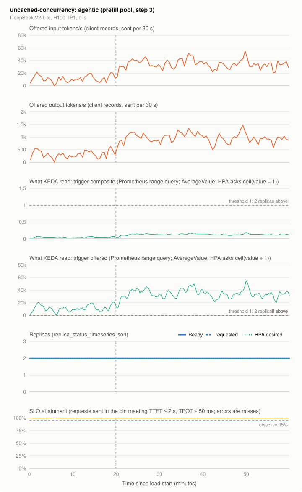
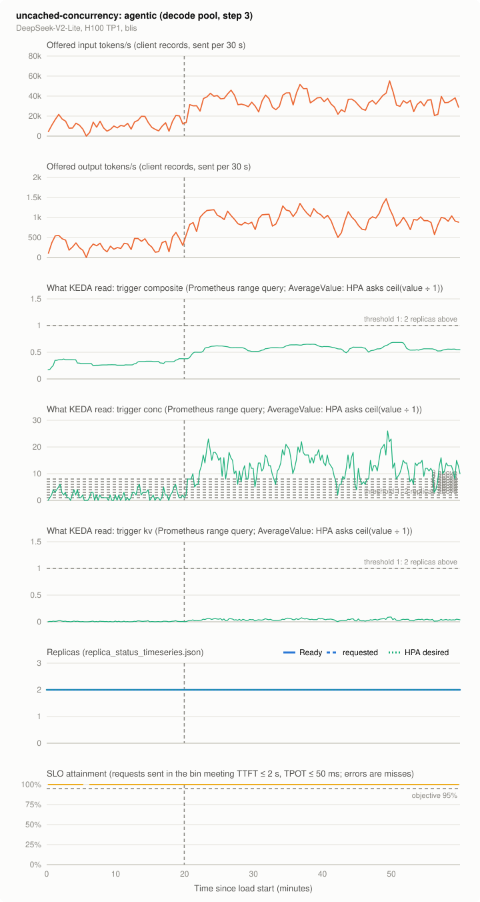

# Step 3, run 5: agentic (pd-disaggregation/uncached-concurrency)

Part of the [step 3 summary](../../uncached-concurrency-step3.md). Simulator numbers: blis priced this plant; they are not GPU measurements.

| | |
|---|---|
| Plant | blis-signal-lab `25f2dfb` (branch `signals-hpa`) plus task 0545's counter patch; blis-substrate `v0.14.0` catalog entry `deepseek-v2-lite` |
| BLIS scenario | [`deepseek-v2-lite-h100-pd.yaml`](../deepseek-v2-lite-h100-pd.yaml): a `prefill` and a `decode` pool, H100, bf16, TP1 (1 GPU per replica), block size 128, gpu-memory-utilization 0.90, max-model-len 32768, prefix caching on, as the overlay; router [`router/pd-always.yaml`](../router/pd-always.yaml) (always-disagg decider) |
| Cold start | 120 s (`loading_delay`): the protocol's default; this overlay has no GPU measurement |
| Metrics | scrape 15 s (the rendered PodMonitors), `metrics_delay_s` 0 (raw series), HPA sync 15 s, `pollingInterval` 15 s |
| Seed | blis's default (no `--seed`); the load's seed is `schedule.seed` in `blis-run.json` |
| Scenario | `benchmark/config/scenarios/staging/pd-disaggregation/uncached-concurrency.yaml`, rendered with `standup --dry-run`; policy [`policy.json`](policy.json) (calibrated constants, [`scaledobjects-calibrated.yaml`](../scaledobjects-calibrated.yaml)), translated from it ([`terms.json`](../terms.json)) |
| Model | `deepseek-ai/DeepSeek-V2-Lite`, 1 H100 per replica (TP1), both roles |
| SLO | TTFT <= 2 s, TPOT <= 0.05 s; X = 0.95 |
| Run | 5, agentic |
| Load | `agentic` in [`index.json`](../index.json): multi-turn sessions (shared 4,096-token system prompt, 10 rounds, 2 s pauses), 1,200 s at 0.944 then 2,400 s at 2.833 req/s (0.1 and 0.3 x C x mean ISL of B / an estimated mean prompt of 14,364 tokens) |
| Arm | ScaledObjects active, each pool from `minReplicaCount` (2) Ready |
| Gaps exposed | agentic sessions as blis models them (summary): per-turn lengths truncated (input <= 2,400, output <= 640), one shared prefix group, no subagent fan-out |
| Memory | peak RSS 2.45 GiB of a 42.2 GiB budget; not killed |
| Raw results | `benchmark/results/step3-uncached-concurrency-20261124/agentic/` (not committed) |

Agentic sessions at 0.944 req/s for 1,200 s, then 2.833 req/s for 2,400 s. Both pools stayed at their floor of 2 Ready pods; A was 1.000 and no request failed.
 The trigger panels are the HPA's own reading at each sync, from blis's decision log, not a Prometheus query. Every number is a simulator number. Each run is one sample (n = 1).

## Per stage, prefill pool

| stage | s | set req/s | offered req/s | λ_in tok/s | λ_out tok/s | sent | errors | A | TTFT p50/p90/p99 s | TPOT p50/p90/p99 ms | Ready | need | requested replica-s | Ready replica-s |
|---|---|---|---|---|---|---|---|---|---|---|---|---|---|---|
| 1 | 1200 | 0.944 | 0.939 | 11,273 | 317 | 1,127 | 0 | 100.0 % | 0.13/0.19/0.26 | 6.2/8.5/10.1 | 2–2 | – | 2,400 | 2,400 |
| 2 | 2400 | 2.833 | 2.813 | 34,543 | 968 | 6,752 | 0 | 100.0 % | 0.15/0.24/0.33 | 13.2/15.5/17.3 | 2–2 | – | 4,800 | 4,800 |

- run: 7,879 sent, A 100.0 %, errors 0, requested 7,200 replica-s = 7,200 GPU-s at 1 GPU per replica
- placement: 0 request(s) before the first stage, 61 after the last (session rounds); stages more than 3 sd off their set rate: none: ok

## Per stage, decode pool

| stage | s | set req/s | offered req/s | λ_in tok/s | λ_out tok/s | sent | errors | A | TTFT p50/p90/p99 s | TPOT p50/p90/p99 ms | Ready | need | requested replica-s | Ready replica-s |
|---|---|---|---|---|---|---|---|---|---|---|---|---|---|---|
| 1 | 1200 | 0.944 | 0.939 | 11,273 | 317 | 1,127 | 0 | 100.0 % | 0.13/0.19/0.26 | 6.2/8.5/10.1 | 2–2 | – | 2,400 | 2,400 |
| 2 | 2400 | 2.833 | 2.813 | 34,543 | 968 | 6,752 | 0 | 100.0 % | 0.15/0.24/0.33 | 13.2/15.5/17.3 | 2–2 | – | 4,800 | 4,800 |

- run: 7,879 sent, A 100.0 %, errors 0, requested 7,200 replica-s = 7,200 GPU-s at 1 GPU per replica
- placement: 0 request(s) before the first stage, 61 after the last (session rounds); stages more than 3 sd off their set rate: none: ok

## What the run shows

The run shows a problem when A < X once settled, or on any context-overflow error. The report does not judge sizing (run-set.md §2: agentic needs more GPU per prompt token than the blend).

- **A and errors.** A 1.000 in both phases; 0 errors in the per-request records (7,940 requests, 61 of them session rounds after the last stage, the placement check's allowance). TTFT p50/p90/p99 0.13/0.19/0.26 s in phase 1 and 0.15/0.24/0.33 s in phase 2.
- **Context overflow: none.** The longest prompt was 28,309 tokens against `max_model_len` 32,768 (per-request records).
- **Replicas.** Both pools held 2 Ready (their floor) throughout: the decode composite peaked at 0.68 and the prefill composite at 0.19, so neither trigger asked for more than 1.
- **TTFT by prompt-length bucket** (per-request records, all phases): 4,096 to 8,191 tokens, 1,983 requests, p50/p90/p99 0.117/0.163/0.285 s; 8,192 to 16,383, 4,149 requests, 0.152/0.213/0.315 s; 16,384 to 32,767, 1,808 requests, 0.198/0.265/0.365 s.
- **Delivered load against the intended 0.1 and 0.3 x C x mean ISL.** Prompt tokens per second were 11,273 and 34,543, against 13,563 and 40,689 (the estimated mean prompt of 14,364 tokens was above what the sessions sent, about 12,000 to 12,300 tokens per request). The load is light for the pools: phase 2's 34,543 tok/s is 32 % of two prefill pods' 107,256 tok/s (2 x 53,628).
- **The uncached discount.** The sessions share a 4,096-token system prompt and re-send their context, so most prompt tokens are cached. In phase 2 the prefill trigger's `offered` averaged about 30,200 tok/s, `done` 32,200 and `comp` 4,100 (`triggers/prefill/`, mean over the phase's second half): an uncached share of 0.13, so the composite read 0.1 to 0.19 where the prompt tokens alone would have read 0.80 (30,200 / 37,540) against a floor of 2 pods that covers it either way.
- Unexplained: none.

**Outcome: as expected.** A 1.000, 0 errors, no context overflow, both pools at their floor.

## Amendments

None.
