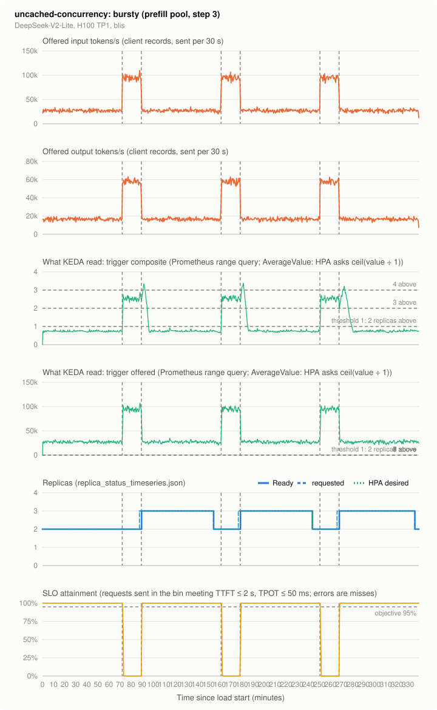
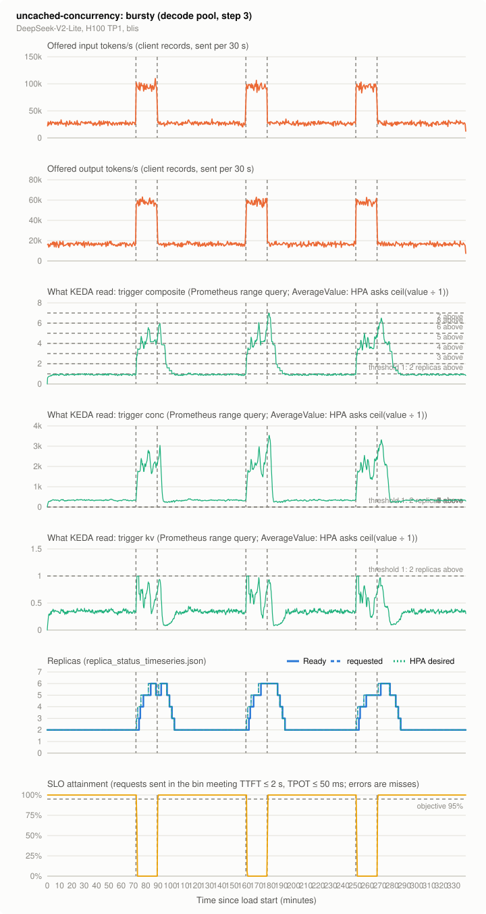

# Step 3, run 8: bursty (pd-disaggregation/uncached-concurrency)

Part of the [step 3 summary](../../uncached-concurrency-step3.md). Simulator numbers: blis priced this plant; they are not GPU measurements.

| | |
|---|---|
| Plant | blis-signal-lab `25f2dfb` (branch `signals-hpa`) plus task 0545's counter patch; blis-substrate `v0.14.0` catalog entry `deepseek-v2-lite`, with the TTFT projection of inference-sim `dfa8987` (#2237) applied ([`lab-patch.diff`](lab-patch.diff)), which changes the reported TTFT of disaggregated requests and nothing the HPAs read (see the discarded attempts in the summary) |
| BLIS scenario | [`deepseek-v2-lite-h100-pd.yaml`](../deepseek-v2-lite-h100-pd.yaml): a `prefill` and a `decode` pool, H100, bf16, TP1 (1 GPU per replica), block size 128, gpu-memory-utilization 0.90, max-model-len 32768, prefix caching on, as the overlay; router [`router/pd-always.yaml`](../router/pd-always.yaml) (always-disagg decider) |
| Cold start | 120 s (`loading_delay`): the protocol's default; this overlay has no GPU measurement |
| Metrics | scrape 15 s (the rendered PodMonitors), `metrics_delay_s` 0 (raw series), HPA sync 15 s, `pollingInterval` 15 s |
| Seed | blis's default (no `--seed`); the load's seed is `schedule.seed` in `blis-run.json` |
| Scenario | `benchmark/config/scenarios/staging/pd-disaggregation/uncached-concurrency.yaml`, rendered with `standup --dry-run`; policy [`policy.json`](policy.json) (calibrated constants, [`scaledobjects-calibrated.yaml`](../scaledobjects-calibrated.yaml)), translated from it ([`terms.json`](../terms.json)) |
| Model | `deepseek-ai/DeepSeek-V2-Lite`, 1 H100 per replica (TP1), both roles |
| SLO | TTFT <= 2 s, TPOT <= 0.05 s; X = 0.95 |
| Run | 8, bursty |
| Load | `bursty` in [`index.json`](../index.json): the blend, a quiet phase Q = 4,320 s at 0.2 x C = 7.753 req/s, then three cycles of a spike R = 1,035 s at 0.7 x C = 27.136 req/s and a quiet phase Q |
| Arm | ScaledObjects active, each pool from `minReplicaCount` (2) Ready |
| Gaps exposed | see the summary |
| Memory | peak RSS 43.01 GiB of a 48.2 GiB budget; not killed |
| Raw results | `benchmark/results/step3-uncached-concurrency-20261124/bursty/` (not committed) |

The blend at 0.2 x C (7.75 req/s) for 4,320 s, then three cycles of a 1,035 s spike at 0.7 x C (27.1 req/s) and 4,320 s at 0.2 x C. In each spike decode went from 2 to 6 Ready and prefill's third pod became Ready 15 s after the spike ended; A was 0.04 to 0.05 in every spike and 0.996 or more in every quiet phase.
 The trigger panels are the HPA's own reading at each sync, from blis's decision log, not a Prometheus query. Every number is a simulator number. Each run is one sample (n = 1).

## Per stage, prefill pool

| stage | s | set req/s | offered req/s | λ_in tok/s | λ_out tok/s | sent | errors | A | TTFT p50/p90/p99 s | TPOT p50/p90/p99 ms | Ready | need | requested replica-s | Ready replica-s |
|---|---|---|---|---|---|---|---|---|---|---|---|---|---|---|
| 1 | 4320 | 7.753 | 7.753 | 27,127 | 16,541 | 33,495 | 0 | 100.0 % | 0.15/0.27/0.39 | 20.3/20.9/21.7 | 2–2 | 1 | 8,640 | 8,640 |
| 2 | 1035 | 27.136 | 27.136 | 94,941 | 57,891 | 28,086 | 4168 timeout | 4.8 % | 130.65/196.49/277.69 | 33.0/37.4/41.7 | 2–2 | 2 | 2,175 | 2,070 |
| 3 | 4320 | 7.753 | 7.753 | 27,127 | 16,541 | 33,495 | 0 | 99.6 % | 0.15/0.26/0.40 | 20.2/21.1/29.1 | 2–3 | 1 | 12,540 | 12,540 |
| 4 | 1035 | 27.136 | 27.136 | 94,941 | 57,891 | 28,086 | 4719 timeout | 4.4 % | 145.84/214.42/272.82 | 34.0/37.8/42.2 | 2–2 | 2 | 2,175 | 2,070 |
| 5 | 4320 | 7.753 | 7.753 | 27,127 | 16,541 | 33,495 | 3 timeout | 99.7 % | 0.15/0.26/0.39 | 20.2/20.9/29.5 | 2–3 | 1 | 12,540 | 12,540 |
| 6 | 1035 | 27.136 | 27.136 | 94,941 | 57,891 | 28,086 | 17507 timeout | 4.3 % | 117.03/214.80/282.67 | 35.6/38.8/44.4 | 2–2 | 2 | 2,175 | 2,070 |
| 7 | 4320 | 7.753 | 7.753 | 27,127 | 16,541 | 33,495 | 121 timeout | 99.6 % | 0.15/0.26/0.41 | 20.2/20.9/28.8 | 2–3 | 1 | 12,735 | 12,735 |

- run: 218,238 sent, A 63.0 %, errors {'timeout': 26518}, requested 52,980 replica-s = 52,980 GPU-s at 1 GPU per replica
- placement: 0 request(s) before the first stage, 0 after the last; stages more than 3 sd off their set rate: none: ok

## Per stage, decode pool

| stage | s | set req/s | offered req/s | λ_in tok/s | λ_out tok/s | sent | errors | A | TTFT p50/p90/p99 s | TPOT p50/p90/p99 ms | Ready | need | requested replica-s | Ready replica-s |
|---|---|---|---|---|---|---|---|---|---|---|---|---|---|---|
| 1 | 4320 | 7.753 | 7.753 | 27,127 | 16,541 | 33,495 | 0 | 100.0 % | 0.15/0.27/0.39 | 20.3/20.9/21.7 | 2–2 | 2 | 8,640 | 8,640 |
| 2 | 1035 | 27.136 | 27.136 | 94,941 | 57,891 | 28,086 | 4168 timeout | 4.8 % | 130.65/196.49/277.69 | 33.0/37.4/41.7 | 2–6 | 5 | 5,175 | 4,710 |
| 3 | 4320 | 7.753 | 7.753 | 27,127 | 16,541 | 33,495 | 0 | 99.6 % | 0.15/0.26/0.40 | 20.2/21.1/29.1 | 2–6 | 2 | 11,145 | 11,085 |
| 4 | 1035 | 27.136 | 27.136 | 94,941 | 57,891 | 28,086 | 4719 timeout | 4.4 % | 145.84/214.42/272.82 | 34.0/37.8/42.2 | 2–6 | 5 | 5,220 | 4,740 |
| 5 | 4320 | 7.753 | 7.753 | 27,127 | 16,541 | 33,495 | 3 timeout | 99.7 % | 0.15/0.26/0.39 | 20.2/20.9/29.5 | 2–6 | 2 | 11,340 | 11,400 |
| 6 | 1035 | 27.136 | 27.136 | 94,941 | 57,891 | 28,086 | 17507 timeout | 4.3 % | 117.03/214.80/282.67 | 35.6/38.8/44.4 | 2–5 | 5 | 4,665 | 4,305 |
| 7 | 4320 | 7.753 | 7.753 | 27,127 | 16,541 | 33,495 | 121 timeout | 99.6 % | 0.15/0.26/0.41 | 20.2/20.9/28.8 | 2–6 | 2 | 12,255 | 12,195 |

- run: 218,238 sent, A 63.0 %, errors {'timeout': 26518}, requested 58,440 replica-s = 58,440 GPU-s at 1 GPU per replica
- placement: 0 request(s) before the first stage, 0 after the last; stages more than 3 sd off their set rate: none: ok

## What the run shows

The run shows a problem when A < X in a quiet phase, or requests fail at a scale-down. Stage numbers are the table's: 2, 4 and 6 are the spikes (t = 4,320, 9,675 and 15,030 s on the load clock), 1, 3, 5 and 7 the quiet phases. `need` ignores `minReplicaCount` 2 (spike: decode 5, prefill 2).

- **A in the quiet phases:** 1.000, 0.996, 0.997, 0.996 (3 and 121 timeouts in phases 5 and 7, the tails of the preceding spike's backlog). None below 0.95.
- **A in the spikes:** 0.048, 0.044, 0.043; timeouts 4,168, 4,719 and 17,507. TTFT p50 131, 146 and 117 s.
- **Failed at a scale-down:** none, as the simulator cannot fail one (summary, gaps); the 26,518 timeouts are all in spikes and their tails.
- **Decode, per cycle** (requested to Ready): cycle 1, the third pod requested at t = 4,365 s, 4 Ready at t = 4,530 s, 5 at t = 4,680 s, the sixth requested at t = 4,935 s and Ready at t = 5,040 s, 720 s after the spike began and 315 s before it ended; the pool dropped to 5 at t = 5,295 s (composite falling as the backlog's concurrency fell, 60 s before the spike ended), asked for 6 again at t = 5,445 s and had it Ready at t = 5,550 s, after the spike, then scaled down 5, 4, 3, 2 from t = 5,835 to 6,195 s (840 s after the spike). Cycle 2: 6 Ready at t = 10,410 s, 735 s after the spike began; at 2 again from t = 11,580 s (870 s after). Cycle 3: 5 Ready at t = 15,540 s and 6 at t = 16,245 s, 180 s after the spike ended; at 2 again from t = 17,220 s (1,155 s after).
- **Replicas requested in a spike and Ready only after it ended.** Prefill's third pod in every cycle: requested at t = 5,265, 10,620 and 15,975 s (945 s into each spike, the 900 s scale-up window plus a sync), Ready at t = 5,370, 10,725 and 16,080 s, 15 s after each spike ended. Decode's sixth pod in cycle 3 (above) and its re-request after cycle 1.
- **What held the spike's A down.** Prefill stayed at 2 pods for the whole of each spike, offered 94,941 tok/s against 107,256 tok/s (2 x 53,628, the blend knee), and its mean waiting count per pod was 23 at t = 4,320 s, 822 at t = 4,560 s, 1,666 at t = 4,800 s and 2,178 at t = 5,280 s (`signals-pods.csv`, cycle 1); decode's waiting count per pod stayed between 88 and 213 while it grew from 2 to 6 pods. A per two-minute bin in cycle 1: 0.41, then 0.00 for 960 s, 0.48 at the first bin after the spike (t = 5,280 s) and 1.00 from t = 5,400 s. The run did not separate prefill's queue from decode's as the cause of the misses.
- **Cost.** Requested replica-seconds 52,980 (prefill) and 58,440 (decode), 111,420 GPU-s. Prefill's third pod stayed Ready for 3,900, 3,900 and 4,095 s after it became Ready (t = 5,370 to 9,270 s, 10,725 to 14,625 s and 16,080 to 20,175 s), in quiet phases whose need is 2 (the 3,600 s scale-down window).
- Unexplained: decode's drop from 6 to 5 pods at t = 5,295 s, 60 s before the spike's end, and the re-request at t = 5,445 s (cycle 1 only).

**Outcome: problem shown.** A 0.043 to 0.048 in all three spikes while the quiet phases kept A >= 0.996: the spike (R = 1,035 s) is not served by the pools' reaction, whose prefill scale-up window alone (900 s) consumes it, and prefill's third pod became Ready after the spike in every cycle and was then held 3,900 s into the quiet phase.

## Amendments

None.
