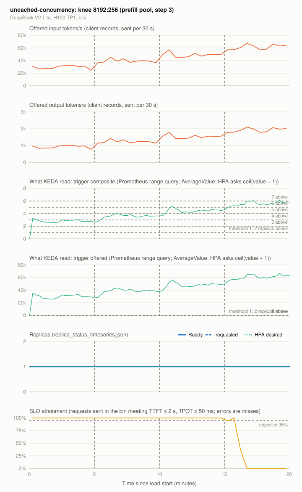

# Step 3, run 1e: knee 8192:256, prefill pool (pd-disaggregation/uncached-concurrency)

Part of the [step 3 summary](../../../uncached-concurrency-step3.md). Simulator numbers: blis priced this plant; they are not GPU measurements.

| | |
|---|---|
| Plant | blis-signal-lab `25f2dfb` (branch `signals-hpa`) plus task 0545's counter patch; blis-substrate `v0.14.0` catalog entry `deepseek-v2-lite` |
| BLIS scenario | [`deepseek-v2-lite-h100-pd.yaml`](../../deepseek-v2-lite-h100-pd.yaml): a `prefill` and a `decode` pool, H100, bf16, TP1 (1 GPU per replica), block size 128, gpu-memory-utilization 0.90, max-model-len 32768, prefix caching on, as the overlay; router [`router/pd-always.yaml`](../../router/pd-always.yaml) (always-disagg decider) |
| Cold start | 120 s (`loading_delay`): the protocol's default; this overlay has no GPU measurement |
| Metrics | scrape 15 s (the rendered PodMonitors), `metrics_delay_s` 0 (raw series), HPA sync 15 s, `pollingInterval` 15 s |
| Seed | blis's default (no `--seed`); the load's seed is `schedule.seed` in `blis-run.json` |
| Scenario | `benchmark/config/scenarios/staging/pd-disaggregation/uncached-concurrency.yaml`, rendered with `standup --dry-run`; policy [`policy.json`](policy.json) (the as-rendered GLM-5.3 constants; the pool is pinned, so only the HPA log reads them; [`scaledobjects.json`](../../policy-glm-constants/scaledobjects.json)), translated from it ([`terms.json`](../../terms.json)) |
| Model | `deepseek-ai/DeepSeek-V2-Lite`, 1 H100 per replica (TP1), both roles |
| SLO | TTFT <= 2 s, TPOT <= 0.05 s; X = 0.95 |
| Run | 1e, knee 8192:256, prefill pool |
| Load | four 300 s stages at 0.6, 0.8, 1.0 and 1.25 x an estimate of 6 req/s ([`knee-index.json`](knee-index.json)) |
| Arm | pinned: prefill 1, decode 6 |
| Gaps exposed | see the summary |
| Memory | peak RSS 2.14 GiB of a 27.1 GiB budget; not killed |
| Raw results | `benchmark/results/step3-uncached-concurrency-20261124/prefill-8192x256/` (not committed) |

8192:256 at four rates (3.600, 4.800, 6.000, 7.500 req/s) on one pinned prefill pod. A per stage: 100.0 %, 100.0 %, 100.0 %, 21.3 %; it crosses 0.95 between stages 3 and 4, at μ_SLO = 6.095 req/s. The trigger panels are the HPA's own reading at each sync, from blis's decision log, not a Prometheus query. Every number is a simulator number. Each run is one sample (n = 1).

## Per stage, prefill pool

| stage | s | set req/s | offered req/s | λ_in tok/s | λ_out tok/s | sent | errors | A | TTFT p50/p90/p99 s | TPOT p50/p90/p99 ms | Ready | need | requested replica-s | Ready replica-s |
|---|---|---|---|---|---|---|---|---|---|---|---|---|---|---|
| 1 | 300 | 3.600 | 3.600 | 29,491 | 922 | 1,080 | 0 | 100.0 % | 0.21/0.41/0.69 | 4.9/6.0/7.1 | 1–1 | – | 300 | 300 |
| 2 | 300 | 4.800 | 4.800 | 39,322 | 1,229 | 1,440 | 0 | 100.0 % | 0.29/0.59/0.88 | 5.2/6.5/8.1 | 1–1 | – | 300 | 300 |
| 3 | 300 | 6.000 | 6.000 | 49,152 | 1,536 | 1,800 | 0 | 100.0 % | 0.46/0.96/1.49 | 5.5/6.8/8.1 | 1–1 | – | 300 | 300 |
| 4 | 300 | 7.500 | 7.500 | 61,440 | 1,920 | 2,250 | 0 | 21.3 % | 8.72/16.35/19.51 | 5.7/7.0/8.0 | 1–1 | – | 300 | 300 |

- run: 6,570 sent, A 73.0 %, errors 0, requested 1,200 replica-s = 1,200 GPU-s at 1 GPU per replica
- placement: 0 request(s) before the first stage, 0 after the last; stages more than 3 sd off their set rate: none: ok
- knee: μ_SLO = 6.095 req/s (A crosses 0.95 between stages 3 and 4)

## What the run shows

The run shows a problem when stage 1 fails or stage 4 passes (the crossing is outside the stages). Stage 1 passed (A 100.0 %) and stage 4 failed (A 21.3 %), so the crossing is inside them: μ_SLO(8192:256, prefill) = 6.095 req/s (A crosses 0.95 between stages 3 and 4, linear interpolation). The prefill pod's uncached prompt rate at the crossing is 6.095 x 8,192 = 49,930 tok/s.

This run was the first knee and gated the translation: every trigger of both ScaledObjects left 0 while load was sent (`offered` read 32,404 tok/s at t = 150 s against 29,491 tok/s sent in stage 1, a 60 s Poisson window, `comp` and `done` within 0.4 % of each other, `conc`, `lam`, `ok`, `pods`, `kv`, `itl` all non-zero). Rerun with `blis_run.py --rerun`, its decision logs gave the same sha256 (repeatability gate): `signals-hpa-prefill.csv` 8a3ba501..., `signals-hpa-decode.csv` c6a9525a....

**Outcome: as expected; μ_SLO = 6.095 req/s.**

## Amendments

None.
