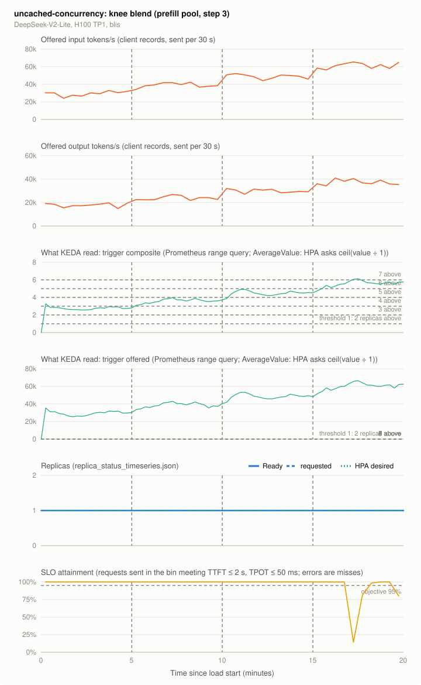

# Step 3, run 1f: knee blend, prefill pool (pd-disaggregation/uncached-concurrency)

Part of the [step 3 summary](../../../uncached-concurrency-step3.md). Simulator numbers: blis priced this plant; they are not GPU measurements.

| | |
|---|---|
| Plant | blis-signal-lab `25f2dfb` (branch `signals-hpa`) plus task 0545's counter patch; blis-substrate `v0.14.0` catalog entry `deepseek-v2-lite` |
| BLIS scenario | [`deepseek-v2-lite-h100-pd.yaml`](../../deepseek-v2-lite-h100-pd.yaml): a `prefill` and a `decode` pool, H100, bf16, TP1 (1 GPU per replica), block size 128, gpu-memory-utilization 0.90, max-model-len 32768, prefix caching on, as the overlay; router [`router/pd-always.yaml`](../../router/pd-always.yaml) (always-disagg decider) |
| Cold start | 120 s (`loading_delay`): the protocol's default; this overlay has no GPU measurement |
| Metrics | scrape 15 s (the rendered PodMonitors), `metrics_delay_s` 0 (raw series), HPA sync 15 s, `pollingInterval` 15 s |
| Seed | blis's default (no `--seed`); the load's seed is `schedule.seed` in `blis-run.json` |
| Scenario | `benchmark/config/scenarios/staging/pd-disaggregation/uncached-concurrency.yaml`, rendered with `standup --dry-run`; policy [`policy.json`](policy.json) (the as-rendered GLM-5.3 constants; the pool is pinned, so only the HPA log reads them; [`scaledobjects.json`](../../policy-glm-constants/scaledobjects.json)), translated from it ([`terms.json`](../../terms.json)) |
| Model | `deepseek-ai/DeepSeek-V2-Lite`, 1 H100 per replica (TP1), both roles |
| SLO | TTFT <= 2 s, TPOT <= 0.05 s; X = 0.95 |
| Run | 1f, knee blend, prefill pool |
| Load | four 300 s stages at 0.6, 0.8, 1.0 and 1.25 x an estimate of 14 req/s ([`knee-index.json`](knee-index.json)) |
| Arm | pinned: prefill 1, decode 12 |
| Gaps exposed | see the summary |
| Memory | peak RSS 10.1 GiB of a 29.5 GiB budget; not killed |
| Raw results | `benchmark/results/step3-uncached-concurrency-20261124/prefill-blend-e14/` (not committed) |

blend at four rates (8.400, 11.200, 14.000, 17.500 req/s) on one pinned prefill pod. A per stage: 100.0 %, 100.0 %, 100.0 %, 86.8 %; it crosses 0.95 between stages 3 and 4, at μ_SLO = 15.328 req/s. The trigger panels are the HPA's own reading at each sync, from blis's decision log, not a Prometheus query. Every number is a simulator number. Each run is one sample (n = 1).

## Per stage, prefill pool

| stage | s | set req/s | offered req/s | λ_in tok/s | λ_out tok/s | sent | errors | A | TTFT p50/p90/p99 s | TPOT p50/p90/p99 ms | Ready | need | requested replica-s | Ready replica-s |
|---|---|---|---|---|---|---|---|---|---|---|---|---|---|---|
| 1 | 300 | 8.400 | 8.400 | 29,389 | 17,920 | 2,520 | 0 | 100.0 % | 0.20/0.34/0.56 | 13.0/14.1/14.6 | 1–1 | – | 300 | 300 |
| 2 | 300 | 11.200 | 11.200 | 39,185 | 23,893 | 3,360 | 0 | 100.0 % | 0.22/0.47/0.81 | 14.5/15.0/15.4 | 1–1 | – | 300 | 300 |
| 3 | 300 | 14.000 | 14.010 | 49,016 | 29,888 | 4,203 | 0 | 100.0 % | 0.31/0.66/1.09 | 15.2/15.6/15.8 | 1–1 | – | 300 | 300 |
| 4 | 300 | 17.500 | 17.500 | 61,227 | 37,333 | 5,250 | 0 | 86.8 % | 0.87/2.44/3.99 | 15.7/16.1/16.5 | 1–1 | – | 300 | 300 |

- run: 15,333 sent, A 95.5 %, errors 0, requested 1,200 replica-s = 1,200 GPU-s at 1 GPU per replica
- placement: 0 request(s) before the first stage, 0 after the last; stages more than 3 sd off their set rate: none: ok
- knee: μ_SLO = 15.328 req/s (A crosses 0.95 between stages 3 and 4)

## What the run shows

The run shows a problem when stage 1 fails or stage 4 passes (the crossing is outside the stages). Stage 1 passed (A 100.0 %) and stage 4 failed (A 86.8 %), so the crossing is inside them: μ_SLO(blend, prefill) = 15.328 req/s (A crosses 0.95 between stages 3 and 4, linear interpolation). The prefill pod's uncached prompt rate at the crossing is 15.328 x 3,499 (the blend's mean ISL) = 53,628 tok/s; it is the capacity the prefill threshold rule uses (run-set.md §1: a rule that names no mix takes the blend's).

**Outcome: as expected; μ_SLO = 15.328 req/s.**

## Amendments

None.
