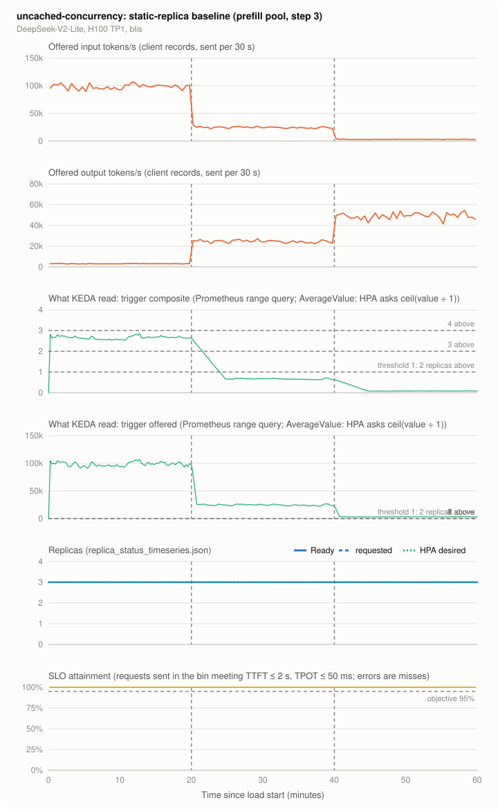
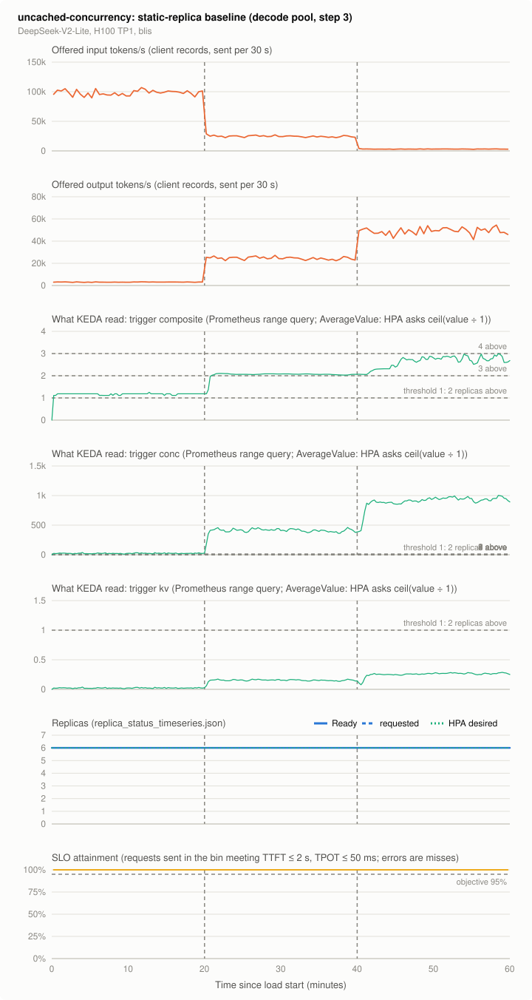

# Step 3, run 6: static-replica baseline (pd-disaggregation/uncached-concurrency)

Part of the [step 3 summary](../../uncached-concurrency-step3.md). Simulator numbers: blis priced this plant; they are not GPU measurements.

| | |
|---|---|
| Plant | blis-signal-lab `25f2dfb` (branch `signals-hpa`) plus task 0545's counter patch; blis-substrate `v0.14.0` catalog entry `deepseek-v2-lite` |
| BLIS scenario | [`deepseek-v2-lite-h100-pd.yaml`](../deepseek-v2-lite-h100-pd.yaml): a `prefill` and a `decode` pool, H100, bf16, TP1 (1 GPU per replica), block size 128, gpu-memory-utilization 0.90, max-model-len 32768, prefix caching on, as the overlay; router [`router/pd-always.yaml`](../router/pd-always.yaml) (always-disagg decider) |
| Cold start | 120 s (`loading_delay`): the protocol's default; this overlay has no GPU measurement |
| Metrics | scrape 15 s (the rendered PodMonitors), `metrics_delay_s` 0 (raw series), HPA sync 15 s, `pollingInterval` 15 s |
| Seed | blis's default (no `--seed`); the load's seed is `schedule.seed` in `blis-run.json` |
| Scenario | `benchmark/config/scenarios/staging/pd-disaggregation/uncached-concurrency.yaml`, rendered with `standup --dry-run`; policy [`policy.json`](policy.json) (calibrated constants, [`scaledobjects-calibrated.yaml`](../scaledobjects-calibrated.yaml)), translated from it ([`terms.json`](../terms.json)) |
| Model | `deepseek-ai/DeepSeek-V2-Lite`, 1 H100 per replica (TP1), both roles |
| SLO | TTFT <= 2 s, TPOT <= 0.05 s; X = 0.95 |
| Run | 6, static-replica baseline |
| Load | `mixshift` in [`index.json`](../index.json), the same load as run 3: 12.006 req/s, three 1,200 s phases (8192:256, 2048:2048, 256:4096) |
| Arm | pinned: prefill 3 and decode 6 Ready (run 3's peak), autoscaling paused |
| Gaps exposed | see the summary |
| Memory | peak RSS 28.09 GiB of a 39.49 GiB budget; not killed |
| Raw results | `benchmark/results/step3-uncached-concurrency-20261124/mixshift-static/` (not committed) |

Run 3's load (12.006 req/s, three 1,200 s phases) with both pools pinned at run 3's peak Ready counts, 3 prefill and 6 decode. The pools did not move; A was 1.000 in every phase.
 The trigger panels are the HPA's own reading at each sync, from blis's decision log, not a Prometheus query. Every number is a simulator number. Each run is one sample (n = 1).

## Per stage, prefill pool

| stage | s | set req/s | offered req/s | λ_in tok/s | λ_out tok/s | sent | errors | A | TTFT p50/p90/p99 s | TPOT p50/p90/p99 ms | Ready | need | requested replica-s | Ready replica-s |
|---|---|---|---|---|---|---|---|---|---|---|---|---|---|---|
| 1 | 1200 | 12.006 | 12.007 | 98,359 | 3,074 | 14,408 | 0 | 100.0 % | 0.22/0.39/0.55 | 7.5/9.5/11.0 | 3–3 | 2 | 3,600 | 3,600 |
| 2 | 1200 | 12.006 | 12.007 | 24,590 | 24,590 | 14,408 | 0 | 100.0 % | 0.12/0.12/0.15 | 16.8/17.2/17.6 | 3–3 | 1 | 3,600 | 3,600 |
| 3 | 1200 | 12.006 | 12.007 | 3,074 | 49,179 | 14,408 | 0 | 100.0 % | 0.10/0.11/0.12 | 18.9/19.3/20.0 | 3–3 | 1 | 3,600 | 3,600 |

- run: 43,224 sent, A 100.0 %, errors 0, requested 10,800 replica-s = 10,800 GPU-s at 1 GPU per replica
- placement: 0 request(s) before the first stage, 0 after the last; stages more than 3 sd off their set rate: none: ok

## Per stage, decode pool

| stage | s | set req/s | offered req/s | λ_in tok/s | λ_out tok/s | sent | errors | A | TTFT p50/p90/p99 s | TPOT p50/p90/p99 ms | Ready | need | requested replica-s | Ready replica-s |
|---|---|---|---|---|---|---|---|---|---|---|---|---|---|---|
| 1 | 1200 | 12.006 | 12.007 | 98,359 | 3,074 | 14,408 | 0 | 100.0 % | 0.22/0.39/0.55 | 7.5/9.5/11.0 | 6–6 | 1 | 7,200 | 7,200 |
| 2 | 1200 | 12.006 | 12.007 | 24,590 | 24,590 | 14,408 | 0 | 100.0 % | 0.12/0.12/0.15 | 16.8/17.2/17.6 | 6–6 | 3 | 7,200 | 7,200 |
| 3 | 1200 | 12.006 | 12.007 | 3,074 | 49,179 | 14,408 | 0 | 100.0 % | 0.10/0.11/0.12 | 18.9/19.3/20.0 | 6–6 | 3 | 7,200 | 7,200 |

- run: 43,224 sent, A 100.0 %, errors 0, requested 21,600 replica-s = 21,600 GPU-s at 1 GPU per replica
- placement: 0 request(s) before the first stage, 0 after the last; stages more than 3 sd off their set rate: none: ok

## What the run shows

Run 6 is not a pass/fail run: it is the cost reference for run 3 (same load, same seed 103, pools pinned at run 3's peak Ready counts: prefill 3, decode 6; the HPAs still read and log every trigger but cannot move the pools).

- **A per phase:** 1.000, 1.000, 1.000 (run 3: 1.000, 1.000, 0.840). No errors.
- **TTFT p90 and TPOT p90 in the phases:** 0.39 s and 9.5 ms, 0.12 s and 17.2 ms, 0.11 s and 19.3 ms; run 3's phase 3 had TTFT p90 67.3 s.
- **GPU-seconds:** 32,400 (prefill 10,800 + decode 21,600), against run 3's 19,950 (prefill 9,900 + decode 10,050): run 3 / run 6 = 0.62. The comparison table is in the summary.

**Outcome: as expected (cost reference).** The static fleet met the SLO in every phase at 62 % more GPU-seconds than run 3; run 3 lost attainment only in phase 3 (A 0.840), while its decode pool went from 2 to 6.

## Amendments

None.
