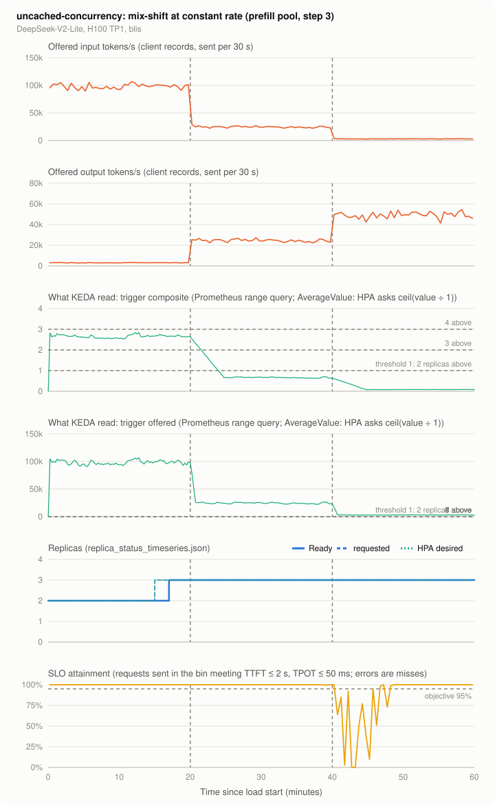
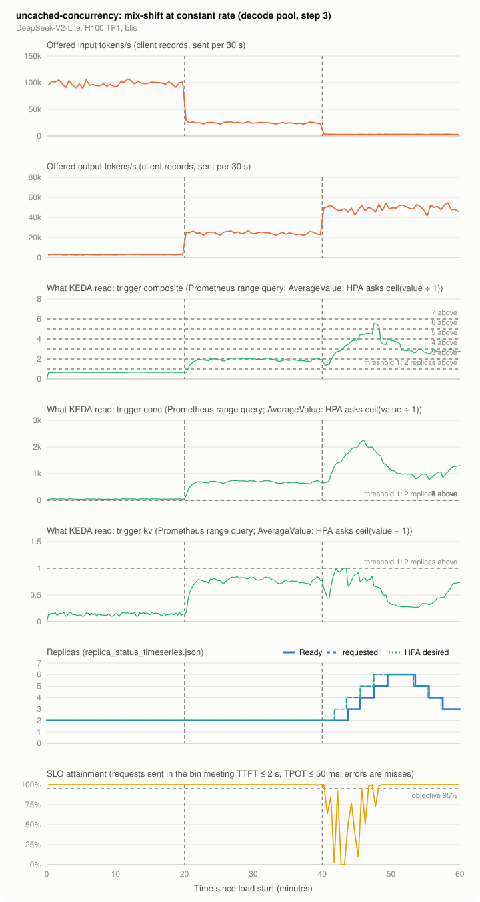

# Step 3, run 3: mix-shift at constant rate (pd-disaggregation/uncached-concurrency)

Part of the [step 3 summary](../../uncached-concurrency-step3.md). Simulator numbers: blis priced this plant; they are not GPU measurements.

| | |
|---|---|
| Plant | blis-signal-lab `25f2dfb` (branch `signals-hpa`) plus task 0545's counter patch; blis-substrate `v0.14.0` catalog entry `deepseek-v2-lite` |
| BLIS scenario | [`deepseek-v2-lite-h100-pd.yaml`](../deepseek-v2-lite-h100-pd.yaml): a `prefill` and a `decode` pool, H100, bf16, TP1 (1 GPU per replica), block size 128, gpu-memory-utilization 0.90, max-model-len 32768, prefix caching on, as the overlay; router [`router/pd-always.yaml`](../router/pd-always.yaml) (always-disagg decider) |
| Cold start | 120 s (`loading_delay`): the protocol's default; this overlay has no GPU measurement |
| Metrics | scrape 15 s (the rendered PodMonitors), `metrics_delay_s` 0 (raw series), HPA sync 15 s, `pollingInterval` 15 s |
| Seed | blis's default (no `--seed`); the load's seed is `schedule.seed` in `blis-run.json` |
| Scenario | `benchmark/config/scenarios/staging/pd-disaggregation/uncached-concurrency.yaml`, rendered with `standup --dry-run`; policy [`policy.json`](policy.json) (calibrated constants, [`scaledobjects-calibrated.yaml`](../scaledobjects-calibrated.yaml)), translated from it ([`terms.json`](../terms.json)) |
| Model | `deepseek-ai/DeepSeek-V2-Lite`, 1 H100 per replica (TP1), both roles |
| SLO | TTFT <= 2 s, TPOT <= 0.05 s; X = 0.95 |
| Run | 3, mix-shift at constant rate |
| Load | `mixshift` in [`index.json`](../index.json): one request rate q = 0.5 x 6 x min μ_SLO(m) = 12.006 req/s (the decode pool's smallest, 4.002 req/s) for three 1,200 s phases: 8192:256, 2048:2048, 256:4096 |
| Arm | ScaledObjects active, each pool from `minReplicaCount` (2) Ready |
| Gaps exposed | see the summary |
| Memory | peak RSS 26.07 GiB of a 39.54 GiB budget; not killed |
| Raw results | `benchmark/results/step3-uncached-concurrency-20261124/mixshift/` (not committed) |

One request rate, 12.006 req/s, in three 1,200 s phases: 8192:256, 2048:2048, 256:4096. Prefill went 2 to 3 in phase 1 and held 3 to the end; decode held 2 through phases 1 and 2, went 2 to 6 in phase 3 and settled at 3. A fell to 0.36 in phase 3's second two-minute bin.
 The trigger panels are the HPA's own reading at each sync, from blis's decision log, not a Prometheus query. Every number is a simulator number. Each run is one sample (n = 1).

## Per stage, prefill pool

| stage | s | set req/s | offered req/s | λ_in tok/s | λ_out tok/s | sent | errors | A | TTFT p50/p90/p99 s | TPOT p50/p90/p99 ms | Ready | need | requested replica-s | Ready replica-s |
|---|---|---|---|---|---|---|---|---|---|---|---|---|---|---|
| 1 | 1200 | 12.006 | 12.007 | 98,359 | 3,074 | 14,408 | 0 | 100.0 % | 0.36/0.68/1.08 | 15.5/16.4/17.0 | 2–3 | 2 | 2,700 | 2,580 |
| 2 | 1200 | 12.006 | 12.007 | 24,590 | 24,590 | 14,408 | 0 | 100.0 % | 0.14/0.16/0.18 | 28.0/28.8/29.1 | 3–3 | 1 | 3,600 | 3,600 |
| 3 | 1200 | 12.006 | 12.007 | 3,074 | 49,179 | 14,408 | 0 | 84.0 % | 0.11/67.27/149.95 | 22.7/33.5/42.2 | 3–3 | 1 | 3,600 | 3,600 |

- run: 43,224 sent, A 94.7 %, errors 0, requested 9,900 replica-s = 9,900 GPU-s at 1 GPU per replica
- placement: 0 request(s) before the first stage, 0 after the last; stages more than 3 sd off their set rate: none: ok

## Per stage, decode pool

| stage | s | set req/s | offered req/s | λ_in tok/s | λ_out tok/s | sent | errors | A | TTFT p50/p90/p99 s | TPOT p50/p90/p99 ms | Ready | need | requested replica-s | Ready replica-s |
|---|---|---|---|---|---|---|---|---|---|---|---|---|---|---|
| 1 | 1200 | 12.006 | 12.007 | 98,359 | 3,074 | 14,408 | 0 | 100.0 % | 0.36/0.68/1.08 | 15.5/16.4/17.0 | 2–2 | 1 | 2,400 | 2,400 |
| 2 | 1200 | 12.006 | 12.007 | 24,590 | 24,590 | 14,408 | 0 | 100.0 % | 0.14/0.16/0.18 | 28.0/28.8/29.1 | 2–2 | 3 | 2,400 | 2,400 |
| 3 | 1200 | 12.006 | 12.007 | 3,074 | 49,179 | 14,408 | 0 | 84.0 % | 0.11/67.27/149.95 | 22.7/33.5/42.2 | 2–6 | 3 | 5,250 | 4,815 |

- run: 43,224 sent, A 94.7 %, errors 0, requested 10,050 replica-s = 10,050 GPU-s at 1 GPU per replica
- placement: 0 request(s) before the first stage, 0 after the last; stages more than 3 sd off their set rate: none: ok

## What the run shows

The run shows a problem when A < X once settled, or settled replicas differ from the need by more than the configuration's headroom. `need` is `ceil(q / μ_SLO(m))` and does not apply `minReplicaCount` 2 (decode: 1, 3, 3 with the decode knees 20.267, 5.647 and 4.002 req/s; prefill: 1 for 8192:256 with 6.095 req/s, and `minReplicaCount` for the other two).

- **Phase 1 (8192:256, A 1.000).** Prefill held 2 Ready for the first 915 s at 98,300 tok/s offered against two pods' 99,860 tok/s (2 x 49,930, the 8192:256 knee); the trigger read 2.56 to 2.69 from t = 600 s, and the third pod was requested at t = 915 s (the 900 s scale-up window) and Ready at t = 1,020 s. A stayed 1.000 in the phase. Decode held 2 against a need of 1.
- **Phase 2 (2048:2048, A 1.000).** Prefill held 3 for the rest of the run: its trigger read 0.64 to 0.70 (proposal 1, floored at 2 by `minReplicaCount`) and the 3,600 s scale-down window kept the third pod, 1 pod above the floor for 2,580 s of the run (t = 1,020 to 3,600 s). Decode held 2 against a need of 3 (12.006 req/s against 2 x 5.647 = 11.294 req/s): the KV guard held the composite at 1.95 to 2.04 with mean KV usage at 0.77 to 0.82 and 337 to 360 requests per pod; A stayed 1.000.
- **Phase 3 (256:4096, A 0.840).** The step at t = 2,400 s took decode from 2 pods at 674 requests (conc / 510 = 1.32) to 1,116 requests 90 s later (composite 2.19, then 3.06 at t = 2,580 s). The pool followed: 3 requested at t = 2,520 s, 4 at t = 2,625 s, 5 at t = 2,745 s, 6 at t = 2,865 s, all Ready at t = 2,970 s (570 s after the step). A per two-minute bin from the step: 0.63, 0.36, 0.55, 0.81, then 1.00 from t = 2,880 s; TTFT p90 67.3 s and p99 150 s for the phase (requests that waited in decode's queue). The ITL guard won the composite at 4.47 and 5.56 (decode ITL p90 reached 0.056 s, over the 0.05 s TPOT limit) and drove the pool to its cap of 6.
- **Settled, phase 3.** The pool released pods one per two minutes after t = 3,195 s and settled at 3 Ready from t = 3,450 s (need 3), the feed-forward term (`lam * gen / ok / (8.4 x 2,133)`) holding 2.6 to 2.9.
- Unexplained: none.

**Outcome: problem shown.** A 0.840 in phase 3 (decode took 570 s to go from 2 to 6 Ready after the mix changed under a constant request rate; A 0.36 at the worst bin) and 1 prefill pod held above the floor for 2,580 s. After settling A was 1.000 and settled replicas matched the need in phases 1 (prefill 3 against 1, floor 2) and 3 (decode 3 against 3); phase 2's decode had 2 against 3 with A 1.000.

## Amendments

None.
