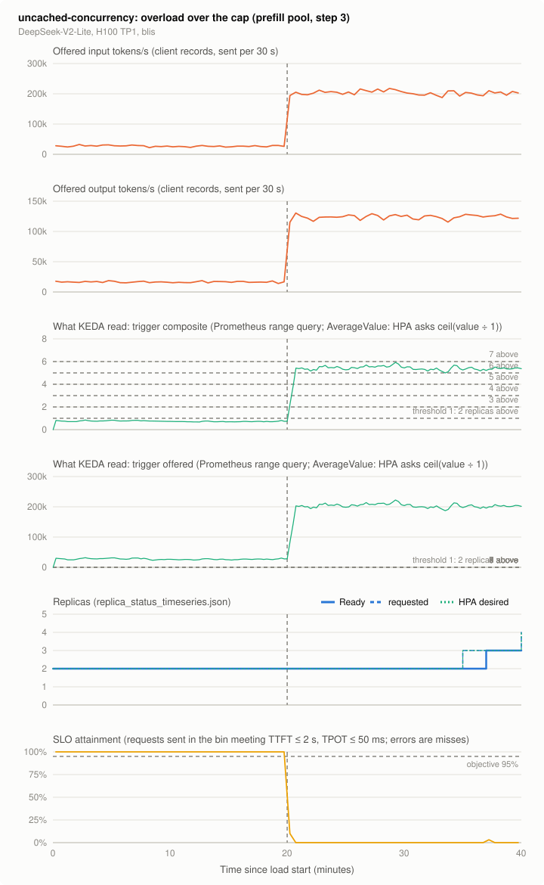
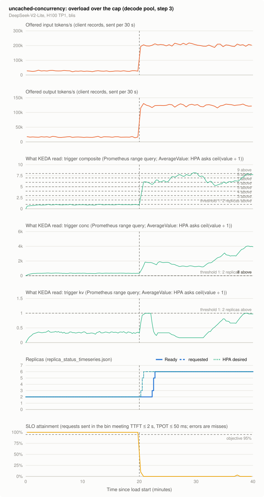

# Step 3, run 4b: overload over the cap (pd-disaggregation/uncached-concurrency)

Part of the [step 3 summary](../../uncached-concurrency-step3.md). Simulator numbers: blis priced this plant; they are not GPU measurements.

| | |
|---|---|
| Plant | blis-signal-lab `25f2dfb` (branch `signals-hpa`) plus task 0545's counter patch; blis-substrate `v0.14.0` catalog entry `deepseek-v2-lite`, with the TTFT projection of inference-sim `dfa8987` (#2237) applied ([`lab-patch.diff`](lab-patch.diff)), which changes the reported TTFT of disaggregated requests and nothing the HPAs read (see the discarded attempts in the summary) |
| BLIS scenario | [`deepseek-v2-lite-h100-pd.yaml`](../deepseek-v2-lite-h100-pd.yaml): a `prefill` and a `decode` pool, H100, bf16, TP1 (1 GPU per replica), block size 128, gpu-memory-utilization 0.90, max-model-len 32768, prefix caching on, as the overlay; router [`router/pd-always.yaml`](../router/pd-always.yaml) (always-disagg decider) |
| Cold start | 120 s (`loading_delay`): the protocol's default; this overlay has no GPU measurement |
| Metrics | scrape 15 s (the rendered PodMonitors), `metrics_delay_s` 0 (raw series), HPA sync 15 s, `pollingInterval` 15 s |
| Seed | blis's default (no `--seed`); the load's seed is `schedule.seed` in `blis-run.json` |
| Scenario | `benchmark/config/scenarios/staging/pd-disaggregation/uncached-concurrency.yaml`, rendered with `standup --dry-run`; policy [`policy.json`](policy.json) (calibrated constants, [`scaledobjects-calibrated.yaml`](../scaledobjects-calibrated.yaml)), translated from it ([`terms.json`](../terms.json)) |
| Model | `deepseek-ai/DeepSeek-V2-Lite`, 1 H100 per replica (TP1), both roles |
| SLO | TTFT <= 2 s, TPOT <= 0.05 s; X = 0.95 |
| Run | 4b, overload over the cap |
| Load | `overload-over` in [`index.json`](../index.json): the blend, 1,200 s at 1.2 x μ_SLO(B) = 7.753 req/s, then 1,200 s at 1.5 x C = 58.149 req/s |
| Arm | ScaledObjects active, each pool from `minReplicaCount` (2) Ready |
| Gaps exposed | see the summary |
| Memory | peak RSS 25.95 GiB of a 38.44 GiB budget; not killed |
| Raw results | `benchmark/results/step3-uncached-concurrency-20261124/overload-over/` (not committed) |

The blend at 7.8 req/s for 1,200 s, then at 58.1 req/s (1.5 x C). Decode reached its cap of 6 Ready 165 s after the step; prefill went 2 to 3 Ready at t = 2,220 s and to its cap of 4 at t = 2,520 s, after the load ended at t = 2,400 s. A fell to 0.003 for the phase.
 The trigger panels are the HPA's own reading at each sync, from blis's decision log, not a Prometheus query. Every number is a simulator number. Each run is one sample (n = 1).

## Per stage, prefill pool

| stage | s | set req/s | offered req/s | λ_in tok/s | λ_out tok/s | sent | errors | A | TTFT p50/p90/p99 s | TPOT p50/p90/p99 ms | Ready | need | requested replica-s | Ready replica-s |
|---|---|---|---|---|---|---|---|---|---|---|---|---|---|---|
| 1 | 1200 | 7.753 | 7.755 | 27,132 | 16,544 | 9,306 | 0 | 100.0 % | 0.15/0.27/0.39 | 20.2/20.9/27.1 | 2–2 | 1 | 2,400 | 2,400 |
| 2 | 1200 | 58.149 | 58.150 | 203,447 | 124,053 | 69,780 | 62008 timeout | 0.3 % | 85.65/209.81/282.76 | 35.4/38.4/42.4 | 2–3 | 4 | 2,700 | 2,580 |

- run: 79,086 sent, A 12.0 %, errors {'timeout': 62008}, requested 5,100 replica-s = 5,100 GPU-s at 1 GPU per replica
- placement: 0 request(s) before the first stage, 0 after the last; stages more than 3 sd off their set rate: none: ok

## Per stage, decode pool

| stage | s | set req/s | offered req/s | λ_in tok/s | λ_out tok/s | sent | errors | A | TTFT p50/p90/p99 s | TPOT p50/p90/p99 ms | Ready | need | requested replica-s | Ready replica-s |
|---|---|---|---|---|---|---|---|---|---|---|---|---|---|---|
| 1 | 1200 | 7.753 | 7.755 | 27,132 | 16,544 | 9,306 | 0 | 100.0 % | 0.15/0.27/0.39 | 20.2/20.9/27.1 | 2–2 | 2 | 2,400 | 2,400 |
| 2 | 1200 | 58.149 | 58.150 | 203,447 | 124,053 | 69,780 | 62008 timeout | 0.3 % | 85.65/209.81/282.76 | 35.4/38.4/42.4 | 2–6 | 9 | 7,080 | 6,600 |

- run: 79,086 sent, A 12.0 %, errors {'timeout': 62008}, requested 9,480 replica-s = 9,480 GPU-s at 1 GPU per replica
- placement: 0 request(s) before the first stage, 0 after the last; stages more than 3 sd off their set rate: none: ok

## What the run shows

The run shows a problem when the trigger reads 0 or falls while the load holds, or replicas stop below `maxReplicaCount`. `need` is `ceil(q / μ_SLO(B))` (decode 9, prefill 4 at 58.1 req/s) and does not apply `minReplicaCount` 2. The run ran on the patched lab from the start (the TTFT projection of inference-sim `dfa8987`, the fix run 4a needed).

- **Trigger at the cap.** Decode's composite read 5.7 to 8.1 while the pool sat at its cap of 6 Ready from t = 1,365 s to the end (proposal 6 or 7, "at max" in the HPA's reason); the feed-forward term (`lam * gen / ok`) won the max between t = 1,350 and 2,250 s, reading 5.7 to 8.1, and the concurrency term from t = 2,100 s (6.1 to 7.7). It never fell while the load held. Prefill's composite read 5.3 to 5.4 from t = 1,500 s to the end of the load (proposal 6, above its cap of 4), and 3.30 after the load ended.
- **Replicas.** Decode: 6 Ready from t = 1,365 s, 165 s after the step, below the need of 9 because of the cap. Prefill: the trigger proposed more than 2 from t = 1,230 s; the third pod was requested at t = 2,115 s (the 900 s scale-up window) and the fourth at t = 2,400 s (1 pod per 300 s), Ready at t = 2,220 s and t = 2,520 s. Prefill therefore reached `maxReplicaCount` 4 only after the load ended, 1,320 s after the step.
- **Errors by type.** 62,008 of the phase's 69,780 requests timed out at 311 s (89 %); no 429 or 503 (blis has no flow control and the drops count is 0). 37,165 requests (2,414 in flight, 34,751 queued) had not finished at the horizon and count as misses. A 0.003 in the phase; TTFT p50 85.7 s.
- **Prefill's served rate fell under overload.** `comp` read 55,336 tok/s at t = 1,500 s, 23,567 at t = 1,800 s and 87,946 at t = 2,100 s with 2 pods (capacity 107,256 tok/s at the blend knee); the mean waiting count per prefill pod was 617 at t = 1,200 s, 6,238 at t = 1,500 s, 13,912 at t = 1,800 s and 18,237 at t = 2,100 s (`signals-pods.csv`). Requests past the client timeout keep running in blis (inference-sim#2291), so part of this is the simulator holding capacity a cluster would free; the run does not measure how much. The `comp` floor of the prefill formula read 0.63 at t = 1,800 s against an `offered`-based 5.44, so the floor did not bind and the trigger did not under-read.
- Unexplained: none.

**Outcome: as expected for the cap; no trigger fault shown.** Neither condition of the problem column holds: decode's trigger stayed at or above its cap's count while the load held, and both pools were at `maxReplicaCount` (decode from t = 1,365 s, prefill from t = 2,520 s, after the load). A 0.003 in the 1.5 x C phase is the overload itself, and prefill's 1,320 s to reach its cap is the scale-up behavior (900 s window, 1 pod per 300 s) that runs 2, 3 and 4a also showed.

## Amendments

None.
