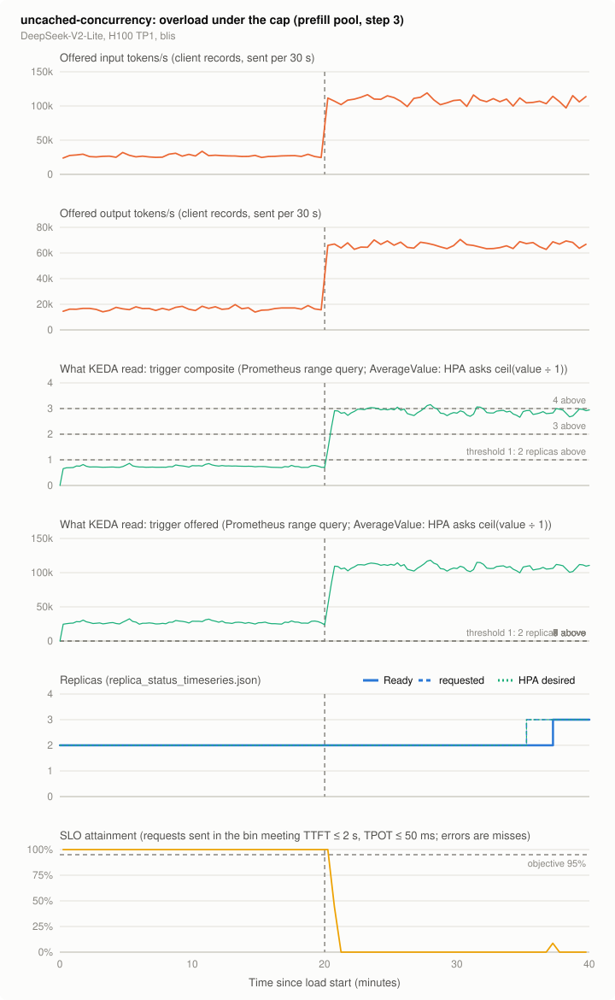
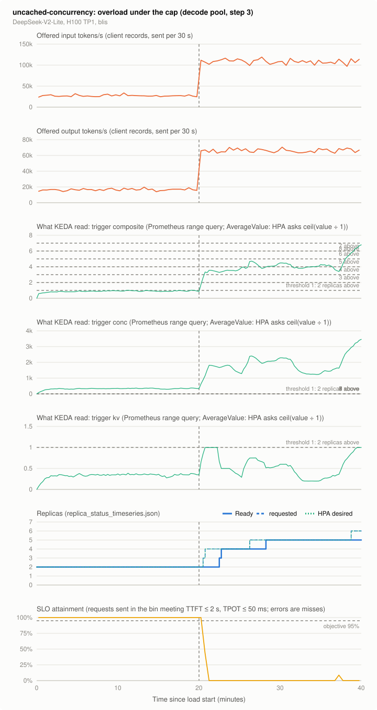

# Step 3, run 4a: overload under the cap (pd-disaggregation/uncached-concurrency)

Part of the [step 3 summary](../../uncached-concurrency-step3.md). Simulator numbers: blis priced this plant; they are not GPU measurements.

| | |
|---|---|
| Plant | blis-signal-lab `25f2dfb` (branch `signals-hpa`) plus task 0545's counter patch; blis-substrate `v0.14.0` catalog entry `deepseek-v2-lite`, with the TTFT projection of inference-sim `dfa8987` (#2237) applied ([`lab-patch.diff`](lab-patch.diff)), which changes the reported TTFT of disaggregated requests and nothing the HPAs read (see the discarded attempts in the summary) |
| BLIS scenario | [`deepseek-v2-lite-h100-pd.yaml`](../deepseek-v2-lite-h100-pd.yaml): a `prefill` and a `decode` pool, H100, bf16, TP1 (1 GPU per replica), block size 128, gpu-memory-utilization 0.90, max-model-len 32768, prefix caching on, as the overlay; router [`router/pd-always.yaml`](../router/pd-always.yaml) (always-disagg decider) |
| Cold start | 120 s (`loading_delay`): the protocol's default; this overlay has no GPU measurement |
| Metrics | scrape 15 s (the rendered PodMonitors), `metrics_delay_s` 0 (raw series), HPA sync 15 s, `pollingInterval` 15 s |
| Seed | blis's default (no `--seed`); the load's seed is `schedule.seed` in `blis-run.json` |
| Scenario | `benchmark/config/scenarios/staging/pd-disaggregation/uncached-concurrency.yaml`, rendered with `standup --dry-run`; policy [`policy.json`](policy.json) (calibrated constants, [`scaledobjects-calibrated.yaml`](../scaledobjects-calibrated.yaml)), translated from it ([`terms.json`](../terms.json)) |
| Model | `deepseek-ai/DeepSeek-V2-Lite`, 1 H100 per replica (TP1), both roles |
| SLO | TTFT <= 2 s, TPOT <= 0.05 s; X = 0.95 |
| Run | 4a, overload under the cap |
| Load | `overload-under` in [`index.json`](../index.json): the blend, 1,200 s at 1.2 x μ_SLO(B) = 7.753 req/s, then 1,200 s at 0.8 x C = 31.013 req/s |
| Arm | ScaledObjects active, each pool from `minReplicaCount` (2) Ready |
| Gaps exposed | see the summary |
| Memory | peak RSS 27.5 GiB of a 38.8 GiB budget; not killed |
| Raw results | `benchmark/results/step3-uncached-concurrency-20261124/overload-under/` (not committed) |

The blend at 7.8 req/s for 1,200 s, then at 31.0 req/s (0.8 x C). Decode went from 2 to 6 Ready pods and prefill from 2 to 3 after the step, and A fell from 1.000 to 0.000 within four minutes and stayed there to the end of the load.
 The trigger panels are the HPA's own reading at each sync, from blis's decision log, not a Prometheus query. Every number is a simulator number. Each run is one sample (n = 1).

## Per stage, prefill pool

| stage | s | set req/s | offered req/s | λ_in tok/s | λ_out tok/s | sent | errors | A | TTFT p50/p90/p99 s | TPOT p50/p90/p99 ms | Ready | need | requested replica-s | Ready replica-s |
|---|---|---|---|---|---|---|---|---|---|---|---|---|---|---|
| 1 | 1200 | 7.753 | 7.755 | 27,132 | 16,544 | 9,306 | 0 | 100.0 % | 0.15/0.26/0.39 | 20.3/20.8/26.8 | 2–2 | 1 | 2,400 | 2,400 |
| 2 | 1200 | 31.013 | 31.015 | 108,511 | 66,165 | 37,218 | 24459 timeout | 3.9 % | 100.13/232.83/295.89 | 35.3/38.2/42.9 | 2–3 | 3 | 2,685 | 2,565 |

- run: 46,524 sent, A 23.1 %, errors {'timeout': 24459}, requested 5,085 replica-s = 5,085 GPU-s at 1 GPU per replica
- placement: 0 request(s) before the first stage, 0 after the last; stages more than 3 sd off their set rate: none: ok

## Per stage, decode pool

| stage | s | set req/s | offered req/s | λ_in tok/s | λ_out tok/s | sent | errors | A | TTFT p50/p90/p99 s | TPOT p50/p90/p99 ms | Ready | need | requested replica-s | Ready replica-s |
|---|---|---|---|---|---|---|---|---|---|---|---|---|---|---|
| 1 | 1200 | 7.753 | 7.755 | 27,132 | 16,544 | 9,306 | 0 | 100.0 % | 0.15/0.26/0.39 | 20.3/20.8/26.8 | 2–2 | 2 | 2,400 | 2,400 |
| 2 | 1200 | 31.013 | 31.015 | 108,511 | 66,165 | 37,218 | 24459 timeout | 3.9 % | 100.13/232.83/295.89 | 35.3/38.2/42.9 | 2–5 | 5 | 5,625 | 5,190 |

- run: 46,524 sent, A 23.1 %, errors {'timeout': 24459}, requested 8,025 replica-s = 8,025 GPU-s at 1 GPU per replica
- placement: 0 request(s) before the first stage, 0 after the last; stages more than 3 sd off their set rate: none: ok

## What the run shows

The run shows a problem when A < X after Ready replicas stop rising. `need` is `ceil(q / μ_SLO(B))` and does not apply `minReplicaCount` 2 (decode 5, prefill 3 at 31.0 req/s). This is the second attempt, on the patched lab (the first failed blis's Result validation; see the summary).

- **Phase 1 (1.2 x μ_SLO(B), 7.75 req/s), A 1.000** with 2 prefill and 2 decode Ready.
- **Phase 2 (31.0 req/s), A 0.039.** A per two-minute bin from the step at t = 1,200 s: 0.36, then 0.00 in every bin to t = 2,400 s except 0.02 (`load-vs-supply-decode.csv`). 24,459 of the phase's 37,218 requests timed out at 311 s (66 %), and 10,792 requests (1,713 in flight, 9,079 queued) had not finished at the horizon; they count as misses in A. TTFT p50 100 s.
- **Decode followed within a few minutes and reached its cap.** 4 requested at t = 1,245 s and Ready at t = 1,365 s; 5 at t = 1,590 s (Ready at t = 1,695 s); 6 at t = 2,340 s (Ready at t = 2,445 s), after which the composite read 7.08 (proposal 8, at the cap). Decode held 5 Ready, the need, from t = 1,695 to 2,340 s, and the composite sat at 3.8 to 4.5 (the concurrency term and the feed-forward term alternated).
- **Prefill was the pool that queued, and its 900 s scale-up window held it at 2 pods.** The prefill trigger proposed 3 from t = 1,230 s (30 s after the step) and read 2.8 to 3.0 over the phase; the third pod was requested at t = 2,115 s and Ready at t = 2,235 s, 1,035 s after the step. Offered prompt work was 108,511 tok/s against two pods' 107,256 tok/s (2 x 53,628). The mean waiting count per prefill pod, from `signals-pods.csv`, was 115 at t = 1,200 s, 2,089 at t = 1,500 s, 6,854 at t = 2,100 s and 3,320 at t = 2,700 s; per decode pod it stayed between 120 and 187.
- **The backlog did not clear after the pools reached what the load needs.** Prefill had 3 pods (capacity 160,884 tok/s) from t = 2,235 s and A stayed at 0.00 to the end of the load. Requests past the client timeout keep running in blis (inference-sim#2291, summary), so they hold prefill capacity a cluster would free: the recovery time after t = 2,235 s is slower here than on a cluster by an amount the run does not measure.
- Unexplained: none.

**Outcome: problem shown.** A 0.039 in phase 2 after the Ready replicas stopped rising (decode 6, prefill 3, both above the need of 5 and 3): the 900 s prefill scale-up window left prefill at 2 pods, below its need, for 1,035 s after the step, and the backlog it built was not served within the load.

## Amendments

None.
