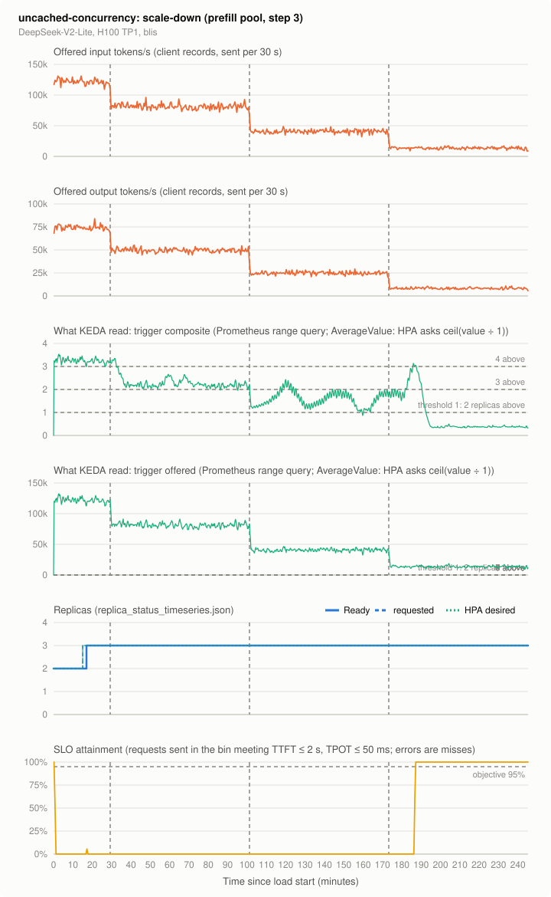
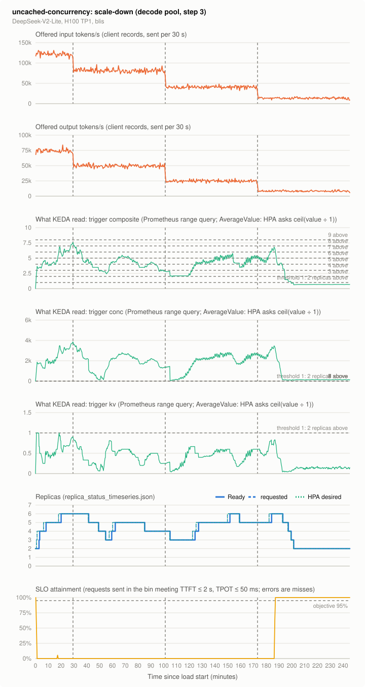

# Step 3, run 10: scale-down (pd-disaggregation/uncached-concurrency)

Part of the [step 3 summary](../../uncached-concurrency-step3.md). Simulator numbers: blis priced this plant; they are not GPU measurements.

| | |
|---|---|
| Plant | blis-signal-lab `25f2dfb` (branch `signals-hpa`) plus task 0545's counter patch; blis-substrate `v0.14.0` catalog entry `deepseek-v2-lite`, with the TTFT projection of inference-sim `dfa8987` (#2237) applied ([`lab-patch.diff`](lab-patch.diff)), which changes the reported TTFT of disaggregated requests and nothing the HPAs read (see the discarded attempts in the summary) |
| BLIS scenario | [`deepseek-v2-lite-h100-pd.yaml`](../deepseek-v2-lite-h100-pd.yaml): a `prefill` and a `decode` pool, H100, bf16, TP1 (1 GPU per replica), block size 128, gpu-memory-utilization 0.90, max-model-len 32768, prefix caching on, as the overlay; router [`router/pd-always.yaml`](../router/pd-always.yaml) (always-disagg decider) |
| Cold start | 120 s (`loading_delay`): the protocol's default; this overlay has no GPU measurement |
| Metrics | scrape 15 s (the rendered PodMonitors), `metrics_delay_s` 0 (raw series), HPA sync 15 s, `pollingInterval` 15 s |
| Seed | blis's default (no `--seed`); the load's seed is `schedule.seed` in `blis-run.json` |
| Scenario | `benchmark/config/scenarios/staging/pd-disaggregation/uncached-concurrency.yaml`, rendered with `standup --dry-run`; policy [`policy.json`](policy.json) (calibrated constants, [`scaledobjects-calibrated.yaml`](../scaledobjects-calibrated.yaml)), translated from it ([`terms.json`](../terms.json)) |
| Model | `deepseek-ai/DeepSeek-V2-Lite`, 1 H100 per replica (TP1), both roles |
| SLO | TTFT <= 2 s, TPOT <= 0.05 s; X = 0.95 |
| Run | 10, scale-down |
| Load | `scale-down` in [`index.json`](../index.json): the blend, H = 1,755 s at 0.9 x C = 34.889 req/s, then steps of D = 4,320 s at 0.6, 0.3 and 0.1 x C (23.260, 11.630, 3.877 req/s) |
| Arm | ScaledObjects active, each pool from `minReplicaCount` (2) Ready |
| Gaps exposed | see the summary |
| Memory | peak RSS 36.79 GiB of a 45.24 GiB budget; not killed |
| Raw results | `benchmark/results/step3-uncached-concurrency-20261124/scale-down/` (not committed) |

The blend at 0.9 x C (34.9 req/s) for 1,755 s from 2 pods per pool, then 4,320 s steps at 0.6, 0.3 and 0.1 x C. Decode reached 6 Ready, prefill 3. A was 0.026 in the hold and 0.000 in the next two steps, and returned to 1.00 only at t = 11,700 s, 1,305 s into the last step.
 The trigger panels are the HPA's own reading at each sync, from blis's decision log, not a Prometheus query. Every number is a simulator number. Each run is one sample (n = 1).

## Per stage, prefill pool

| stage | s | set req/s | offered req/s | λ_in tok/s | λ_out tok/s | sent | errors | A | TTFT p50/p90/p99 s | TPOT p50/p90/p99 ms | Ready | need | requested replica-s | Ready replica-s |
|---|---|---|---|---|---|---|---|---|---|---|---|---|---|---|
| 1 | 1755 | 34.889 | 34.891 | 122,071 | 74,433 | 61,233 | 52269 timeout | 2.6 % | 79.79/226.11/293.01 | 35.3/38.1/42.8 | 2–3 | 3 | 4,365 | 4,245 |
| 2 | 4320 | 23.260 | 23.260 | 81,378 | 49,621 | 100,482 | 100482 timeout | 0.0 % | –/–/– | –/–/– | 3–3 | 2 | 12,960 | 12,960 |
| 3 | 4320 | 11.630 | 11.630 | 40,689 | 24,810 | 50,241 | 50241 timeout | 0.0 % | –/–/– | –/–/– | 3–3 | 1 | 12,960 | 12,960 |
| 4 | 4320 | 3.877 | 3.877 | 13,565 | 8,271 | 16,749 | 2008 timeout | 81.4 % | 0.13/0.28/213.30 | 16.5/18.0/31.2 | 3–3 | 1 | 12,960 | 12,960 |

- run: 228,705 sent, A 6.7 %, errors {'timeout': 205000}, requested 43,245 replica-s = 43,245 GPU-s at 1 GPU per replica
- placement: 0 request(s) before the first stage, 0 after the last; stages more than 3 sd off their set rate: none: ok

## Per stage, decode pool

| stage | s | set req/s | offered req/s | λ_in tok/s | λ_out tok/s | sent | errors | A | TTFT p50/p90/p99 s | TPOT p50/p90/p99 ms | Ready | need | requested replica-s | Ready replica-s |
|---|---|---|---|---|---|---|---|---|---|---|---|---|---|---|
| 1 | 1755 | 34.889 | 34.891 | 122,071 | 74,433 | 61,233 | 52269 timeout | 2.6 % | 79.79/226.11/293.01 | 35.3/38.1/42.8 | 2–6 | 6 | 8,955 | 8,475 |
| 2 | 4320 | 23.260 | 23.260 | 81,378 | 49,621 | 100,482 | 100482 timeout | 0.0 % | –/–/– | –/–/– | 3–6 | 4 | 20,490 | 20,310 |
| 3 | 4320 | 11.630 | 11.630 | 40,689 | 24,810 | 50,241 | 50241 timeout | 0.0 % | –/–/– | –/–/– | 3–6 | 2 | 19,650 | 19,320 |
| 4 | 4320 | 3.877 | 3.877 | 13,565 | 8,271 | 16,749 | 2008 timeout | 81.4 % | 0.13/0.28/213.30 | 16.5/18.0/31.2 | 2–6 | 1 | 13,935 | 13,875 |

- run: 228,705 sent, A 6.7 %, errors {'timeout': 205000}, requested 63,030 replica-s = 63,030 GPU-s at 1 GPU per replica
- placement: 0 request(s) before the first stage, 0 after the last; stages more than 3 sd off their set rate: none: ok

## What the run shows

The run shows a problem when A < X after a step down, requests fail at a scale-down, or replicas have not reached the new need at the end of a step. `need` is `ceil(q / μ_SLO(B))` (decode 6, 4, 2, 1; prefill 3, 2, 1, 1), and `minReplicaCount` 2 sets the floor of both pools; the stage table does not apply it.

- **The opening hold did not run from a pool at the need.** The run starts at 2 pods per pool, so the hold at 0.9 x C is a step from 2 to a need of 6 decode and 3 prefill pods. A 0.026 in the hold (52,269 of 61,233 requests timed out). Decode reached 6 Ready at t = 1,200 s; prefill's third pod was requested at t = 915 s (the 900 s window) and Ready at t = 1,020 s, with offered prompt work of 122,071 tok/s against two pods' 107,256.
- **A in the steps down:** 0.000 at 0.6 x C (all 100,482 requests timed out) and 0.000 at 0.3 x C (all 50,241 timed out), 0.814 at 0.1 x C (2,008 timeouts); A per 15-minute bin from the load clock: 0.05, then 0.00 to t = 10,800 s, 0.55 in the bin from t = 10,800 s and 1.00 from t = 11,700 s. The cause was the prefill backlog left by the hold: the mean waiting count per prefill pod, from `signals-pods.csv` (20-minute bins), was 2,832 at t = 0 to 600 s, 7,158 at t = 1,200 s, 13,606 at t = 6,000 s, 4,090 at t = 10,800 s and 1 at t = 12,000 s, against 135 to 248 per decode pod. Prefill's served rate (`comp`, mean of the HPA's readings) was 75,596 tok/s in the hold, 67,215 in the 0.6 x C step against 81,651 offered (the backlog grew), 58,238 in the 0.3 x C step against 40,998 offered (it drained) and 73,668 in the first 1,305 s of the last step, with 3 pods whose capacity at the blend's knee is 160,884 tok/s (3 x 53,628). blis serves requests past the client timeout (inference-sim#2291), which a cluster would drop: the 205,000 timeouts of this run overstate the time a cluster would take to recover, by an amount the run does not measure.
- **Time until Ready reached the new need, decode.** Step 0.6 x C (need 4, begins t = 1,755 s): Ready 4 first at t = 2,955 s (1,200 s), then 3 at t = 3,285 s, 5 at t = 3,735 s as the concurrency of the backlog rose, and 4 again at t = 5,115 s (3,360 s). Step 0.3 x C (need 2, begins t = 6,075 s): Ready 3 at t = 6,300 s, then 4, 5 and 6 as the backlog's concurrency drove the composite (6 at t = 9,105 s and again at t = 11,055 s); never 2 in the step (4,320 s). Step 0.1 x C (need 1, floor 2, begins t = 10,395 s): 2 Ready at t = 12,090 s, 1,695 s into the step.
- **Prefill never scaled down.** It held 3 from t = 1,020 s to the end of the run (t = 14,715 s) while its need was 2, then 1 (floor 2). Its trigger read 0.35 to 0.38 from t = 11,700 s (proposal 1, floor 2); the 3,600 s scale-down window would have ended at t = 15,300 s, after the load.
- **Replica-seconds above the need or the floor (higher of the two), decode and prefill:** step 0.6 x C, 3,210 and 4,320; step 0.3 x C, 11,010 and 4,320; step 0.1 x C, 5,295 and 4,320 (requested replica-seconds from the stage tables against 4, 2, 2 pods x 4,320 s for decode and 2 pods x 4,320 s for prefill).
- **Requests failed when a replica was removed:** none, because the simulator cannot fail one (summary, gaps; `requests_errored_at_end` is 0 by construction).
- Unexplained: prefill served 42 to 47 % of its knee capacity while a backlog stood (hold to 0.3 x C), a rate the run does not account for; and decode's drop from 6 to 3 Ready between t = 2,490 and 3,285 s followed by a return to 5 at t = 3,735 s (the composite fell with the backlog's concurrency, then rose again).

**Outcome: problem shown.** A 0.067 over the run: 0.026 in the hold, 0.000 at 0.6 and 0.3 x C, 0.814 at 0.1 x C. Neither pool reached the need of the 0.3 x C step (decode 3 to 6 against 2, prefill 3 against 1), and prefill had not scaled down by the end of the load. The hold itself starts from a pool 4 pods short in decode and 1 in prefill, and its backlog, not the scale-down, set A in the steps; a run that started the hold from the need would isolate the scale-down, and this one cannot (run-set.md §2).

## Amendments

None.
