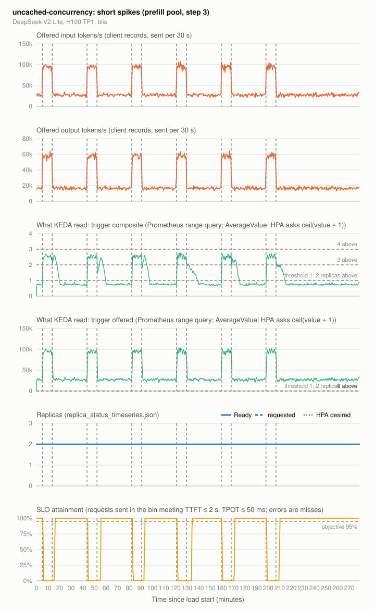
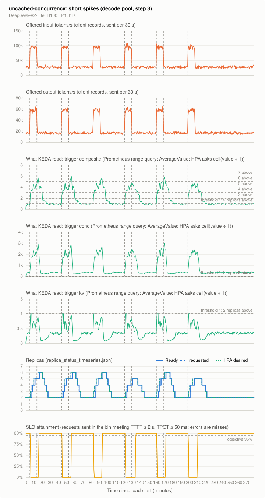

# Step 3, run 9: short spikes (pd-disaggregation/uncached-concurrency)

Part of the [step 3 summary](../../uncached-concurrency-step3.md). Simulator numbers: blis priced this plant; they are not GPU measurements.

| | |
|---|---|
| Plant | blis-signal-lab `25f2dfb` (branch `signals-hpa`) plus task 0545's counter patch; blis-substrate `v0.14.0` catalog entry `deepseek-v2-lite`, with the TTFT projection of inference-sim `dfa8987` (#2237) applied ([`lab-patch.diff`](lab-patch.diff)), which changes the reported TTFT of disaggregated requests and nothing the HPAs read (see the discarded attempts in the summary) |
| BLIS scenario | [`deepseek-v2-lite-h100-pd.yaml`](../deepseek-v2-lite-h100-pd.yaml): a `prefill` and a `decode` pool, H100, bf16, TP1 (1 GPU per replica), block size 128, gpu-memory-utilization 0.90, max-model-len 32768, prefix caching on, as the overlay; router [`router/pd-always.yaml`](../router/pd-always.yaml) (always-disagg decider) |
| Cold start | 120 s (`loading_delay`): the protocol's default; this overlay has no GPU measurement |
| Metrics | scrape 15 s (the rendered PodMonitors), `metrics_delay_s` 0 (raw series), HPA sync 15 s, `pollingInterval` 15 s |
| Seed | blis's default (no `--seed`); the load's seed is `schedule.seed` in `blis-run.json` |
| Scenario | `benchmark/config/scenarios/staging/pd-disaggregation/uncached-concurrency.yaml`, rendered with `standup --dry-run`; policy [`policy.json`](policy.json) (calibrated constants, [`scaledobjects-calibrated.yaml`](../scaledobjects-calibrated.yaml)), translated from it ([`terms.json`](../terms.json)) |
| Model | `deepseek-ai/DeepSeek-V2-Lite`, 1 H100 per replica (TP1), both roles |
| SLO | TTFT <= 2 s, TPOT <= 0.05 s; X = 0.95 |
| Run | 9, short spikes |
| Load | `short-spikes` in [`index.json`](../index.json): the blend, 300 s at 0.2 x C = 7.753 req/s, then six spikes of R/2 = 517 s at 0.7 x C = 27.136 req/s separated by gaps G = 1,800 s at 0.2 x C, then Q = 4,320 s at 0.2 x C |
| Arm | ScaledObjects active, each pool from `minReplicaCount` (2) Ready |
| Gaps exposed | see the summary |
| Memory | peak RSS 40.57 GiB of a 46.04 GiB budget; not killed |
| Raw results | `benchmark/results/step3-uncached-concurrency-20261124/short-spikes/` (not committed) |

The blend at 0.2 x C for 300 s, then six 517 s spikes at 0.7 x C (27.1 req/s) separated by 1,800 s gaps at 0.2 x C (7.75 req/s), then 4,320 s at 0.2 x C. Decode scaled up in every spike (2 to 5 or 6 Ready) and back to 2 afterwards; prefill never left 2. A was 0.088 to 0.095 in the spikes and 0.848 to 0.927 in the first five gaps.
 The trigger panels are the HPA's own reading at each sync, from blis's decision log, not a Prometheus query. Every number is a simulator number. Each run is one sample (n = 1).

## Per stage, prefill pool

| stage | s | set req/s | offered req/s | λ_in tok/s | λ_out tok/s | sent | errors | A | TTFT p50/p90/p99 s | TPOT p50/p90/p99 ms | Ready | need | requested replica-s | Ready replica-s |
|---|---|---|---|---|---|---|---|---|---|---|---|---|---|---|
| 1 | 300 | 7.753 | 7.760 | 27,150 | 16,555 | 2,328 | 0 | 100.0 % | 0.15/0.26/0.39 | 20.3/21.4/29.5 | 2–2 | 1 | 600 | 600 |
| 2 | 517 | 27.136 | 27.139 | 94,951 | 57,897 | 14,031 | 839 timeout | 9.4 % | 78.02/176.67/245.25 | 33.9/37.5/42.0 | 2–2 | 2 | 1,034 | 1,034 |
| 3 | 1800 | 7.753 | 7.753 | 27,126 | 16,540 | 13,956 | 0 | 92.7 % | 0.15/0.35/130.92 | 19.8/21.3/36.7 | 2–2 | 1 | 3,600 | 3,600 |
| 4 | 517 | 27.136 | 27.139 | 94,951 | 57,897 | 14,031 | 2000 timeout | 9.4 % | 122.58/213.39/263.17 | 34.3/38.2/43.4 | 2–2 | 2 | 1,034 | 1,034 |
| 5 | 1800 | 7.753 | 7.753 | 27,126 | 16,540 | 13,956 | 2 timeout | 89.4 % | 0.17/8.79/120.26 | 20.0/27.1/37.0 | 2–2 | 1 | 3,600 | 3,600 |
| 6 | 517 | 27.136 | 27.139 | 94,951 | 57,897 | 14,031 | 1047 timeout | 9.2 % | 89.81/192.02/247.59 | 34.4/38.1/43.9 | 2–2 | 2 | 1,034 | 1,034 |
| 7 | 1800 | 7.753 | 7.753 | 27,126 | 16,540 | 13,956 | 0 | 91.9 % | 0.15/0.36/105.01 | 20.1/23.3/36.4 | 2–2 | 1 | 3,600 | 3,600 |
| 8 | 517 | 27.136 | 27.139 | 94,951 | 57,897 | 14,031 | 2589 timeout | 9.1 % | 102.26/200.27/282.42 | 35.3/38.0/42.3 | 2–2 | 2 | 1,034 | 1,034 |
| 9 | 1800 | 7.753 | 7.753 | 27,126 | 16,540 | 13,956 | 136 timeout | 84.8 % | 0.19/47.56/245.55 | 19.9/21.5/27.4 | 2–2 | 1 | 3,600 | 3,600 |
| 10 | 517 | 27.136 | 27.139 | 94,951 | 57,897 | 14,031 | 474 timeout | 9.5 % | 112.42/175.69/218.22 | 34.8/38.1/43.0 | 2–2 | 2 | 1,034 | 1,034 |
| 11 | 1800 | 7.753 | 7.753 | 27,126 | 16,540 | 13,956 | 0 | 90.3 % | 0.16/0.47/151.51 | 20.0/23.6/31.3 | 2–2 | 1 | 3,600 | 3,600 |
| 12 | 517 | 27.136 | 27.139 | 94,951 | 57,897 | 14,031 | 1763 timeout | 8.8 % | 86.47/188.80/267.54 | 34.8/37.7/42.6 | 2–2 | 2 | 1,034 | 1,034 |
| 13 | 4320 | 7.753 | 7.753 | 27,127 | 16,541 | 33,495 | 10 timeout | 95.9 % | 0.15/0.30/92.97 | 20.2/21.0/26.4 | 2–2 | 1 | 8,640 | 8,640 |

- run: 189,789 sent, A 55.3 %, errors {'timeout': 8860}, requested 33,444 replica-s = 33,444 GPU-s at 1 GPU per replica
- placement: 0 request(s) before the first stage, 0 after the last; stages more than 3 sd off their set rate: none: ok

## Per stage, decode pool

| stage | s | set req/s | offered req/s | λ_in tok/s | λ_out tok/s | sent | errors | A | TTFT p50/p90/p99 s | TPOT p50/p90/p99 ms | Ready | need | requested replica-s | Ready replica-s |
|---|---|---|---|---|---|---|---|---|---|---|---|---|---|---|
| 1 | 300 | 7.753 | 7.760 | 27,150 | 16,555 | 2,328 | 0 | 100.0 % | 0.15/0.26/0.39 | 20.3/21.4/29.5 | 2–2 | 2 | 600 | 600 |
| 2 | 517 | 27.136 | 27.139 | 94,951 | 57,897 | 14,031 | 839 timeout | 9.4 % | 78.02/176.67/245.25 | 33.9/37.5/42.0 | 2–5 | 5 | 2,210 | 1,850 |
| 3 | 1800 | 7.753 | 7.753 | 27,126 | 16,540 | 13,956 | 0 | 92.7 % | 0.15/0.35/130.92 | 19.8/21.3/36.7 | 2–6 | 2 | 5,994 | 5,934 |
| 4 | 517 | 27.136 | 27.139 | 94,951 | 57,897 | 14,031 | 2000 timeout | 9.4 % | 122.58/213.39/263.17 | 34.3/38.2/43.4 | 2–5 | 5 | 2,201 | 1,841 |
| 5 | 1800 | 7.753 | 7.753 | 27,126 | 16,540 | 13,956 | 2 timeout | 89.4 % | 0.17/8.79/120.26 | 20.0/27.1/37.0 | 2–6 | 2 | 6,258 | 6,198 |
| 6 | 517 | 27.136 | 27.139 | 94,951 | 57,897 | 14,031 | 1047 timeout | 9.2 % | 89.81/192.02/247.59 | 34.4/38.1/43.9 | 2–5 | 5 | 2,222 | 1,862 |
| 7 | 1800 | 7.753 | 7.753 | 27,126 | 16,540 | 13,956 | 0 | 91.9 % | 0.15/0.36/105.01 | 20.1/23.3/36.4 | 2–6 | 2 | 6,012 | 5,952 |
| 8 | 517 | 27.136 | 27.139 | 94,951 | 57,897 | 14,031 | 2589 timeout | 9.1 % | 102.26/200.27/282.42 | 35.3/38.0/42.3 | 2–4 | 5 | 2,003 | 1,690 |
| 9 | 1800 | 7.753 | 7.753 | 27,126 | 16,540 | 13,956 | 136 timeout | 84.8 % | 0.19/47.56/245.55 | 19.9/21.5/27.4 | 2–5 | 2 | 5,661 | 5,659 |
| 10 | 517 | 27.136 | 27.139 | 94,951 | 57,897 | 14,031 | 474 timeout | 9.5 % | 112.42/175.69/218.22 | 34.8/38.1/43.0 | 2–5 | 5 | 2,234 | 1,874 |
| 11 | 1800 | 7.753 | 7.753 | 27,126 | 16,540 | 13,956 | 0 | 90.3 % | 0.16/0.47/151.51 | 20.0/23.6/31.3 | 2–6 | 2 | 6,150 | 6,090 |
| 12 | 517 | 27.136 | 27.139 | 94,951 | 57,897 | 14,031 | 1763 timeout | 8.8 % | 86.47/188.80/267.54 | 34.8/37.7/42.6 | 2–5 | 5 | 2,105 | 1,745 |
| 13 | 4320 | 7.753 | 7.753 | 27,127 | 16,541 | 33,495 | 10 timeout | 95.9 % | 0.15/0.30/92.97 | 20.2/21.0/26.4 | 2–5 | 2 | 10,734 | 10,779 |

- run: 189,789 sent, A 55.3 %, errors {'timeout': 8860}, requested 54,384 replica-s = 54,384 GPU-s at 1 GPU per replica
- placement: 0 request(s) before the first stage, 0 after the last; stages more than 3 sd off their set rate: none: ok

## What the run shows

The run shows a problem when A < X in a gap, or requests fail at a scale-down. Stage numbers are the table's: even stages 2 to 12 are the spikes (t = 300, 2,617, 4,934, 7,251, 9,568 and 11,885 s on the load clock, 517 s each), odd stages 3 to 11 the 1,800 s gaps, stage 13 the final 4,320 s. `need` ignores `minReplicaCount` 2 (spike: decode 5, prefill 2).

- **A in the gaps** (stages 3, 5, 7, 9, 11): 0.927, 0.894, 0.919, 0.848, 0.903; and 0.959 in the final 4,320 s. Five of the six are below 0.95: each gap starts with the backlog of the spike before it (TTFT p99 131, 120, 105, 246 and 152 s in those gaps), and 136 requests timed out in gap 4 and 2 in gap 2.
- **A in the spikes:** 0.094, 0.094, 0.092, 0.091, 0.095, 0.088; timeouts 839, 2,000, 1,047, 2,589, 474 and 1,763.
- **Failed at a scale-down:** none (the simulator cannot fail one; summary, gaps).
- **Which spikes caused a scale-up.** Decode scaled up in all six: a third pod was requested 45 to 55 s into each spike, the fourth after about 105 s, and the fifth 242 to 459 s into it. The fourth pod was Ready 205 to 219 s into each spike, before it ended, in every spike. The fifth was Ready 347 to 375 s into spikes 1, 2, 3 and 5, 475 s into spike 6 (all before the end at 517 s), and 564 s into spike 4, after it ended (t = 7,815 against t = 7,768 s). Prefill never scaled: its trigger asked for 3 from the first sync of each spike, but the 900 s scale-up window is longer than a 517 s spike, so no prefill pod was requested in the whole run, including the 4,320 s tail.
- **Ready replicas through the run and after the last spike.** Decode: 5 Ready by the end of spikes 1, 2, 3, 5 and 6; after spikes 1, 2, 3 and 5 a sixth pod was requested 83, 181, 99 and 85 s after the spike ended and Ready 188, 286, 204 and 190 s after it (t = 1,005, 3,420, 5,655 and 10,275 s), then pods were released one per 120 s down to 2, 818 to 901 s after the spike (t = 1,635, 4,035, 6,270 and 10,935 s). After the last spike it held 5 until t = 12,915 s and was back at 2 at t = 13,275 s, 873 s after t = 12,402 s. Prefill: 2 throughout.
- **Cost.** Requested replica-seconds 33,444 (prefill, 2 pods for the whole run) and 54,384 (decode), 87,828 GPU-s.
- Unexplained: none.

**Outcome: problem shown.** A below 0.95 in five of six gaps (0.848 to 0.927), because the two prefill pods carried each spike's 94,951 tok/s (88 % of 107,256 tok/s) without a third pod and left a backlog the 1,800 s gap only partly drained; decode followed each spike but the fifth pod was Ready only 347 to 564 s into a 517 s spike. The pool did chase every spike on the decode side (6 scale-ups and 6 scale-downs) and none on the prefill side.

## Amendments

None.
