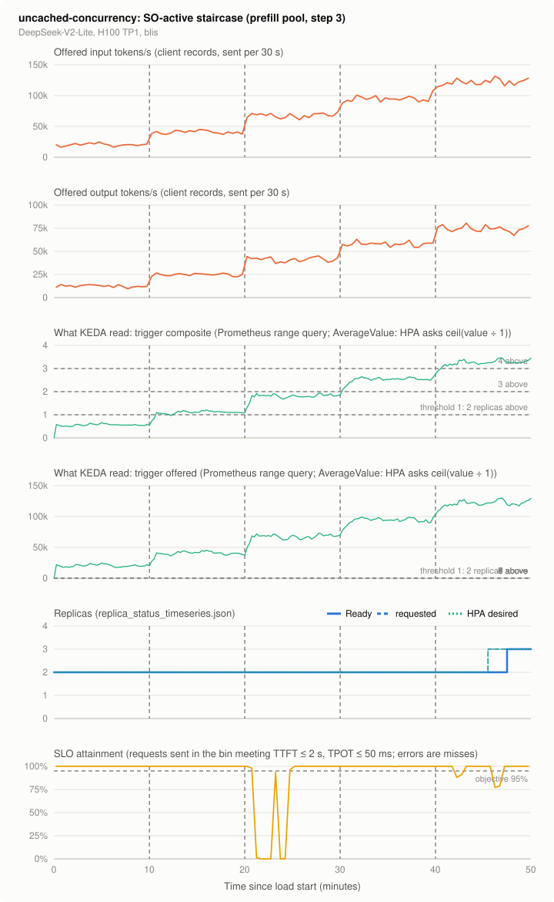
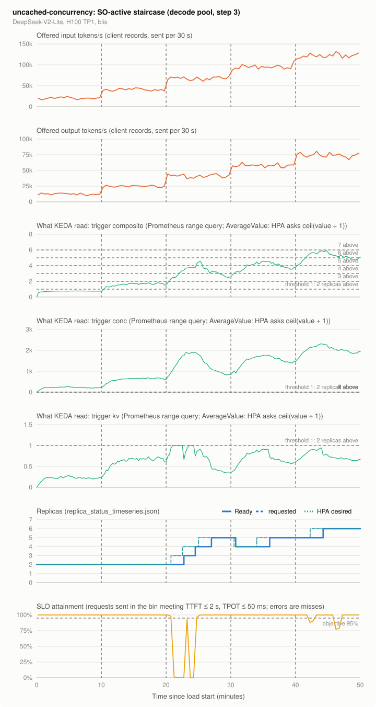

# Step 3, run 2: SO-active staircase (pd-disaggregation/uncached-concurrency)

Part of the [step 3 summary](../../uncached-concurrency-step3.md). Simulator numbers: blis priced this plant; they are not GPU measurements.

| | |
|---|---|
| Plant | blis-signal-lab `25f2dfb` (branch `signals-hpa`) plus task 0545's counter patch; blis-substrate `v0.14.0` catalog entry `deepseek-v2-lite` |
| BLIS scenario | [`deepseek-v2-lite-h100-pd.yaml`](../deepseek-v2-lite-h100-pd.yaml): a `prefill` and a `decode` pool, H100, bf16, TP1 (1 GPU per replica), block size 128, gpu-memory-utilization 0.90, max-model-len 32768, prefix caching on, as the overlay; router [`router/pd-always.yaml`](../router/pd-always.yaml) (always-disagg decider) |
| Cold start | 120 s (`loading_delay`): the protocol's default; this overlay has no GPU measurement |
| Metrics | scrape 15 s (the rendered PodMonitors), `metrics_delay_s` 0 (raw series), HPA sync 15 s, `pollingInterval` 15 s |
| Seed | blis's default (no `--seed`); the load's seed is `schedule.seed` in `blis-run.json` |
| Scenario | `benchmark/config/scenarios/staging/pd-disaggregation/uncached-concurrency.yaml`, rendered with `standup --dry-run`; policy [`policy.json`](policy.json) (calibrated constants, [`scaledobjects-calibrated.yaml`](../scaledobjects-calibrated.yaml)), translated from it ([`terms.json`](../terms.json)) |
| Model | `deepseek-ai/DeepSeek-V2-Lite`, 1 H100 per replica (TP1), both roles |
| SLO | TTFT <= 2 s, TPOT <= 0.05 s; X = 0.95 |
| Run | 2, SO-active staircase |
| Load | `stair` in [`index.json`](../index.json): the blend in five 600 s stages at 0.15, 0.3, 0.5, 0.7 and 0.9 x C (C = 38.766 req/s) |
| Arm | ScaledObjects active, each pool from `minReplicaCount` (2) Ready |
| Gaps exposed | see the summary |
| Memory | peak RSS 23.64 GiB of a 31.09 GiB budget; not killed |
| Raw results | `benchmark/results/step3-uncached-concurrency-20261124/stair/` (not committed) |

The blend in five 600 s stages at 0.15, 0.3, 0.5, 0.7 and 0.9 x C (5.8 to 34.9 req/s). Decode went 2 to 5 Ready in stage 3 and to 6 in stage 5; prefill stayed at 2 until stage 5, then went to 3. A fell to 0.23 in the second two-minute bin of stage 3.
 The trigger panels are the HPA's own reading at each sync, from blis's decision log, not a Prometheus query. Every number is a simulator number. Each run is one sample (n = 1).

## Per stage, prefill pool

| stage | s | set req/s | offered req/s | λ_in tok/s | λ_out tok/s | sent | errors | A | TTFT p50/p90/p99 s | TPOT p50/p90/p99 ms | Ready | need | requested replica-s | Ready replica-s |
|---|---|---|---|---|---|---|---|---|---|---|---|---|---|---|
| 1 | 600 | 5.815 | 5.815 | 20,345 | 12,405 | 3,489 | 0 | 100.0 % | 0.12/0.24/0.36 | 18.4/18.9/19.8 | 2–2 | 1 | 1,200 | 1,200 |
| 2 | 600 | 11.630 | 11.630 | 40,689 | 24,811 | 6,978 | 0 | 100.0 % | 0.15/0.29/0.45 | 26.1/27.0/30.1 | 2–2 | 1 | 1,200 | 1,200 |
| 3 | 600 | 19.383 | 19.385 | 67,822 | 41,355 | 11,631 | 0 | 69.7 % | 0.27/42.15/60.49 | 27.5/36.1/38.7 | 2–2 | 2 | 1,200 | 1,200 |
| 4 | 600 | 27.136 | 27.140 | 94,954 | 57,899 | 16,284 | 0 | 100.0 % | 0.28/0.56/1.02 | 26.9/30.2/31.3 | 2–2 | 2 | 1,200 | 1,200 |
| 5 | 600 | 34.889 | 34.890 | 122,068 | 74,432 | 20,934 | 0 | 96.6 % | 0.48/1.47/2.30 | 27.3/30.4/31.5 | 2–3 | 3 | 1,470 | 1,350 |

- run: 59,316 sent, A 92.9 %, errors 0, requested 6,270 replica-s = 6,270 GPU-s at 1 GPU per replica
- placement: 0 request(s) before the first stage, 0 after the last; stages more than 3 sd off their set rate: none: ok

## Per stage, decode pool

| stage | s | set req/s | offered req/s | λ_in tok/s | λ_out tok/s | sent | errors | A | TTFT p50/p90/p99 s | TPOT p50/p90/p99 ms | Ready | need | requested replica-s | Ready replica-s |
|---|---|---|---|---|---|---|---|---|---|---|---|---|---|---|
| 1 | 600 | 5.815 | 5.815 | 20,345 | 12,405 | 3,489 | 0 | 100.0 % | 0.12/0.24/0.36 | 18.4/18.9/19.8 | 2–2 | 1 | 1,200 | 1,200 |
| 2 | 600 | 11.630 | 11.630 | 40,689 | 24,811 | 6,978 | 0 | 100.0 % | 0.15/0.29/0.45 | 26.1/27.0/30.1 | 2–2 | 2 | 1,200 | 1,200 |
| 3 | 600 | 19.383 | 19.385 | 67,822 | 41,355 | 11,631 | 0 | 69.7 % | 0.27/42.15/60.49 | 27.5/36.1/38.7 | 2–5 | 3 | 2,505 | 2,145 |
| 4 | 600 | 27.136 | 27.140 | 94,954 | 57,899 | 16,284 | 0 | 100.0 % | 0.28/0.56/1.02 | 26.9/30.2/31.3 | 4–5 | 5 | 2,790 | 2,685 |
| 5 | 600 | 34.889 | 34.890 | 122,068 | 74,432 | 20,934 | 0 | 96.6 % | 0.48/1.47/2.30 | 27.3/30.4/31.5 | 5–6 | 6 | 3,465 | 3,345 |

- run: 59,316 sent, A 92.9 %, errors 0, requested 11,160 replica-s = 11,160 GPU-s at 1 GPU per replica
- placement: 0 request(s) before the first stage, 0 after the last; stages more than 3 sd off their set rate: none: ok

## What the run shows

The run shows a problem when replicas do not rise with the stages, or A < X once the pool settled. `need` is `ceil(q / μ_SLO(B))` and does not apply `minReplicaCount` 2; the decode column uses 6.461 req/s, the prefill column 15.328 req/s.

- **Replicas rose with the stages.** Decode Ready per stage: 2, 2, 2–5, 4–5, 5–6 against a need of 1, 2, 3, 5, 6. Prefill: 2, 2, 2, 2, 2–3 against 1, 1, 2, 2, 3.
- **A after settling met X; A in the transient did not.** Stage 3 (19.4 req/s) had A 0.697. Decode had 2 Ready pods when stage 3 began at t = 1,200 s; the third pod was requested at t = 1,245 s (composite 2.02) and Ready at t = 1,380 s, and the pool took until t = 1,470 s to reach 4 Ready and t = 1,620 s to reach 5. A per 120 s bin from the step: 0.50, 0.23, 0.74, then 1.00 from t = 1,560 s (`load-vs-supply-decode.csv`). Stage 5 had A 0.966; its dips were 0.95 at t = 2,520 s (decode 5 Ready, KV at 1.00 before the sixth pod, requested at t = 2,535 s) and 0.89 at t = 2,760 s, when prefill had 2 pods (below; the run did not measure which pool missed).
- **Decode overshot the need in stage 3.** 5 Ready at settled against a need of 3, for about 200 s (back to 4 at t = 1,845 s). The KV guard (`pods * kv / 0.8`) won the max at 1.00 mean KV usage during the step (3.74 to 4.45), then the ITL guard (3.23 to 2.49) as KV fell to 0.35: the concurrency driver `conc / 510` read 1.6 to 3.7 and won only for 30 to 90 s. At 2 pods before the step, `conc / 510` read 1.18 and the composite 1.52 with 302 requests per pod and KV at 0.61: the 1.3 x concurrency constant (510 against 392 at the knee) puts the driver above the knee.
- **Prefill's 900 s scale-up window held the pool at 2 while the trigger asked for 3.** The trigger proposed 3 from t = 1,845 s (stage 4, composite 2.29) and 4 from t = 2,445 s; the third pod was requested at t = 2,730 s and Ready at t = 2,850 s, 885 s after the first proposal. In stage 5, 34.9 req/s x 3,499 tok = 122,068 tok/s is above two pods' 107,256 tok/s (2 x 53,628), and A was 0.89 in the bin at t = 2,760 s.
- Unexplained: none. The decode composite's drop from 5.81 to 0 at t = 3,255 s is the load ending (the last request was sent at t = 3,000 s).

**Outcome: problem shown.** A 0.697 in stage 3 (270 s from the step to 4 Ready decode pods after a step of 7.8 req/s from 2 pods), 0.966 in stage 5 (prefill's 900 s window); the pools followed the staircase and A was 1.000 from t = 1,560 to 2,400 s.

## Amendments

None.
