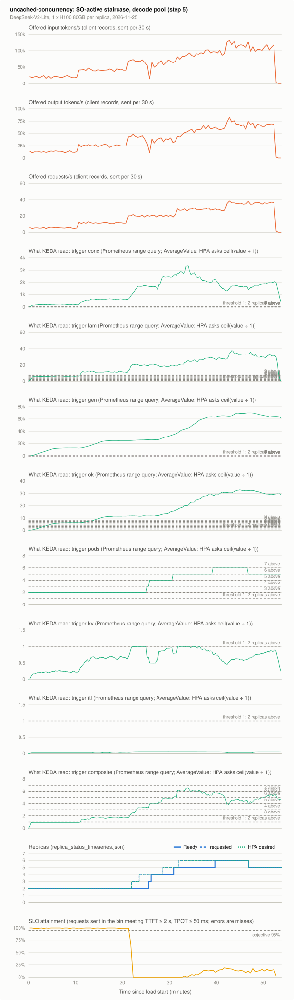
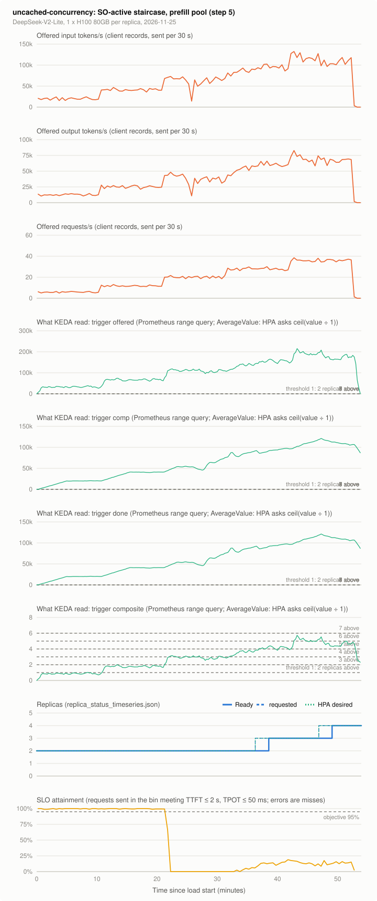

# Step 5, run 2: SO-active staircase (pd-disaggregation/uncached-concurrency)

Part of the [step 5 summary](../../../uncached-concurrency-step5.md).

**Discarded (2026-11-25 12:15 UTC), a failed attempt.** The router's Envoy ran
at its 4-CPU limit from stage 3 on. By the coordinator's decision its limit was
raised to 16 CPU (a plant change after the knees) and run 2 rerun; this report
stays as the evidence for that change.

| | |
|---|---|
| Namespace | `step5-uncached-concurrency-20261125`, Kubernetes v1.32.9 (OpenShift) |
| Scenario / overlay | `staging/pd-disaggregation/uncached-concurrency.yaml` at `2e607e4a` / `ocp/vllm-rdma.yaml` (the `--set` flags are in the summary) |
| Model / GPU | deepseek-ai/DeepSeek-V2-Lite bf16 / 1 × NVIDIA H100 80GB HBM3 per replica, both roles |
| Images, KEDA | as in the summary header |
| SLO | TTFT ≤ 2 s, TPOT ≤ 0.05 s; X = 0.95 |
| Profile / load | [`profile.yaml`](profile.yaml); `stair.csv` (64,108 requests, seed 102; `index.json` entry `stair`: five 630 s stages at 0.15, 0.3, 0.5, 0.7, 0.9 × C = 39.79 req/s), client timeout 311 s; schedule in [`load.json`](load.json) |
| Arm | active: both ScaledObjects pinned at `minReplicaCount` (2) for 300 s, then resumed |
| Session | `villardl-20261125-050105-679` |
| Start / end (UTC) | 2026-11-25 10:01:49 / 2026-11-25 10:55:44 (inference-perf stage 0, with the drain) |
| Raw results | `benchmark/results/villardl-20261125-050105-679/results/inference-perf-1795600896-nrb5uk_1/` (not committed); its `per_request_lifecycle_metrics.json` is slimmed: `chunk_times` and `output_token_times` cut to their first and last entries, which is all TTFT and TPOT need (the full file was too large to copy) |

Five 630 s stages of the blend at 0.15 to 0.9 × C (6.0 to 35.8 req/s), from 2
decode and 2 prefill pods with both ScaledObjects active. Decode follows the
stages one stage late: 2 → 5 pods in stage 3, 6 in stage 4; prefill adds its
third pod 946 s after its trigger asked for it. A is 0.997 in stages 1 and 2
and 0.078 to 0.137 from stage 3 on, with 5,167 failed requests. The prefill
pool's figure is the second one.

## Per stage, decode pool

| stage | s | set req/s | offered req/s | λ_in tok/s | λ_out tok/s | sent | errors | A | TTFT p50/p90/p99 s | TPOT p50/p90/p99 ms | Ready | need | requested replica-s | Ready replica-s |
|---|---|---|---|---|---|---|---|---|---|---|---|---|---|---|
| 1 | 630 | 5.969 | 5.829 | 19,986 | 12,580 | 3,672 | 0 | 99.7 % | 0.22/0.38/0.54 | 16.3/17.1/23.7 | 2–2 | 1 | 1,260 | 1,260 |
| 2 | 630 | 11.938 | 11.738 | 41,185 | 25,209 | 7,395 | 0 | 99.7 % | 0.31/0.45/0.59 | 24.6/25.3/34.3 | 2–2 | 2 | 1,260 | 1,260 |
| 3 | 630 | 19.896 | 20.144 | 62,512 | 37,635 | 12,691 | 1547 error | 7.8 % | 82.35/124.51/173.17 | 36.7/45.6/67.4 | 2–5 | 4 | 2,488 | 1,983 |
| 4 | 630 | 27.854 | 27.932 | 90,236 | 56,533 | 17,597 | 1150 error | 8.3 % | 13.50/36.15/138.46 | 38.4/57.2/83.7 | 5–6 | 5 | 3,748 | 3,290 |
| 5 | 630 | 35.813 | 36.116 | 113,145 | 68,871 | 22,753 | 2470 error | 13.7 % | 9.31/19.95/28.52 | 32.0/50.5/68.2 | 5–6 | 6 | 3,441 | 3,441 |

- run: 64,108 sent, A 25.9 %, errors {'error': 5167}, requested 12,197 replica-s = 12,197 GPU-s at 1 GPU per replica
- placement: 0 request(s) before the first stage, 0 after the last; stages more than 3 sd off their set rate: none: ok

## Per stage, prefill pool

| stage | s | set req/s | offered req/s | λ_in tok/s | λ_out tok/s | sent | errors | A | TTFT p50/p90/p99 s | TPOT p50/p90/p99 ms | Ready | need | requested replica-s | Ready replica-s |
|---|---|---|---|---|---|---|---|---|---|---|---|---|---|---|
| 1 | 630 | 5.969 | 5.829 | 19,986 | 12,580 | 3,672 | 0 | 99.7 % | 0.22/0.38/0.54 | 16.3/17.1/23.7 | 2–2 | 1 | 1,260 | 1,260 |
| 2 | 630 | 11.938 | 11.738 | 41,185 | 25,209 | 7,395 | 0 | 99.7 % | 0.31/0.45/0.59 | 24.6/25.3/34.3 | 2–2 | 1 | 1,260 | 1,260 |
| 3 | 630 | 19.896 | 20.144 | 62,512 | 37,635 | 12,691 | 1547 error | 7.8 % | 82.35/124.51/173.17 | 36.7/45.6/67.4 | 2–2 | 2 | 1,260 | 1,260 |
| 4 | 630 | 27.854 | 27.932 | 90,236 | 56,533 | 17,597 | 1150 error | 8.3 % | 13.50/36.15/138.46 | 38.4/57.2/83.7 | 2–3 | 2 | 1,602 | 1,467 |
| 5 | 630 | 35.813 | 36.116 | 113,145 | 68,871 | 22,753 | 2470 error | 13.7 % | 9.31/19.95/28.52 | 32.0/50.5/68.2 | 3–4 | 3 | 2,229 | 2,096 |

- run: 64,108 sent, A 25.9 %, errors {'error': 5167}, requested 7,612 replica-s = 7,612 GPU-s at 1 GPU per replica
- placement: 0 request(s) before the first stage, 0 after the last; stages more than 3 sd off their set rate: none: ok

- GPU clocks: the lowest SM clock of any GPU the namespace held during the run was 1,980 MHz (DCGM, [`gpu-clocks.txt`](gpu-clocks.txt); a throttled GPU reads 495 MHz).
- the generator kept up: `schedule_delay_seconds` max 7.926 s, p99 1.141 s.
- no eviction, OOM kill or image pull failure of a serving pod during the run ([`events.txt`](events.txt)).

## Triggers per stage

Means over the last 120 s of each stage or phase ([`terms.json`](terms.json), from `triggers/`). `term_*` are the decode formula's four terms; `composite` is each formula evaluated on the exported series (`triggers/<pool>/composite.json`).

| phase | req/s | decode.conc | decode.kv | decode.itl | decode.lam | decode.gen_over_ok | decode.term_conc | decode.term_lam | decode.term_kv | decode.term_itl | decode.composite | prefill.offered | prefill.comp | prefill.done | prefill.composite |
|---|---|---|---|---|---|---|---|---|---|---|---|---|---|---|---|
| 1 | 5.97 | 198 | 0.213 | 0.0235 | 5.79 | 2,149 | 0.389 | 0.695 | 0.532 | 0.94 | 0.94 | 32,842 | 20,360 | 20,360 | 0.875 |
| 2 | 11.9 | 616 | 0.662 | 0.0406 | 11.8 | 2,129 | 1.21 | 1.41 | 1.65 | 1.63 | 1.69 | 68,241 | 40,999 | 40,999 | 1.82 |
| 3 | 19.9 | 2,487 | 0.887 | 0.05 | 19.1 | 2,216 | 4.88 | 2.36 | 4.85 | 4.37 | 4.89 | 108,972 | 69,341 | 69,341 | 2.9 |
| 4 | 27.9 | 1,727 | 0.626 | 0.0458 | 27.7 | 2,147 | 3.39 | 3.33 | 4.69 | 5.49 | 5.49 | 156,115 | 96,228 | 96,228 | 4.16 |
| 5 | 35.8 | 1,969 | 0.846 | 0.0475 | 31.2 | 2,190 | 3.86 | 3.82 | 5.29 | 4.75 | 5.29 | 176,936 | 107,851 | 107,851 | 4.71 |

## What the run shows

The run shows a problem when replicas do not rise with the stages, or A < X
once the pool settled. **Problem shown**: replicas rise with the stages, but A
stays far below X once decode has reached the need, in stages 4 and 5.

- **Decode reacts within about 100 s and is Ready about 180 s later.** Stage 3
  starts at 1,260 s. The decode composite first reads more than 2.2 at
  1,306 s; requested replicas go 2 → 3 at 1,366 s, → 4 at 1,426 s, → 5 at
  1,726 s and → 6 at 1,966 s; Ready follows 180 s after each request (420 s for
  the sixth pod) ([`scale-events.json`](scale-events.json)). Stage 3 (need 4)
  has 2 to 5 Ready, and its A is 0.078: 1,255 requests time out at 311 s and
  TTFT p50 is 82 s. The backlog built while 2 pods served 19.9 req/s
  (3.0 × μ_SLO(B)) does not clear within the stage.
- **The decode drivers read the need.** Over the last 120 s of each stage
  the composite reads 0.94, 1.69, 4.89, 5.49 and 5.29 against needs of 1 (the
  floor is 2), 2, 4, 5 and 6 (ceil(q / 6.632)). In stage 5 it reads one pod
  under the need: the offered-output term reads 3.82 and `conc` 3.86.
- **Prefill waits out its 900 s window (PF6).** The prefill composite first
  reads more than 2.2 at 1,291 s; the third prefill pod is requested at
  2,206 s (915 s later) and Ready at 2,326 s; the fourth at 2,866 s. The prefill
  need is 2, 2, 2, 2 and 3 (`index-prefill.json`, floor 2): prefill reaches 4
  where 3 suffice, since the EPP counts 1.6 × the engine's prompt tokens
  (`offered` 176,936 against λ_in 113,145 in stage 5; PF3).
- **The router fails requests from stage 3 on.** 3,546
  `ClientConnectorError` ("Cannot connect to host"), 30 HTTP 503 and 263
  `ClientPayloadError`, against 1,328 timeouts. The router pod's Envoy used
  up to 4.01 CPU (`container_cpu_usage_seconds_total`, 1 m rate), its limit of
  4; neither container restarted. In stages 4 and 5, with 5 to 6 decode pods
  Ready against needs of 5 and 6, A is 0.083 and 0.137, and most failures are
  connection errors at the router. The run measures the pool and the router
  together: above about 20 req/s of this blend (about 38,000 streamed output
  tokens/s), the router, not the GPU pool, sets A.
- **A decode scale-down under load.** Requested decode replicas go 6 → 5 at
  2,806 s, in stage 5 (need 6), while the composite read 3.78 to 5.70 over the
  preceding 410 s: unexplained. The 263 `ClientPayloadError` (streams cut) are
  all in stage 5.
- Cold start: decode 180 s (4 scale-ups, from the 15 s replica series), once
  420 s; prefill 120 s (2 scale-ups). The loads of runs 8 to 10 were written
  with 186 s (summary, "Lengths").

**Outcome: problem shown** (A 0.078 to 0.137 from 0.5 × C on, with decode at or
one pod under its need from stage 4; the router's Envoy at its CPU limit).

## Amendments

- 2026-11-25 12:15 UTC: discarded as a failed attempt (router at its CPU
  limit); moved from `stair/`. No number in this report changed.
