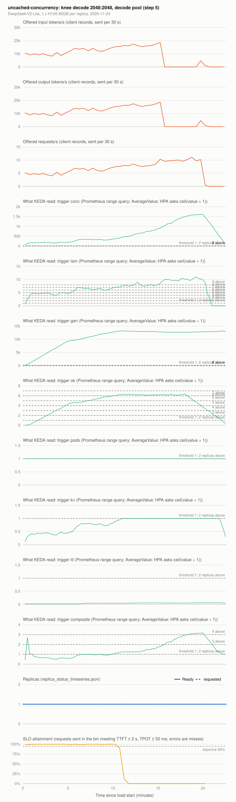
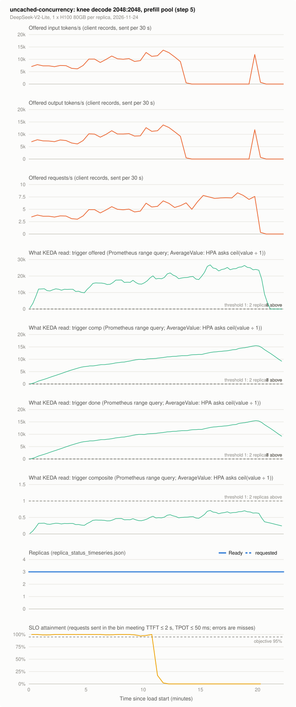

# Step 5, run 1b: knee 2048:2048, decode pool (pd-disaggregation/uncached-concurrency)

Part of the [step 5 summary](../../../uncached-concurrency-step5.md).

| | |
|---|---|
| Namespace | `step5-uncached-concurrency-20261125`, Kubernetes v1.32.9 (OpenShift) |
| Scenario / overlay | `staging/pd-disaggregation/uncached-concurrency.yaml` at `2e607e4a` / `ocp/vllm-rdma.yaml` (the `--set` flags are in the summary) |
| Model / GPU | deepseek-ai/DeepSeek-V2-Lite bf16 / 1 × NVIDIA H100 80GB HBM3 per replica, both roles |
| Images, KEDA | as in the summary header |
| SLO | TTFT ≤ 2 s, TPOT ≤ 0.05 s; X = 0.95 |
| Profile / load | [`profile.yaml`](profile.yaml); `knee-decode-2048x2048.csv` (8,750 requests, seed 1; `gen_load.py knee --mix 2048:2048 --estimate 8`), client timeout 157 s; schedule in [`load.json`](load.json) |
| Arm | pinned (`paused-replicas`): decode 1, prefill 3 |
| Session | `villardl-20261125-010028-650` |
| Start / end (UTC) | 2026-11-25 06:01:13 / 2026-11-25 06:23:48 (inference-perf stage 0, with the drain) |
| Raw results | `benchmark/results/villardl-20261125-010028-650/results/inference-perf-1795586462-yhet5e_1/` (not committed) |

Four 300 s stages of 2048:2048 at 4.8 to 10.0 req/s against one pinned decode
pod, with three prefill pods. A is 0.999 and 0.997 in stages 1 and 2, then
0.192 and 0.000: the decode pod's KV cache fills (mean 0.998 in stage 3) and
requests queue until the 157 s client timeout. The decode composite reads 0.97
in stage 2 and crosses 1.1 only in stage 3. The prefill pool's figure is the
second one.

## Per stage, decode pool

| stage | s | set req/s | offered req/s | λ_in tok/s | λ_out tok/s | sent | errors | A | TTFT p50/p90/p99 s | TPOT p50/p90/p99 ms | Ready | need | requested replica-s | Ready replica-s |
|---|---|---|---|---|---|---|---|---|---|---|---|---|---|---|
| 1 | 300 | 4.800 | 4.727 | 9,680 | 9,676 | 1,418 | 0 | 99.9 % | 0.19/0.22/0.27 | 19.0/19.3/21.8 | 1–1 | – | 300 | 300 |
| 2 | 300 | 6.400 | 6.437 | 13,182 | 13,170 | 1,931 | 0 | 99.7 % | 0.25/0.29/0.37 | 25.3/26.5/28.3 | 1–1 | – | 300 | 300 |
| 3 | 300 | 8.000 | 7.940 | 16,261 | 16,264 | 2,382 | 0 | 19.2 % | 27.45/59.32/76.45 | 33.7/34.3/40.1 | 1–1 | – | 300 | 300 |
| 4 | 300 | 10.000 | 10.063 | 2,376 | 2,368 | 3,019 | 2671 error | 0.0 % | 72.71/109.09/109.94 | 33.9/38.1/43.2 | 1–1 | – | 300 | 300 |

- run: 8,750 sent, A 43.4 %, errors {'error': 2671}, requested 1,200 replica-s = 1,200 GPU-s at 1 GPU per replica
- placement: 0 request(s) before the first stage, 0 after the last; stages more than 3 sd off their set rate: none: ok
- knee: μ_SLO = 6.525 req/s (A crosses 0.95 between stages 2 and 3)

## Per stage, prefill pool

| stage | s | set req/s | offered req/s | λ_in tok/s | λ_out tok/s | sent | errors | A | TTFT p50/p90/p99 s | TPOT p50/p90/p99 ms | Ready | need | requested replica-s | Ready replica-s |
|---|---|---|---|---|---|---|---|---|---|---|---|---|---|---|
| 1 | 300 | 4.800 | 4.727 | 9,680 | 9,676 | 1,418 | 0 | 99.9 % | 0.19/0.22/0.27 | 19.0/19.3/21.8 | 3–3 | – | 900 | 900 |
| 2 | 300 | 6.400 | 6.437 | 13,182 | 13,170 | 1,931 | 0 | 99.7 % | 0.25/0.29/0.37 | 25.3/26.5/28.3 | 3–3 | – | 900 | 900 |
| 3 | 300 | 8.000 | 7.940 | 16,261 | 16,264 | 2,382 | 0 | 19.2 % | 27.45/59.32/76.45 | 33.7/34.3/40.1 | 3–3 | – | 900 | 900 |
| 4 | 300 | 10.000 | 10.063 | 2,376 | 2,368 | 3,019 | 2671 error | 0.0 % | 72.71/109.09/109.94 | 33.9/38.1/43.2 | 3–3 | – | 900 | 900 |

- run: 8,750 sent, A 43.4 %, errors {'error': 2671}, requested 3,600 replica-s = 3,600 GPU-s at 1 GPU per replica
- placement: 0 request(s) before the first stage, 0 after the last; stages more than 3 sd off their set rate: none: ok
- knee: μ_SLO = 6.525 req/s (A crosses 0.95 between stages 2 and 3)

- GPU clocks: the lowest SM clock of any GPU the namespace held during the run was 1,605 MHz (DCGM, [`gpu-clocks.txt`](gpu-clocks.txt); a throttled GPU reads 495 MHz).
- the generator kept up: `schedule_delay_seconds` max 0.077 s, p99 0.031 s.
- no eviction, OOM kill or image pull failure of a serving pod during the run ([`events.txt`](events.txt)).

## Triggers per stage

Means over the last 120 s of each stage or phase ([`terms.json`](terms.json), from `triggers/`). `term_*` are the decode formula's four terms; `composite` is each formula evaluated on the exported series (`triggers/<pool>/composite.json`).

| phase | req/s | decode.conc | decode.kv | decode.itl | decode.lam | decode.gen_over_ok | decode.term_conc | decode.term_lam | decode.term_kv | decode.term_itl | decode.composite | prefill.offered | prefill.comp | prefill.done | prefill.composite |
|---|---|---|---|---|---|---|---|---|---|---|---|---|---|---|---|
| 1 | 4.8 | 180 | 0.421 | 0.0236 | 4.59 | 2,231 | 0.352 | 0.572 | 0.527 | 0.471 | 0.573 | 15,232 | 7,980 | 7,980 | 0.406 |
| 2 | 6.4 | 329 | 0.772 | 0.0464 | 6.38 | 2,138 | 0.645 | 0.761 | 0.964 | 0.928 | 0.969 | 21,167 | 12,642 | 12,642 | 0.564 |
| 3 | 8 | 768 | 0.998 | 0.0559 | 7.8 | 2,100 | 1.51 | 0.914 | 1.25 | 1.12 | 1.51 | 25,876 | 15,666 | 15,666 | 0.689 |
| 4 | 10 | 1,582 | 0.999 | 0.0575 | 10.2 | 2,622 | 3.1 | 1.5 | 1.25 | 1.15 | 3.1 | 34,001 | 19,860 | 19,860 | 0.906 |

## What the run shows

The run shows a problem when stage 1 fails or stage 4 passes. Stage 1 passed
(A 0.999) and stage 4 failed (A 0.000), so μ_SLO(2048:2048, decode) =
**6.525 req/s**, 1.16 × blis's 5.647 req/s (the TCP plant: 4.931).

- **KV binds.** The mean decode KV usage reads 0.421, 0.772, 0.998 and 0.999
  over the last 120 s of the stages, and running + waiting 180, 329, 768 and
  1,582. TPOT p90 stays at or below 38.1 ms; TTFT p90 goes from 0.29 s
  (stage 2) to 59.3 s (stage 3).
- **At this knee all four decode terms read 0.65 to 0.96 per pod**
  (stage 2, 0.99 × μ_SLO): `conc / 510` 0.645, the offered-output term 0.761,
  `kv` 0.964, `itl` 0.928. The composite (0.969) is below the 1.1 the HPA
  needs to add a pod; it crosses 1.1 in stage 3 (1.51, `conc`). On this mix the
  ScaledObject adds the second pod past the knee, as step 1 predicted (P3,
  PF5: the drivers target 1.3 × μ_SLO).
- `gen / ok` reads 2,100 to 2,231 tokens below the knee (the mix's OSL is
  2,048), 2,622 in stage 4.
- The EPP's `offered` over the client's λ_in: 15,232 / 9,680 = 1.57 and
  21,167 / 13,182 = 1.61 (PF3).
- Errors: 2,671, all `TimeoutError` (157 s client timeout), in stages 3 and 4.

**Outcome: as expected; μ_SLO = 6.525 req/s** (the crossing is inside the
stages).

## Amendments

None.
