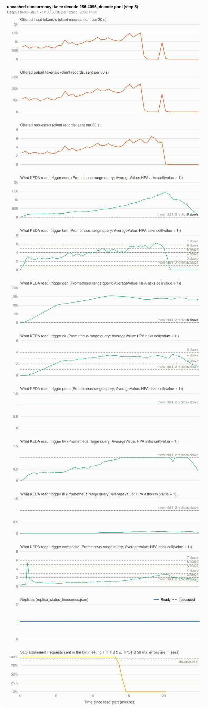
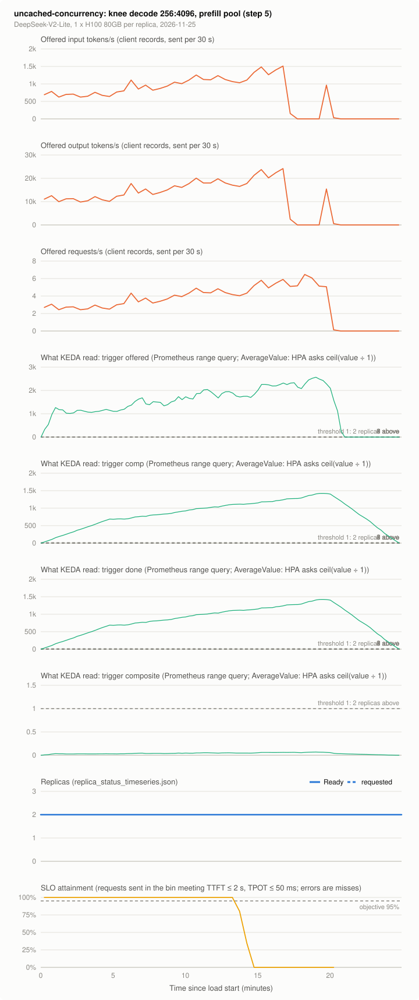

# Step 5, run 1c: knee 256:4096, decode pool (pd-disaggregation/uncached-concurrency)

Part of the [step 5 summary](../../../uncached-concurrency-step5.md).

| | |
|---|---|
| Namespace | `step5-uncached-concurrency-20261125`, Kubernetes v1.32.9 (OpenShift) |
| Scenario / overlay | `staging/pd-disaggregation/uncached-concurrency.yaml` at `2e607e4a` / `ocp/vllm-rdma.yaml` (the `--set` flags are in the summary) |
| Model / GPU | deepseek-ai/DeepSeek-V2-Lite bf16 / 1 × NVIDIA H100 80GB HBM3 per replica, both roles |
| Images, KEDA | as in the summary header |
| SLO | TTFT ≤ 2 s, TPOT ≤ 0.05 s; X = 0.95 |
| Profile / load | [`profile.yaml`](profile.yaml); `knee-decode-256x4096.csv` (4,885 requests, seed 1; `gen_load.py knee --mix 256:4096 --estimate 4.5`), client timeout 311 s; schedule in [`load.json`](load.json) |
| Arm | pinned (`paused-replicas`): decode 1, prefill 2 |
| Session | `villardl-20261125-013553-642` |
| Start / end (UTC) | 2026-11-25 06:36:36 / 2026-11-25 07:01:33 (inference-perf stage 0, with the drain) |
| Raw results | `benchmark/results/villardl-20261125-013553-642/results/inference-perf-1795588586-ziesfa_1/` (not committed) |

Four 300 s stages of 256:4096 at 2.7 to 5.6 req/s against one pinned decode
pod, with two prefill pods. A is 0.999 and 1.000 in stages 1 and 2, then 0.801
and 0.000 as the decode pod's KV cache fills (mean 0.967 in stage 3). The decode
composite reads 0.77 to 0.89 below the knee and 1.24 in stage 3. The prefill
pool's figure is the second one.

## Per stage, decode pool

| stage | s | set req/s | offered req/s | λ_in tok/s | λ_out tok/s | sent | errors | A | TTFT p50/p90/p99 s | TPOT p50/p90/p99 ms | Ready | need | requested replica-s | Ready replica-s |
|---|---|---|---|---|---|---|---|---|---|---|---|---|---|---|
| 1 | 300 | 2.700 | 2.677 | 685 | 10,934 | 803 | 0 | 99.9 % | 0.14/0.16/0.22 | 18.5/18.7/18.7 | 1–1 | – | 300 | 300 |
| 2 | 300 | 3.600 | 3.603 | 922 | 14,762 | 1,081 | 0 | 100.0 % | 0.18/0.22/0.32 | 22.4/24.5/25.5 | 1–1 | – | 300 | 300 |
| 3 | 300 | 4.500 | 4.490 | 1,149 | 18,403 | 1,347 | 0 | 80.1 % | 0.32/15.22/23.60 | 40.6/46.6/48.7 | 1–1 | – | 300 | 300 |
| 4 | 300 | 5.625 | 5.513 | 678 | 10,855 | 1,654 | 859 error | 0.0 % | 71.41/99.51/111.02 | 48.0/56.4/60.6 | 1–1 | – | 300 | 300 |

- run: 4,885 sent, A 60.6 %, errors {'error': 859}, requested 1,200 replica-s = 1,200 GPU-s at 1 GPU per replica
- placement: 0 request(s) before the first stage, 0 after the last; stages more than 3 sd off their set rate: none: ok
- knee: μ_SLO = 3.826 req/s (A crosses 0.95 between stages 2 and 3)

## Per stage, prefill pool

| stage | s | set req/s | offered req/s | λ_in tok/s | λ_out tok/s | sent | errors | A | TTFT p50/p90/p99 s | TPOT p50/p90/p99 ms | Ready | need | requested replica-s | Ready replica-s |
|---|---|---|---|---|---|---|---|---|---|---|---|---|---|---|
| 1 | 300 | 2.700 | 2.677 | 685 | 10,934 | 803 | 0 | 99.9 % | 0.14/0.16/0.22 | 18.5/18.7/18.7 | 2–2 | – | 600 | 600 |
| 2 | 300 | 3.600 | 3.603 | 922 | 14,762 | 1,081 | 0 | 100.0 % | 0.18/0.22/0.32 | 22.4/24.5/25.5 | 2–2 | – | 600 | 600 |
| 3 | 300 | 4.500 | 4.490 | 1,149 | 18,403 | 1,347 | 0 | 80.1 % | 0.32/15.22/23.60 | 40.6/46.6/48.7 | 2–2 | – | 600 | 600 |
| 4 | 300 | 5.625 | 5.513 | 678 | 10,855 | 1,654 | 859 error | 0.0 % | 71.41/99.51/111.02 | 48.0/56.4/60.6 | 2–2 | – | 600 | 600 |

- run: 4,885 sent, A 60.6 %, errors {'error': 859}, requested 2,400 replica-s = 2,400 GPU-s at 1 GPU per replica
- placement: 0 request(s) before the first stage, 0 after the last; stages more than 3 sd off their set rate: none: ok
- knee: μ_SLO = 3.826 req/s (A crosses 0.95 between stages 2 and 3)

- GPU clocks: the lowest SM clock of any GPU the namespace held during the run was 1,500 MHz (DCGM, [`gpu-clocks.txt`](gpu-clocks.txt); a throttled GPU reads 495 MHz).
- the generator kept up: `schedule_delay_seconds` max 0.364 s, p99 0.025 s.
- no eviction, OOM kill or image pull failure of a serving pod during the run ([`events.txt`](events.txt)).

## Triggers per stage

Means over the last 120 s of each stage or phase ([`terms.json`](terms.json), from `triggers/`). `term_*` are the decode formula's four terms; `composite` is each formula evaluated on the exported series (`triggers/<pool>/composite.json`).

| phase | req/s | decode.conc | decode.kv | decode.itl | decode.lam | decode.gen_over_ok | decode.term_conc | decode.term_lam | decode.term_kv | decode.term_itl | decode.composite | prefill.offered | prefill.comp | prefill.done | prefill.composite |
|---|---|---|---|---|---|---|---|---|---|---|---|---|---|---|---|
| 1 | 2.7 | 203 | 0.36 | 0.0235 | 2.68 | 5,085 | 0.398 | 0.76 | 0.449 | 0.471 | 0.766 | 1,113 | 561 | 561 | 0.0297 |
| 2 | 3.6 | 323 | 0.565 | 0.0236 | 3.64 | 4,376 | 0.633 | 0.89 | 0.706 | 0.472 | 0.889 | 1,516 | 854 | 854 | 0.0404 |
| 3 | 4.5 | 621 | 0.967 | 0.0523 | 4.32 | 4,558 | 1.22 | 1.1 | 1.21 | 1.05 | 1.24 | 1,793 | 1,116 | 1,116 | 0.0478 |
| 4 | 5.62 | 1,222 | 0.999 | 0.0859 | 5.73 | 4,132 | 2.4 | 1.32 | 1.25 | 1.72 | 2.4 | 2,385 | 1,378 | 1,378 | 0.0635 |

## What the run shows

The run shows a problem when stage 1 fails or stage 4 passes. Stage 1 passed
(A 0.999) and stage 4 failed (A 0.000), so μ_SLO(256:4096, decode) =
**3.826 req/s**, 0.96 × blis's 4.002 req/s. A request lasts about 4096 × 20 to
45 ms = 80 to 185 s, so a 300 s stage holds under two request lifetimes and this
μ_SLO is an upper bound (run-set.md §2).

- **KV binds.** The mean decode KV usage reads 0.36, 0.565, 0.967 and 0.999
  over the last 120 s of the stages; TPOT p90 goes from 24.5 ms (stage 2) to
  46.6 and 56.4 ms, and TTFT p90 from 0.22 s to 15.2 s (stage 3).
- **The offered-output term is the largest below the knee** (0.76 and 0.89,
  against `conc / 510` 0.40 and 0.63, `kv` 0.45 and 0.71, `itl` 0.47): it
  reads high because `gen / ok` reads 4,376 to 5,085 tokens, above the mix's
  4,096. The two 5 m rates lag differently while the load rises: tokens of
  requests not yet finished are in `gen`, not in `ok`. The composite crosses 1.1
  in stage 3 (1.24).
- At 0.94 × μ_SLO (stage 2) the composite reads 0.89: on this mix the
  ScaledObject adds a pod between the knee and 1.18 × μ_SLO (stage 3), closer to
  the knee than on 8192:256 or 2048:2048 (step 1's `V` across mixes, P3).
- The EPP's `offered` over the client's λ_in: 1,113 / 685 = 1.62 and
  1,516 / 922 = 1.64 (PF3).
- Errors: 859, all `TimeoutError` (311 s client timeout), in stage 4.

**Outcome: as expected; μ_SLO = 3.826 req/s, an upper bound** (the crossing
is inside the stages).

## Amendments

None.
