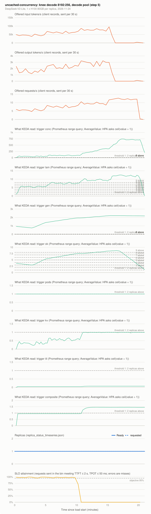
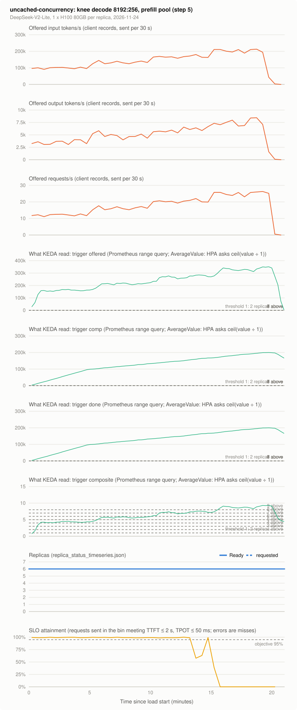

# Step 5, run 1a: knee 8192:256, decode pool (pd-disaggregation/uncached-concurrency)

Part of the [step 5 summary](../../../uncached-concurrency-step5.md).

| | |
|---|---|
| Namespace | `step5-uncached-concurrency-20261125`, Kubernetes v1.32.9 (OpenShift) |
| Scenario / overlay | `staging/pd-disaggregation/uncached-concurrency.yaml` at `2e607e4a` / `ocp/vllm-rdma.yaml` (the `--set` flags are in the summary) |
| Model / GPU | deepseek-ai/DeepSeek-V2-Lite bf16 / 1 × NVIDIA H100 80GB HBM3 per replica, both roles |
| Images, KEDA | as in the summary header |
| SLO | TTFT ≤ 2 s, TPOT ≤ 0.05 s; X = 0.95 |
| Profile / load | [`profile.yaml`](profile.yaml); `knee-decode-8192x256.csv` (22,171 requests, seed 1; `gen_load.py knee --mix 8192:256 --estimate 20.267`), client timeout 60 s; schedule in [`load.json`](load.json) |
| Arm | pinned (`paused-replicas`): decode 1, prefill 6 |
| Session | `villardl-20261124-235855-418` |
| Start / end (UTC) | 2026-11-25 04:59:40 / 2026-11-25 05:20:43 (inference-perf stage 0, with the drain) |
| Raw results | `benchmark/results/villardl-20261124-235855-418/results/inference-perf-1795582768-anwnuc_1/` (not committed) |

Four 300 s stages of 8192:256 at 12.2 to 25.3 req/s against one pinned decode
pod, with six prefill pods. A is 0.993 in stages 1 and 2, 0.910 in stage 3 and
0.037 in stage 4, where the decode pod's KV cache is full (mean 0.993) and
TTFT p90 reaches 47.7 s. The decode composite follows the `kv` term to 1.22
in stage 3. The prefill pool's figure is the second one.

## Per stage, decode pool

| stage | s | set req/s | offered req/s | λ_in tok/s | λ_out tok/s | sent | errors | A | TTFT p50/p90/p99 s | TPOT p50/p90/p99 ms | Ready | need | requested replica-s | Ready replica-s |
|---|---|---|---|---|---|---|---|---|---|---|---|---|---|---|
| 1 | 300 | 12.160 | 12.097 | 99,096 | 3,492 | 3,629 | 0 | 99.3 % | 0.35/0.46/0.62 | 15.1/16.5/25.1 | 1–1 | – | 300 | 300 |
| 2 | 300 | 16.214 | 16.253 | 133,147 | 4,866 | 4,876 | 0 | 99.3 % | 0.40/0.52/0.66 | 19.8/20.6/30.6 | 1–1 | – | 300 | 300 |
| 3 | 300 | 20.267 | 20.397 | 167,089 | 6,023 | 6,119 | 0 | 91.0 % | 0.54/1.85/2.87 | 25.9/29.3/43.9 | 1–1 | – | 300 | 300 |
| 4 | 300 | 25.334 | 25.157 | 187,515 | 6,873 | 7,547 | 680 error | 3.7 % | 26.45/47.70/53.94 | 28.9/29.4/44.0 | 1–1 | – | 300 | 300 |

- run: 22,171 sent, A 64.5 %, errors {'error': 680}, requested 1,200 replica-s = 1,200 GPU-s at 1 GPU per replica
- placement: 0 request(s) before the first stage, 0 after the last; stages more than 3 sd off their set rate: none: ok
- knee: μ_SLO = 18.402 req/s (A crosses 0.95 between stages 2 and 3)

## Per stage, prefill pool

| stage | s | set req/s | offered req/s | λ_in tok/s | λ_out tok/s | sent | errors | A | TTFT p50/p90/p99 s | TPOT p50/p90/p99 ms | Ready | need | requested replica-s | Ready replica-s |
|---|---|---|---|---|---|---|---|---|---|---|---|---|---|---|
| 1 | 300 | 12.160 | 12.097 | 99,096 | 3,492 | 3,629 | 0 | 99.3 % | 0.35/0.46/0.62 | 15.1/16.5/25.1 | 6–6 | – | 1,800 | 1,800 |
| 2 | 300 | 16.214 | 16.253 | 133,147 | 4,866 | 4,876 | 0 | 99.3 % | 0.40/0.52/0.66 | 19.8/20.6/30.6 | 6–6 | – | 1,800 | 1,800 |
| 3 | 300 | 20.267 | 20.397 | 167,089 | 6,023 | 6,119 | 0 | 91.0 % | 0.54/1.85/2.87 | 25.9/29.3/43.9 | 6–6 | – | 1,800 | 1,800 |
| 4 | 300 | 25.334 | 25.157 | 187,515 | 6,873 | 7,547 | 680 error | 3.7 % | 26.45/47.70/53.94 | 28.9/29.4/44.0 | 6–6 | – | 1,800 | 1,800 |

- run: 22,171 sent, A 64.5 %, errors {'error': 680}, requested 7,200 replica-s = 7,200 GPU-s at 1 GPU per replica
- placement: 0 request(s) before the first stage, 0 after the last; stages more than 3 sd off their set rate: none: ok
- knee: μ_SLO = 18.402 req/s (A crosses 0.95 between stages 2 and 3)

- GPU clocks: the lowest SM clock of any GPU the namespace held during the run was 1,290 MHz (DCGM, [`gpu-clocks.txt`](gpu-clocks.txt); a throttled GPU reads 495 MHz).
- the generator kept up: `schedule_delay_seconds` max 0.430 s, p99 0.153 s.
- no eviction, OOM kill or image pull failure of a serving pod during the run ([`events.txt`](events.txt)).

## Triggers per stage

Means over the last 120 s of each stage or phase ([`terms.json`](terms.json), from `triggers/`). `term_*` are the decode formula's four terms; `composite` is each formula evaluated on the exported series (`triggers/<pool>/composite.json`).

| phase | req/s | decode.conc | decode.kv | decode.itl | decode.lam | decode.gen_over_ok | decode.term_conc | decode.term_lam | decode.term_kv | decode.term_itl | decode.composite | prefill.offered | prefill.comp | prefill.done | prefill.composite |
|---|---|---|---|---|---|---|---|---|---|---|---|---|---|---|---|
| 1 | 12.2 | 45.6 | 0.287 | 0.0235 | 12.2 | 258 | 0.0895 | 0.176 | 0.359 | 0.47 | 0.471 | 161,963 | 82,372 | 82,372 | 4.31 |
| 2 | 16.2 | 80.8 | 0.508 | 0.0235 | 16.1 | 257 | 0.158 | 0.231 | 0.635 | 0.471 | 0.635 | 214,112 | 126,868 | 126,868 | 5.7 |
| 3 | 20.3 | 170 | 0.975 | 0.0459 | 21 | 257 | 0.333 | 0.301 | 1.22 | 0.918 | 1.22 | 278,214 | 162,353 | 162,353 | 7.41 |
| 4 | 25.3 | 1,033 | 0.993 | 0.0476 | 25.4 | 256 | 2.03 | 0.363 | 1.24 | 0.951 | 2.03 | 336,741 | 196,791 | 196,791 | 8.97 |

## What the run shows

The run shows a problem when stage 1 fails or stage 4 passes. Stage 1 passed
(A 0.993) and stage 4 failed (A 0.037), so μ_SLO(8192:256, decode) =
**18.402 req/s**, 0.91 × blis's 20.267 req/s (13.9 × the TCP plant's 1.328).

- **KV binds.** The mean decode KV usage reads 0.287, 0.508, 0.975 and 0.993
  over the last 120 s of the four stages; running + waiting reads 45.6, 80.8,
  170 and 1,033. TPOT p90 stays at or below 29.4 ms; TTFT p90 goes from 0.52 s
  (stage 2) to 1.85 s (stage 3) and 47.7 s (stage 4).
- **The KV guard sizes decode on this mix (PF10).** Over the stages
  `conc / 510` reads 0.09 to 0.33 and the offered-output term 0.18 to 0.30;
  `kv` reads 0.36 to 1.22 and `itl` 0.47 to 0.95. The composite crosses the
  HPA's 1.1 tolerance only in stage 3 (1.22, set by `kv`), past the knee.
- **`itl` reads 0.0235 s below the knee and 0.046 to 0.048 s past it**, so
  its term is 0.47 per pod at 0.66 to 0.88 × μ_SLO (PF8 predicted 0.58 at the
  knee); it does not cross 1.1 in this run.
- **The EPP counts 1.6 × the client's prompt tokens** (PF3): prefill
  `offered` over the client's λ_in reads 161,963 / 99,096 = 1.63 in stage 1
  and 1.61 in stage 2; `comp` and `done` (5 m rates) read 82,372 and 126,868
  tok/s. The prefill composite reads 4.31 at 12.2 req/s: on this mix the
  prefill ScaledObject would ask for its cap of 4 at about 11 req/s.
- Errors: 680, all `TimeoutError` (60 s client timeout), in stage 4.

**Outcome: as expected; μ_SLO = 18.402 req/s** (the crossing is inside the
stages).

## Amendments

None.
