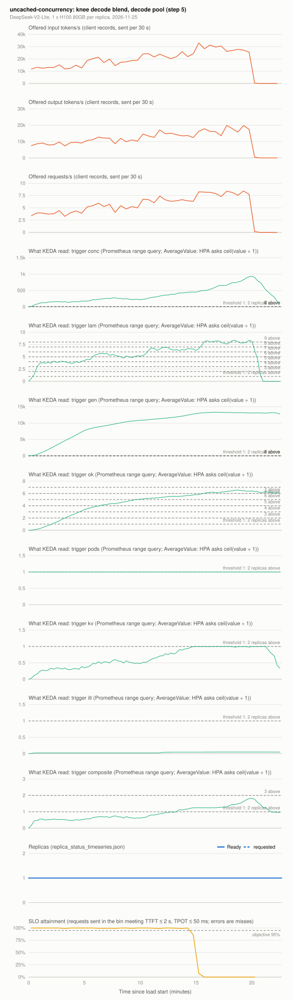
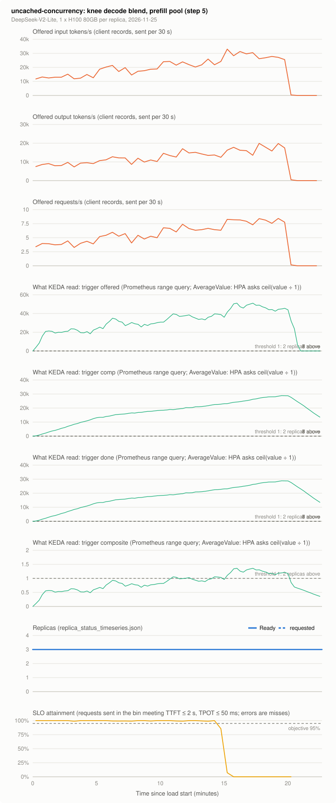

# Step 5, run 1d: knee blend, decode pool (pd-disaggregation/uncached-concurrency)

Part of the [step 5 summary](../../../uncached-concurrency-step5.md).

| | |
|---|---|
| Namespace | `step5-uncached-concurrency-20261125`, Kubernetes v1.32.9 (OpenShift) |
| Scenario / overlay | `staging/pd-disaggregation/uncached-concurrency.yaml` at `2e607e4a` / `ocp/vllm-rdma.yaml` (the `--set` flags are in the summary) |
| Model / GPU | deepseek-ai/DeepSeek-V2-Lite bf16 / 1 × NVIDIA H100 80GB HBM3 per replica, both roles |
| Images, KEDA | as in the summary header |
| SLO | TTFT ≤ 2 s, TPOT ≤ 0.05 s; X = 0.95 |
| Profile / load | [`profile.yaml`](profile.yaml); `knee-decode-blend.csv` (7,109 requests, seed 1; each request's mix drawn from 8192:256, 2048:2048, 256:4096 with equal weight; `gen_load.py knee --mix blend --estimate 6.397`), client timeout 311 s; schedule in [`load.json`](load.json) |
| Arm | pinned (`paused-replicas`): decode 1, prefill 3 |
| Session | `villardl-20261125-021734-903` |
| Start / end (UTC) | 2026-11-25 07:18:18 / 2026-11-25 07:40:58 (inference-perf stage 0, with the drain) |
| Raw results | `benchmark/results/villardl-20261125-021734-903/results/inference-perf-1795591087-mcor8n_1/` (not committed) |

Four 300 s stages of the blend at 3.8 to 8.0 req/s against one pinned decode
pod, with three prefill pods. A is 0.999, 0.997 and 0.981 in stages 1 to 3 and
0.007 in stage 4, where the decode pod's KV cache is full (mean 0.992) and TTFT
p90 reaches 71 s. The decode composite crosses 1.1 in stage 3 (1.13, the `kv`
term). The prefill pool's figure is the second one.

## Per stage, decode pool

| stage | s | set req/s | offered req/s | λ_in tok/s | λ_out tok/s | sent | errors | A | TTFT p50/p90/p99 s | TPOT p50/p90/p99 ms | Ready | need | requested replica-s | Ready replica-s |
|---|---|---|---|---|---|---|---|---|---|---|---|---|---|---|
| 1 | 300 | 3.838 | 3.890 | 13,071 | 8,656 | 1,167 | 0 | 99.9 % | 0.20/0.35/0.51 | 18.3/19.7/20.7 | 1–1 | – | 300 | 300 |
| 2 | 300 | 5.118 | 5.207 | 18,384 | 11,065 | 1,562 | 0 | 99.7 % | 0.23/0.37/0.47 | 22.0/22.9/31.5 | 1–1 | – | 300 | 300 |
| 3 | 300 | 6.397 | 6.587 | 23,020 | 14,186 | 1,976 | 0 | 98.1 % | 0.31/0.47/3.14 | 29.8/34.3/38.3 | 1–1 | – | 300 | 300 |
| 4 | 300 | 7.996 | 8.013 | 28,621 | 17,070 | 2,404 | 0 | 0.7 % | 31.86/71.21/74.35 | 35.6/37.4/51.1 | 1–1 | – | 300 | 300 |

- run: 7,109 sent, A 65.8 %, errors 0, requested 1,200 replica-s = 1,200 GPU-s at 1 GPU per replica
- placement: 0 request(s) before the first stage, 0 after the last; stages more than 3 sd off their set rate: none: ok
- knee: μ_SLO = 6.632 req/s (A crosses 0.95 between stages 3 and 4)

## Per stage, prefill pool

| stage | s | set req/s | offered req/s | λ_in tok/s | λ_out tok/s | sent | errors | A | TTFT p50/p90/p99 s | TPOT p50/p90/p99 ms | Ready | need | requested replica-s | Ready replica-s |
|---|---|---|---|---|---|---|---|---|---|---|---|---|---|---|
| 1 | 300 | 3.838 | 3.890 | 13,071 | 8,656 | 1,167 | 0 | 99.9 % | 0.20/0.35/0.51 | 18.3/19.7/20.7 | 3–3 | – | 900 | 900 |
| 2 | 300 | 5.118 | 5.207 | 18,384 | 11,065 | 1,562 | 0 | 99.7 % | 0.23/0.37/0.47 | 22.0/22.9/31.5 | 3–3 | – | 900 | 900 |
| 3 | 300 | 6.397 | 6.587 | 23,020 | 14,186 | 1,976 | 0 | 98.1 % | 0.31/0.47/3.14 | 29.8/34.3/38.3 | 3–3 | – | 900 | 900 |
| 4 | 300 | 7.996 | 8.013 | 28,621 | 17,070 | 2,404 | 0 | 0.7 % | 31.86/71.21/74.35 | 35.6/37.4/51.1 | 3–3 | – | 900 | 900 |

- run: 7,109 sent, A 65.8 %, errors 0, requested 3,600 replica-s = 3,600 GPU-s at 1 GPU per replica
- placement: 0 request(s) before the first stage, 0 after the last; stages more than 3 sd off their set rate: none: ok
- knee: μ_SLO = 6.632 req/s (A crosses 0.95 between stages 3 and 4)

- GPU clocks: the lowest SM clock of any GPU the namespace held during the run was 1,620 MHz (DCGM, [`gpu-clocks.txt`](gpu-clocks.txt); a throttled GPU reads 495 MHz).
- the generator kept up: `schedule_delay_seconds` max 0.289 s, p99 0.120 s.
- no eviction, OOM kill or image pull failure of a serving pod during the run ([`events.txt`](events.txt)).

## Triggers per stage

Means over the last 120 s of each stage or phase ([`terms.json`](terms.json), from `triggers/`). `term_*` are the decode formula's four terms; `composite` is each formula evaluated on the exported series (`triggers/<pool>/composite.json`).

| phase | req/s | decode.conc | decode.kv | decode.itl | decode.lam | decode.gen_over_ok | decode.term_conc | decode.term_lam | decode.term_kv | decode.term_itl | decode.composite | prefill.offered | prefill.comp | prefill.done | prefill.composite |
|---|---|---|---|---|---|---|---|---|---|---|---|---|---|---|---|
| 1 | 3.84 | 156 | 0.323 | 0.0235 | 3.9 | 2,302 | 0.307 | 0.501 | 0.403 | 0.47 | 0.501 | 21,177 | 10,016 | 10,016 | 0.564 |
| 2 | 5.12 | 240 | 0.52 | 0.0236 | 5.01 | 2,196 | 0.471 | 0.615 | 0.65 | 0.473 | 0.651 | 28,410 | 17,363 | 17,363 | 0.757 |
| 3 | 6.4 | 427 | 0.901 | 0.0474 | 6.48 | 2,182 | 0.837 | 0.789 | 1.13 | 0.948 | 1.13 | 36,498 | 21,882 | 21,882 | 0.972 |
| 4 | 8 | 796 | 0.992 | 0.0495 | 8.06 | 2,041 | 1.56 | 0.919 | 1.24 | 0.991 | 1.56 | 44,889 | 28,157 | 28,157 | 1.2 |

## What the run shows

The run shows a problem when stage 1 fails or stage 4 passes. Stage 1 passed
(A 0.999) and stage 4 failed (A 0.007), so μ_SLO(B, decode) =
**6.632 req/s**, 1.03 × blis's 6.461 req/s, and 1.04 × the estimate from the
per-mix knees (6.397, run-set.md §2). C for the decode pool is 6 × 6.632 =
39.79 req/s.

- **KV binds the blend.** The mean decode KV usage reads 0.323, 0.52, 0.901 and
  0.992 over the last 120 s of the stages; TPOT p90 stays at or below 37.4 ms.
- **What the scenario's calibration rules give on this plant.** Running +
  waiting at the knee, interpolated between stage 3 (427 at 6.587 req/s) and
  stage 4 (796 at 8.013), is 439 requests: task 0545's rule (1.3 ×) gives
  `conc / 570`, against the scenario's 510 (blis: 392 → 510). The completions
  rule gives 1.3 × 6.632 = 8.62 req/s, against 8.4. The mean OSL stays 2,133
  and the ITL SLO 0.05 s. Per the coordinator's decision these are reported,
  not applied: the live ScaledObject keeps 510 and 8.4.
- **The `kv` guard decides at the knee.** In stage 3 (0.99 × μ_SLO) the terms
  read `conc / 510` 0.837, offered output 0.789, `kv` 1.13, `itl` 0.948; the
  composite (1.13) crosses the HPA's 1.1 tolerance through `kv`. In stage 2
  (0.79 × μ_SLO) the composite is 0.651. With 510 and 8.4 the drivers alone
  would cross 1.1 only between stages 3 and 4 (`conc` 1.56 in stage 4): the
  driver targets sit past this plant's knee, as step 1 predicted (P3, PF5),
  and the KV guard closes most of the gap.
- `gen / ok` reads 2,041 to 2,302 tokens (the blend's mean OSL is 2,133).
- The EPP's `offered` over the client's λ_in: 21,177 / 13,071 = 1.62,
  28,410 / 18,384 = 1.55 (PF3).
- Errors: 0. Stage 4 requests were slow, not failed: the 311 s timeout is
  longer than the slowest one.

**Outcome: as expected; μ_SLO(B, decode) = 6.632 req/s** (the crossing is
inside the stages).

## Amendments

None.
