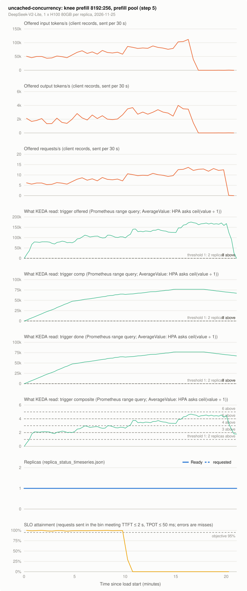
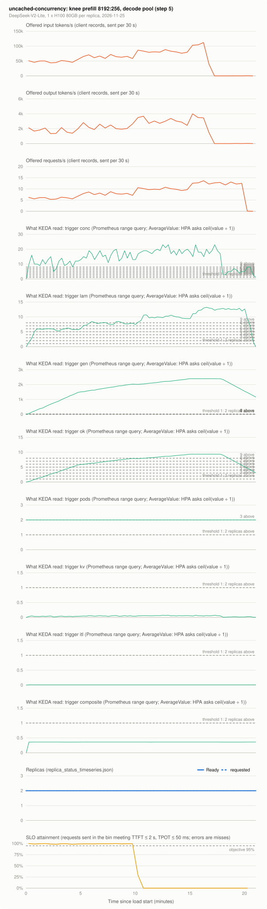

# Step 5, run 1e: knee 8192:256, prefill pool (pd-disaggregation/uncached-concurrency)

Part of the [step 5 summary](../../../uncached-concurrency-step5.md).

| | |
|---|---|
| Namespace | `step5-uncached-concurrency-20261125`, Kubernetes v1.32.9 (OpenShift) |
| Scenario / overlay | `staging/pd-disaggregation/uncached-concurrency.yaml` at `2e607e4a` / `ocp/vllm-rdma.yaml` (the `--set` flags are in the summary) |
| Model / GPU | deepseek-ai/DeepSeek-V2-Lite bf16 / 1 × NVIDIA H100 80GB HBM3 per replica, both roles |
| Images, KEDA | as in the summary header |
| SLO | TTFT ≤ 2 s, TPOT ≤ 0.05 s; X = 0.95 |
| Profile / load | [`profile.yaml`](profile.yaml); `knee-prefill-8192x256.csv` (10,932 requests, seed 1; `gen_load.py knee --mix 8192:256 --estimate 10`), client timeout 60 s; schedule in [`load.json`](load.json) |
| Arm | pinned (`paused-replicas`): prefill 1, decode 2 |
| Session | `villardl-20261125-032754-652` |
| Start / end (UTC) | 2026-11-25 08:28:37 / 2026-11-25 08:49:40 (inference-perf stage 0, with the drain) |
| Raw results | `benchmark/results/villardl-20261125-032754-652/results/inference-perf-1795595306-hbahew_1/` (not committed) |

Four 300 s stages of 8192:256 at 6.0 to 12.5 req/s against one pinned prefill
pod, with two decode pods. A is 0.992 and 0.995 in stages 1 and 2, then 0.029
and 0.000: the prefill pod's computed prompt tokens level off at about 73,600
tok/s (`comp`, 5 m rate) while the router's `offered` keeps rising to
166,736 tok/s. The prefill composite reads 2.05 to 4.44. The decode pool's
figure is the second one.

## Per stage, prefill pool

| stage | s | set req/s | offered req/s | λ_in tok/s | λ_out tok/s | sent | errors | A | TTFT p50/p90/p99 s | TPOT p50/p90/p99 ms | Ready | need | requested replica-s | Ready replica-s |
|---|---|---|---|---|---|---|---|---|---|---|---|---|---|---|
| 1 | 300 | 6.000 | 5.960 | 48,824 | 1,748 | 1,788 | 0 | 99.2 % | 0.33/0.56/0.88 | 6.4/7.4/17.1 | 1–1 | – | 300 | 300 |
| 2 | 300 | 8.000 | 7.880 | 64,553 | 2,267 | 2,364 | 0 | 99.5 % | 0.46/0.94/1.45 | 7.3/8.0/11.3 | 1–1 | – | 300 | 300 |
| 3 | 300 | 10.000 | 9.997 | 81,893 | 3,045 | 2,999 | 0 | 2.9 % | 11.68/19.69/20.84 | 7.8/8.3/12.2 | 1–1 | – | 300 | 300 |
| 4 | 300 | 12.500 | 12.603 | 35,553 | 1,233 | 3,781 | 2479 error | 0.0 % | 39.09/55.69/58.30 | 7.8/8.4/12.1 | 1–1 | – | 300 | 300 |

- run: 10,932 sent, A 38.5 %, errors {'error': 2479}, requested 1,200 replica-s = 1,200 GPU-s at 1 GPU per replica
- placement: 0 request(s) before the first stage, 0 after the last; stages more than 3 sd off their set rate: none: ok
- knee: μ_SLO = 7.978 req/s (A crosses 0.95 between stages 2 and 3)

## Per stage, decode pool

| stage | s | set req/s | offered req/s | λ_in tok/s | λ_out tok/s | sent | errors | A | TTFT p50/p90/p99 s | TPOT p50/p90/p99 ms | Ready | need | requested replica-s | Ready replica-s |
|---|---|---|---|---|---|---|---|---|---|---|---|---|---|---|
| 1 | 300 | 6.000 | 5.960 | 48,824 | 1,748 | 1,788 | 0 | 99.2 % | 0.33/0.56/0.88 | 6.4/7.4/17.1 | 2–2 | – | 600 | 600 |
| 2 | 300 | 8.000 | 7.880 | 64,553 | 2,267 | 2,364 | 0 | 99.5 % | 0.46/0.94/1.45 | 7.3/8.0/11.3 | 2–2 | – | 600 | 600 |
| 3 | 300 | 10.000 | 9.997 | 81,893 | 3,045 | 2,999 | 0 | 2.9 % | 11.68/19.69/20.84 | 7.8/8.3/12.2 | 2–2 | – | 600 | 600 |
| 4 | 300 | 12.500 | 12.603 | 35,553 | 1,233 | 3,781 | 2479 error | 0.0 % | 39.09/55.69/58.30 | 7.8/8.4/12.1 | 2–2 | – | 600 | 600 |

- run: 10,932 sent, A 38.5 %, errors {'error': 2479}, requested 2,400 replica-s = 2,400 GPU-s at 1 GPU per replica
- placement: 0 request(s) before the first stage, 0 after the last; stages more than 3 sd off their set rate: none: ok
- knee: μ_SLO = 7.978 req/s (A crosses 0.95 between stages 2 and 3)

- GPU clocks: the lowest SM clock of any GPU the namespace held during the run was 1,500 MHz (DCGM, [`gpu-clocks.txt`](gpu-clocks.txt); a throttled GPU reads 495 MHz).
- the generator kept up: `schedule_delay_seconds` max 0.264 s, p99 0.130 s.
- no eviction, OOM kill or image pull failure of a serving pod during the run ([`events.txt`](events.txt)).

## Triggers per stage

Means over the last 120 s of each stage or phase ([`terms.json`](terms.json), from `triggers/`). `term_*` are the decode formula's four terms; `composite` is each formula evaluated on the exported series (`triggers/<pool>/composite.json`).

| phase | req/s | decode.conc | decode.kv | decode.itl | decode.lam | decode.gen_over_ok | decode.term_conc | decode.term_lam | decode.term_kv | decode.term_itl | decode.composite | prefill.offered | prefill.comp | prefill.done | prefill.composite |
|---|---|---|---|---|---|---|---|---|---|---|---|---|---|---|---|
| 1 | 6 | 11.1 | 0.035 | 0.00901 | 5.81 | 257 | 0.0218 | 0.0834 | 0.0874 | 0.361 | 0.361 | 77,116 | 38,833 | 38,833 | 2.05 |
| 2 | 8 | 16.1 | 0.0508 | 0.00903 | 7.92 | 256 | 0.0316 | 0.113 | 0.127 | 0.361 | 0.361 | 105,182 | 62,579 | 62,579 | 2.8 |
| 3 | 10 | 18.9 | 0.0594 | 0.00903 | 9.93 | 256 | 0.037 | 0.142 | 0.149 | 0.361 | 0.361 | 131,791 | 73,591 | 73,591 | 3.51 |
| 4 | 12.5 | 4.75 | 0.0148 | 0.00901 | 12.6 | 273 | 0.00931 | 0.191 | 0.0371 | 0.36 | 0.36 | 166,736 | 73,290 | 73,290 | 4.44 |

## What the run shows

The run shows a problem when stage 1 fails or stage 4 passes. Stage 1 passed
(A 0.992) and stage 4 failed (A 0.000), so μ_SLO(8192:256, prefill) =
**7.978 req/s**, 65,356 prompt tokens/s per pod: 1.31 × blis's 6.095 req/s
(49,930 tok/s).

- **Prefill compute binds.** TTFT p90 goes from 0.94 s (stage 2) to 19.7 s
  (stage 3); TPOT stays at or below 8.4 ms p90 (decode has 2 pods for a mix
  it serves at 18.4 req/s per pod). `comp` and `done` level off at 73,591 and
  73,290 tok/s in stages 3 and 4: the most one pod computed.
- **The `offered` driver does not saturate (P5).** It reads 131,791 and
  166,736 tok/s in stages 3 and 4 while the served tokens stay flat: under
  overload the prefill ask keeps growing with the offered load.
- **The prefill ask is 2.8 pods at this pod's knee.** Between stage 2
  (2.80 at 7.88 req/s) and stage 3 (3.51), the composite reads about 2.8 at
  μ_SLO, where the formula is meant to read 1 / 0.7 = 1.43. Two factors: the
  EPP counts 1.6 × the engine's prompt tokens (`offered` / λ_in = 1.58 and
  1.63 in stages 1 and 2; PF3), and the divisor 37,540 is 0.57 × this pod's
  65,356 tok/s, not 0.7. The calibration rule names the blend's knee (run 1f).
- Errors: 2,479 `TimeoutError` (60 s client timeout), in stages 3 and 4.

**Outcome: as expected; μ_SLO = 7.978 req/s** (the crossing is inside the
stages).

## Amendments

None.
