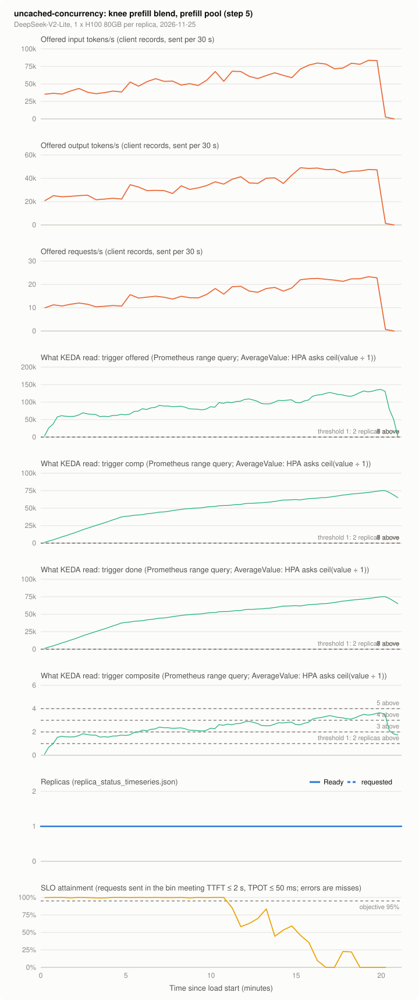
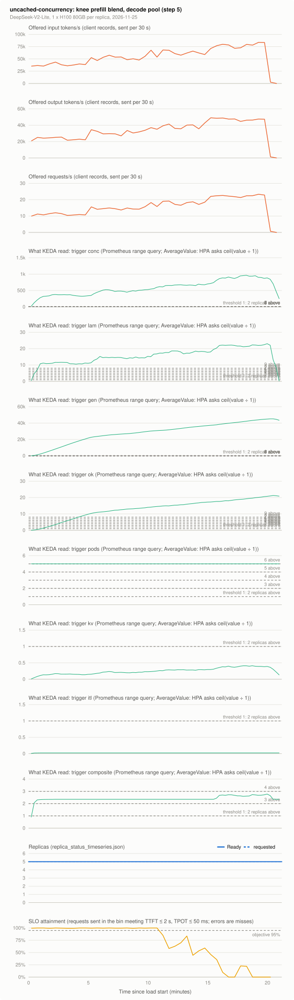

# Step 5, run 1f: knee blend, prefill pool (pd-disaggregation/uncached-concurrency)

Part of the [step 5 summary](../../../uncached-concurrency-step5.md).

| | |
|---|---|
| Namespace | `step5-uncached-concurrency-20261125`, Kubernetes v1.32.9 (OpenShift) |
| Scenario / overlay | `staging/pd-disaggregation/uncached-concurrency.yaml` at `2e607e4a` / `ocp/vllm-rdma.yaml` (the `--set` flags are in the summary) |
| Model / GPU | deepseek-ai/DeepSeek-V2-Lite bf16 / 1 × NVIDIA H100 80GB HBM3 per replica, both roles |
| Images, KEDA | as in the summary header |
| SLO | TTFT ≤ 2 s, TPOT ≤ 0.05 s; X = 0.95 |
| Profile / load | [`profile.yaml`](profile.yaml); `knee-prefill-blend.csv` (19,748 requests, seed 1; `gen_load.py knee --mix blend --estimate 18`), client timeout 311 s; schedule in [`load.json`](load.json) |
| Arm | pinned (`paused-replicas`): prefill 1, decode 5 |
| Session | `villardl-20261125-035941-108` |
| Start / end (UTC) | 2026-11-25 09:00:26 / 2026-11-25 09:21:38 (inference-perf stage 0, with the drain) |
| Raw results | `benchmark/results/villardl-20261125-035941-108/results/inference-perf-1795597212-x9gm9y_1/` (not committed); its `per_request_lifecycle_metrics.json` is slimmed: `chunk_times` and `output_token_times` cut to their first and last entries, which is all TTFT and TPOT need (the full file was too large to copy) |

Four 300 s stages of the blend at 10.8 to 22.5 req/s against one pinned
prefill pod, with five decode pods. A is 0.997 and 0.998 in stages 1 and 2,
then 0.712 and 0.133 as prefill TTFT grows (p90 3.73 s, then 12.98 s). The
prefill composite reads 1.64 to 3.42. The decode pool's figure is the second
one.

## Per stage, prefill pool

| stage | s | set req/s | offered req/s | λ_in tok/s | λ_out tok/s | sent | errors | A | TTFT p50/p90/p99 s | TPOT p50/p90/p99 ms | Ready | need | requested replica-s | Ready replica-s |
|---|---|---|---|---|---|---|---|---|---|---|---|---|---|---|
| 1 | 300 | 10.800 | 10.983 | 38,229 | 23,483 | 3,295 | 0 | 99.7 % | 0.31/0.50/0.80 | 14.9/15.3/21.9 | 1–1 | – | 300 | 300 |
| 2 | 300 | 14.400 | 14.677 | 51,955 | 31,338 | 4,403 | 0 | 99.8 % | 0.32/0.55/0.85 | 16.3/16.7/22.8 | 1–1 | – | 300 | 300 |
| 3 | 300 | 18.000 | 17.813 | 62,480 | 38,216 | 5,344 | 3 error | 71.2 % | 1.02/3.73/7.50 | 17.7/18.7/26.2 | 1–1 | – | 300 | 300 |
| 4 | 300 | 22.500 | 22.353 | 77,679 | 47,418 | 6,706 | 83 error | 13.3 % | 5.60/12.98/19.44 | 20.0/22.7/31.6 | 1–1 | – | 300 | 300 |

- run: 19,748 sent, A 62.7 %, errors {'error': 86}, requested 1,200 replica-s = 1,200 GPU-s at 1 GPU per replica
- placement: 0 request(s) before the first stage, 0 after the last; stages more than 3 sd off their set rate: none: ok
- knee: μ_SLO = 15.205 req/s (A crosses 0.95 between stages 2 and 3)

## Per stage, decode pool

| stage | s | set req/s | offered req/s | λ_in tok/s | λ_out tok/s | sent | errors | A | TTFT p50/p90/p99 s | TPOT p50/p90/p99 ms | Ready | need | requested replica-s | Ready replica-s |
|---|---|---|---|---|---|---|---|---|---|---|---|---|---|---|
| 1 | 300 | 10.800 | 10.983 | 38,229 | 23,483 | 3,295 | 0 | 99.7 % | 0.31/0.50/0.80 | 14.9/15.3/21.9 | 5–5 | – | 1,500 | 1,500 |
| 2 | 300 | 14.400 | 14.677 | 51,955 | 31,338 | 4,403 | 0 | 99.8 % | 0.32/0.55/0.85 | 16.3/16.7/22.8 | 5–5 | – | 1,500 | 1,500 |
| 3 | 300 | 18.000 | 17.813 | 62,480 | 38,216 | 5,344 | 3 error | 71.2 % | 1.02/3.73/7.50 | 17.7/18.7/26.2 | 5–5 | – | 1,500 | 1,500 |
| 4 | 300 | 22.500 | 22.353 | 77,679 | 47,418 | 6,706 | 83 error | 13.3 % | 5.60/12.98/19.44 | 20.0/22.7/31.6 | 5–5 | – | 1,500 | 1,500 |

- run: 19,748 sent, A 62.7 %, errors {'error': 86}, requested 6,000 replica-s = 6,000 GPU-s at 1 GPU per replica
- placement: 0 request(s) before the first stage, 0 after the last; stages more than 3 sd off their set rate: none: ok
- knee: μ_SLO = 15.205 req/s (A crosses 0.95 between stages 2 and 3)

- GPU clocks: the lowest SM clock of any GPU the namespace held during the run was 1,485 MHz (DCGM, [`gpu-clocks.txt`](gpu-clocks.txt); a throttled GPU reads 495 MHz).
- the generator kept up: `schedule_delay_seconds` max 0.434 s, p99 0.195 s.
- no eviction, OOM kill or image pull failure of a serving pod during the run ([`events.txt`](events.txt)).

## Triggers per stage

Means over the last 120 s of each stage or phase ([`terms.json`](terms.json), from `triggers/`). `term_*` are the decode formula's four terms; `composite` is each formula evaluated on the exported series (`triggers/<pool>/composite.json`).

| phase | req/s | decode.conc | decode.kv | decode.itl | decode.lam | decode.gen_over_ok | decode.term_conc | decode.term_lam | decode.term_kv | decode.term_itl | decode.composite | prefill.offered | prefill.comp | prefill.done | prefill.composite |
|---|---|---|---|---|---|---|---|---|---|---|---|---|---|---|---|
| 1 | 10.8 | 345 | 0.148 | 0.0235 | 10.9 | 2,241 | 0.676 | 1.36 | 0.928 | 2.35 | 2.35 | 61,694 | 31,976 | 31,976 | 1.64 |
| 2 | 14.4 | 496 | 0.211 | 0.0235 | 14.4 | 2,114 | 0.972 | 1.7 | 1.32 | 2.35 | 2.35 | 82,384 | 50,104 | 50,104 | 2.19 |
| 3 | 18 | 674 | 0.285 | 0.0235 | 17.9 | 2,147 | 1.32 | 2.14 | 1.78 | 2.35 | 2.35 | 101,236 | 60,565 | 60,565 | 2.7 |
| 4 | 22.5 | 918 | 0.396 | 0.0235 | 22.1 | 2,185 | 1.8 | 2.69 | 2.48 | 2.35 | 2.69 | 128,410 | 72,301 | 72,301 | 3.42 |

## What the run shows

The run shows a problem when stage 1 fails or stage 4 passes. Stage 1 passed
(A 0.997) and stage 4 failed (A 0.133), so μ_SLO(B, prefill) =
**15.205 req/s**, 53,202 prompt tokens/s at the blend's mean ISL of 3,499
tokens: 0.99 × blis's 15.328 req/s. C for the prefill pool is 4 × 15.205 =
60.82 req/s, above the decode pool's 39.79: **the decode pool sets C =
39.79 req/s**.

- **Prefill compute binds.** TTFT p90 goes from 0.55 s (stage 2) to 3.73 s
  and 12.98 s; TPOT p90 stays at or below 22.7 ms on five decode pods.
- **What the calibration rule gives.** 0.7 × 53,202 = 37,241 computed
  prompt tokens/s per pod, against the scenario's 37,540 (blis 0.7 × 53,628):
  the divisor is right for engine tokens. The numerator is not: the EPP's
  `offered` over the client's λ_in reads 61,694 / 38,229 = 1.61 in stage 1
  and 82,384 / 51,955 = 1.59 in stage 2 (PF3), so the prefill composite reads
  1.64 at 0.71 × μ_SLO and 2.19 at 0.97 × μ_SLO, where the formula is meant
  to read 1.0 and 1.36. With `e` ≈ 1.6 the prefill ScaledObject asks for
  about 1.6 × the pods its 0.7 target means.
- **Errors at the router.** 82 `ClientConnectorError` and 4 HTTP 503
  ("upstream connect error"), from 797 s into the run (stage 3) to its end,
  with about 1,000 to 1,500 streams open (rate × request duration). No vLLM
  pod restarted. Their cause is not measured here; they count as misses in A.
- The decode terms at five pods read `itl` 2.35 (5 pods × 0.0235 s / 0.05):
  the `itl` term scales with the pod count, so a pool at its floor ITL bucket
  asks for 0.47 pods per pod it has.

**Outcome: as expected; μ_SLO(B, prefill) = 15.205 req/s** (the crossing is
inside the stages).

## Amendments

None.
