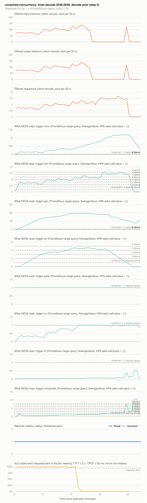

# Step 5, run 1b: knee 2048:2048, decode pool (pd-disaggregation/uncached-concurrency)

Part of the [step 5 summary](../../../../uncached-concurrency-step5.md).

**Superseded (2026-11-25).** This knee ran on the first plant, whose KV
transfer went over TCP on the pod network. The evaluation's owner had the plant
rebuilt with the RDMA NICs attached (overlay `ocp/vllm-rdma.yaml`) and every
knee rerun; see the summary's "First plant" section. The numbers below hold for
the TCP plant only.

| | |
|---|---|
| Namespace | `step5-uncached-concurrency-20261124`, Kubernetes v1.32.9 (OpenShift) |
| Scenario / overlay | `staging/pd-disaggregation/uncached-concurrency.yaml` at `2e607e4a` / `ocp/vllm.yaml` (the `--set` flags are in the summary) |
| Model / GPU | deepseek-ai/DeepSeek-V2-Lite bf16 / 1 × NVIDIA H100 80GB HBM3 per replica, both roles |
| Images, KEDA | as in the summary header |
| SLO | TTFT ≤ 2 s, TPOT ≤ 0.05 s; X = 0.95; client timeout 157 s |
| Profile / trace | [`profile.yaml`](profile.yaml), `knee-decode-2048x2048.csv` (6,546 requests, seed 1); schedule in [`load.json`](load.json) (`gen_load.py knee --mix 2048:2048 --estimate 6`) |
| Arm | pinned (`paused-replicas`): decode 1, prefill 3 |
| Session | `villardl-20261124-195903-784` (second attempt; the first is in the summary's discarded attempts) |
| Start / end (UTC) | 2026-11-25 00:59:56 / 01:22:13 (inference-perf stage 0, with the drain) |
| Raw results | `benchmark/results/villardl-20261124-195903-784/results/inference-perf-1795568376-nrqkkr_1/` (not committed) |

Four 300 s stages of 2048:2048 at 3.6 to 7.5 req/s against one pinned decode
pod, with three prefill pods. A is 0.998 and 0.994 in stages 1 and 2, then
0.211 and 0.000: the decode pod's KV cache fills (mean 0.997 in stage 3) and
requests time out at 157 s. The decode composite crosses 1.0 in stage 3, set
by `itl` and `conc`. The prefill pool's figure is
[`load-vs-supply-prefill.svg`](load-vs-supply-prefill.svg).

## Per stage, decode pool

| stage | s | set req/s | offered req/s | λ_in tok/s | λ_out tok/s | sent | errors | A | TTFT p50/p90/p99 s | TPOT p50/p90/p99 ms | Ready | need | requested replica-s | Ready replica-s |
|---|---|---|---|---|---|---|---|---|---|---|---|---|---|---|---|
| 1 | 300 | 3.600 | 3.503 | 7,175 | 7,185 | 1,051 | 0 | 99.8 % | 0.38/0.59/0.80 | 19.1/20.6/26.2 | 1–1 | – | 300 | 300 |
| 2 | 300 | 4.800 | 4.873 | 9,981 | 10,011 | 1,462 | 0 | 99.4 % | 0.49/0.86/1.51 | 30.7/34.2/37.7 | 1–1 | – | 300 | 300 |
| 3 | 300 | 6.000 | 5.907 | 8,199 | 8,219 | 1,772 | 571 timeout | 21.1 % | 11.05/43.87/50.41 | 47.9/49.6/53.9 | 1–1 | – | 300 | 300 |
| 4 | 300 | 7.500 | 7.537 | 1,263 | 1,254 | 2,261 | 2,076 timeout | 0.0 % | 81.83/84.01/85.58 | 32.0/34.7/47.3 | 1–1 | – | 300 | 300 |

λ_in and λ_out count completed requests' tokens, so they fall in stages 3 and
4 where requests time out.

- run: 6,546 sent, A 43.9 %, 2,647 errors, all `TimeoutError` (per-request
  records); decode 1,200 GPU-s, prefill 3,600 GPU-s.
- placement: 0 requests before the first stage, 0 after the last; no stage
  more than 3 sd off its set rate.
- knee: μ_SLO = 4.931 req/s (A crosses 0.95 between stages 2 and 3).
- the generator kept up: `schedule_delay_seconds` max 0.098 s, p99 0.027 s.
- no eviction, OOM kill or image pull failure of a serving pod during the run.

## Triggers per stage

Means over the last 120 s of each stage ([`terms.json`](terms.json)).

| phase | req/s | decode.conc | decode.kv | decode.itl | decode.lam | decode.gen_over_ok | decode.term_conc | decode.term_lam | decode.term_kv | decode.term_itl | decode.composite | prefill.offered | prefill.comp | prefill.done | prefill.composite |
|---|---|---|---|---|---|---|---|---|---|---|---|---|---|---|---|
| 1 | 3.6 | 131 | 0.308 | 0.0238 | 3.35 | 2,247 | 0.256 | 0.42 | 0.385 | 0.477 | 0.477 | 11,132 | 5,941 | 5,941 | 0.297 |
| 2 | 4.8 | 325 | 0.766 | 0.0468 | 4.9 | 2,231 | 0.637 | 0.61 | 0.957 | 0.936 | 0.975 | 16,244 | 9,420 | 9,420 | 0.433 |
| 3 | 6 | 682 | 0.997 | 0.0679 | 5.67 | 2,127 | 1.34 | 0.674 | 1.25 | 1.36 | 1.4 | 18,836 | 11,636 | 11,636 | 0.502 |
| 4 | 7.5 | 1,177 | 0.978 | 0.166 | 7.53 | 3,579 | 2.31 | 1.5 | 1.22 | 3.31 | 3.57 | 24,985 | 14,795 | 14,795 | 0.666 |

## What the run shows

The run shows a problem when stage 1 fails or stage 4 passes. Stage 1 passed
(A 0.998) and stage 4 failed (A 0.000), so μ_SLO(2048:2048, decode) =
**4.931 req/s**, 0.87 × blis's 5.647 req/s.

- **KV and TPOT bind together.** From stage 2 to stage 3 the mean KV usage
  goes from 0.766 to 0.997, running + waiting from 325 to 682, ITL p90 from
  0.047 to 0.068 s; TTFT p90 jumps from 0.86 to 43.9 s.
- **At this knee each decode term reads 0.6 to 0.96 per pod** (stage 2):
  `conc / 510` 0.637, `lam`'s term 0.61, `kv` 0.957, `itl` 0.936. The
  composite (0.975) stays below the 1.1 the HPA needs to add a pod.
- `gen / ok` reads 2,095 to 2,247 tokens in stages 1 to 3, against the mix's
  2,048, and 3,579 in stage 4, where most completions in the 5 m window
  timed out.
- The EPP's `offered` over the client's λ_in: 11,132 / 7,175 = 1.55 in stage
  1 and 16,244 / 9,981 = 1.63 in stage 2 (PF3).

**Outcome: as expected; μ_SLO = 4.931 req/s** (the crossing is inside the
stages).

## Amendments

- 2026-11-25 02:30 UTC: marked superseded. The plant was rebuilt with the
  RDMA network attached (the owner's decision after this knee showed the TCP
  transfer binding); the rerun is in `../../../knees/` of the summary's tree.
  No number in this report changed.
