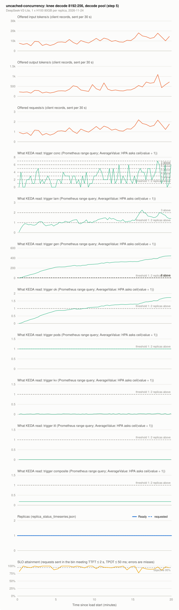

# Step 5, run 1a: knee 8192:256, decode pool (pd-disaggregation/uncached-concurrency)

Part of the [step 5 summary](../../../../uncached-concurrency-step5.md).

**Superseded (2026-11-25).** This knee ran on the first plant, whose KV
transfer went over TCP on the pod network. The evaluation's owner had the plant
rebuilt with the RDMA NICs attached (overlay `ocp/vllm-rdma.yaml`) and every
knee rerun; see the summary's "First plant" section. The numbers below hold for
the TCP plant only.

| | |
|---|---|
| Namespace | `step5-uncached-concurrency-20261124`, Kubernetes v1.32.9 (OpenShift) |
| Scenario / overlay | `staging/pd-disaggregation/uncached-concurrency.yaml` at `2e607e4a` / `ocp/vllm.yaml` (the `--set` flags are in the summary) |
| Model / GPU | deepseek-ai/DeepSeek-V2-Lite bf16 / 1 × NVIDIA H100 80GB HBM3 per replica, both roles |
| Images, KEDA | as in the summary header |
| SLO | TTFT ≤ 2 s, TPOT ≤ 0.05 s; X = 0.95 |
| Profile / trace | [`profile.yaml`](profile.yaml), `knee-decode-8192x256.csv` (1,498 requests, seed 1); schedule in [`load.json`](load.json) (`gen_load.py knee --mix 8192:256 --estimate 1.4`) |
| Arm | pinned (`paused-replicas`): decode 1, prefill 3 |
| Session | `villardl-20261124-190320-336` (third attempt; the first two are in the summary's discarded attempts) |
| Start / end (UTC) | 2026-11-25 00:04:22 / 00:24:24 (inference-perf stage 0) |
| Raw results | `benchmark/results/villardl-20261124-190320-336/results/inference-perf-1795565050-ow3l5u_1/` (not committed) |

Four 300 s stages of 8192:256 at 0.84 to 1.75 req/s against one pinned decode
pod, with three prefill pods. A is 0.957, 0.979 and 0.953 in stages 1 to 3 and
0.912 in stage 4; TTFT binds (p90 1.50 to 1.92 s, TPOT p90 at most 6.7 ms).
The decode composite reads 0.18 throughout, set by the `itl` term. The prefill
pool's figure is [`load-vs-supply-prefill.svg`](load-vs-supply-prefill.svg).

## Per stage, decode pool

| stage | s | set req/s | offered req/s | λ_in tok/s | λ_out tok/s | sent | errors | A | TTFT p50/p90/p99 s | TPOT p50/p90/p99 ms | Ready | need | requested replica-s | Ready replica-s |
|---|---|---|---|---|---|---|---|---|---|---|---|---|---|---|---|
| 1 | 300 | 0.840 | 0.860 | 7,045 | 217 | 258 | 0 | 95.7 % | 0.91/1.50/2.14 | 4.5/5.5/66.6 | 1–1 | – | 300 | 300 |
| 2 | 300 | 1.120 | 1.100 | 9,011 | 360 | 330 | 0 | 97.9 % | 0.96/1.56/2.03 | 4.7/5.8/11.5 | 1–1 | – | 300 | 300 |
| 3 | 300 | 1.400 | 1.290 | 10,568 | 351 | 387 | 0 | 95.3 % | 0.97/1.73/2.83 | 4.9/6.2/12.0 | 1–1 | – | 300 | 300 |
| 4 | 300 | 1.750 | 1.743 | 14,281 | 632 | 523 | 0 | 91.2 % | 1.13/1.92/4.62 | 5.4/6.7/9.1 | 1–1 | – | 300 | 300 |

- run: 1,498 sent, A 94.5 %, 0 errors (from the per-request records,
  [`stages-decode.json`](stages-decode.json)); decode 1,200 GPU-s, prefill
  3,600 GPU-s ([`stages-prefill.txt`](stages-prefill.txt)).
- placement: 0 requests before the first stage, 0 after the last; no stage
  more than 3 sd off its set rate.
- knee: μ_SLO = 1.328 req/s (A crosses 0.95 between stages 3 and 4).
- the generator kept up: `schedule_delay_seconds` max 0.137 s, p99 0.059 s.
- no eviction, OOM kill or image pull failure of a serving pod during the run.

## Triggers per stage

Means over the last 120 s of each stage ([`terms.json`](terms.json), from
`triggers/`). `term_*` are the decode formula's four terms; `composite` is the
formula evaluated on the exported series (`triggers/<pool>/composite.json`).

| phase | req/s | decode.conc | decode.kv | decode.itl | decode.lam | decode.gen_over_ok | decode.term_conc | decode.term_lam | decode.term_kv | decode.term_itl | decode.composite | prefill.offered | prefill.comp | prefill.done | prefill.composite |
|---|---|---|---|---|---|---|---|---|---|---|---|---|---|---|---|
| 1 | 0.84 | 1.25 | 0.00782 | 0.00901 | 0.792 | 257 | 0.00245 | 0.0113 | 0.00978 | 0.18 | 0.18 | 10,523 | 5,982 | 5,982 | 0.28 |
| 2 | 1.12 | 1.62 | 0.0101 | 0.00901 | 1.05 | 256 | 0.00319 | 0.0151 | 0.0127 | 0.18 | 0.18 | 13,996 | 8,530 | 8,530 | 0.373 |
| 3 | 1.4 | 2.75 | 0.0171 | 0.00901 | 1.17 | 256 | 0.00539 | 0.0167 | 0.0213 | 0.18 | 0.18 | 15,526 | 10,452 | 10,452 | 0.414 |
| 4 | 1.75 | 3.62 | 0.0225 | 0.00901 | 1.7 | 256 | 0.00711 | 0.0242 | 0.0282 | 0.18 | 0.18 | 22,491 | 13,847 | 13,847 | 0.599 |

## What the run shows

The run shows a problem when stage 1 fails or stage 4 passes. Stage 1 passed
(A 0.957) and stage 4 failed (A 0.912), so μ_SLO(8192:256, decode) =
**1.328 req/s**, 0.066 × blis's 20.267 req/s.

- **The KV pull binds, not decode compute.** TPOT p90 is at most 6.7 ms in
  every stage, and TTFT p90 grows from 1.50 to 1.92 s. At the end of stage 1,
  the decode pod's `vllm:request_queue_time_seconds` p90 read 1.99 s (4 m
  rate) and the mean NIXL transfer took 1.14 s, while the prefill pods' own
  TTFT p90 was 0.47 s. Each request moves 243 MB of KV (vLLM's KV transfer
  log, "Avg MB per transfer=243.0"). The pods have one network interface, the
  cluster pod network, and UCX runs with `UCX_TLS=sm,cuda_ipc,cuda_copy,tcp`
  (set by llm-d-benchmark): the transfer goes over TCP.
- **A is close to X at every rate.** A at 0.84 req/s is 0.957, so the
  interpolated μ_SLO is a weak bracket (n = 1).
- **The decode triggers read 0.2 % to 2.8 % of a pod** at this knee: `conc`
  1.25 to 3.62 requests against 510 per pod, `kv` 0.008 to 0.023, `lam`'s term
  0.011 to 0.024. `itl` reads 0.009 s in every stage, inside the histogram's
  lowest bucket (TPOT p50 is 4.5 to 5.4 ms), so its term, 0.18, is the
  formula's maximum (PF8 predicted about 0.58 per pod at a knee).
- **The EPP counts about 1.5 × the client's prompt tokens** (PF3): the prefill
  `offered` trigger over the last 120 s of each stage against the stage's λ_in
  from the client records reads 10,523 / 7,045 = 1.49, then 1.55, 1.47 and
  1.57.

**Outcome: as expected; μ_SLO = 1.328 req/s** (the crossing is inside the
stages).

## Amendments

- 2026-11-25 02:30 UTC: marked superseded. The plant was rebuilt with the
  RDMA network attached (the owner's decision after this knee showed the TCP
  transfer binding); the rerun is in `../../../knees/` of the summary's tree.
  No number in this report changed.
